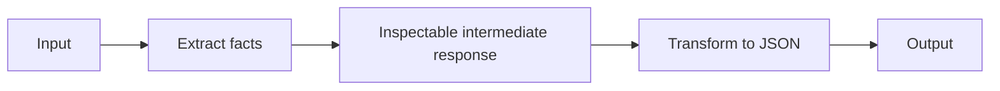

# Chapter 01 — Prompt Chaining

Prompt chaining breaks a transformation into ordered, inspectable model calls. The extractor preserves facts; the formatter consumes that intermediate response and produces a typed JSON shape. MAF's `BuildSequential` supplies orchestration, not a hand-written simulation.



## Where to look in code

- [`PromptChainRunner.RunAsync<TOutput>`](Demos/PromptChainRunner.cs): two agents, `BuildSequential`, typed response schema, workflow output and failure handling.
- [`TechnicalSpecificationsDemo`](Demos/TechnicalSpecificationsDemo.cs): extraction and specification schema (`cpu`, `memory`, `storage`).
- [`MarketTrendsDemo`](Demos/MarketTrendsDemo.cs): evidence-preserving trend extraction and the notebook's JSON structure.
- [`BufferedStreamingChatClient`](Demos/BufferedStreamingChatClient.cs): compatibility bridge; the installed sequential workflow calls agent streaming APIs internally, even when the caller awaits a completed run.

## Notebook → C# mapping

| Notebook in `chapter_notebooks/` | C# behavior |
|---|---|
| `Chapter_01_Prompt_Chaining_(Code_Example).ipynb` | `specs`: the same laptop specifications flow from extraction to JSON formatting. LCEL pipes become `BuildSequential`. |
| `Chapter_01_Prompt_Chaining_(JSON_Example).ipynb` | `trends`: reproduces the example's `trends`, `trend_name`, and `supporting_data` shape. The notebook contains only JSON; the demo supplies corresponding source notes rather than pretending it contains an executable pipeline. |

Both completed assistant responses are printed, followed by final JSON. The formatter receives a response schema and the result is deserialized before success; neither structural typing nor valid JSON proves that extracted facts are correct.

## Run

Use .NET 10 and the [shared Foundry configuration](../../README.md). From the repository root:

```powershell
dotnet run --project .\dotnet\src\Chapter01.PromptChaining
dotnet run --project .\dotnet\src\Chapter01.PromptChaining -- specs
dotnet run --project .\dotnet\src\Chapter01.PromptChaining -- trends --deployment fast
dotnet test .\dotnet\tests\PromptChaining.Tests
```

The default and `all` run both examples; `--deployment <alias>` selects a configured model alias. Deterministic tests check handoff, visible intermediate output, schema selection, and invalid JSON without model access.

## When to use / when not to use

Use when stages have distinct responsibilities and useful intermediate artifacts. Avoid it for a direct question, independent subtasks that could run concurrently, or a pipeline whose later stages cannot detect upstream omissions.

## Scenarios

- Extract contract fields, then normalize them into an intake schema.
- Identify evidence-backed market trends, then format a report.
- Interpret legacy records, then map them into a target data model.
- Extract product attributes, then generate a consistent catalog entry.

## Foundry and hosting

Foundry supplies the model; there is no distinct native prompt-chaining primitive to demonstrate. Evaluate extraction fidelity as well as schema validity. This chapter intentionally remains a console example: it presents two fixed sample transformations rather than a caller-input service. A hosted adaptation should first define scenario selection and the caller's input/output contract; see [common hosting guidance](../../HOSTING.md).

## Tradeoffs

Serial calls add latency and token cost. Intermediate model errors can propagate, and a schema controls shape rather than evidence fidelity. Keep source facts available and validate domain requirements at the consuming boundary.
