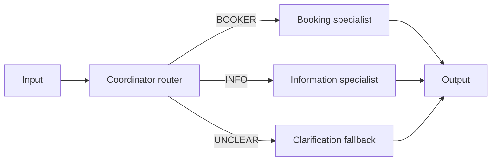

# Chapter 02 — Routing

Routing chooses a specialist before answering. The model returns a structured enum decision and rationale; deterministic MAF conditional edges select a booking specialist, information specialist, or clarification branch. Routing is a capability choice, **not authorization**.



## Where to look in code

- [`RoutingWorkflow.Create`](RoutingWorkflow.cs): actual `WorkflowBuilder` conditional edges and specialist responsibilities.
- `RouterExecutor.HandleAsync`: `RunAsync<RoutingAssessment>` replaces route-token parsing; incomplete or unsupported responses fail explicitly.
- [`RoutingDecision`](Models/RoutingDecision.cs): string-enum schema and assessment contract.
- [`RoutingAgent`](RoutingAgent.cs): thin shared stateless adapter; workflow logic stays independent of the Responses protocol.
- [`IntentRoutingDemo`](Demos/IntentRoutingDemo.cs): booking, information, and ambiguous sample requests.

## Notebook → C# mapping

| Notebook in `chapter_notebooks/` | C# behavior |
|---|---|
| `Chapter_02_Routing_(Google_ADK).ipynb` | Coordinator and travel specialists become named `ChatClientAgent`s; booking remains simulated. |
| `Chapter_02_Routing_(LangGraph).ipynb` | Branch selection becomes typed `Booker`, `Info`, or `Unclear` plus MAF conditional edges, not string-prefix parsing. |
| `Chapter_02_Routing_(Openrouter).ipynb` | Provider request example only; it has no separate routing algorithm to port. |

The console prints the decision, rationale, specialist output, and final answer. Specialists receive the original request unchanged. `Unclear` returns deterministic clarification without another model call; invalid structured decisions are failures, not silently coerced routes.

## Run

Configure .NET 10 and [shared Foundry settings](../../README.md). From the repository root:

```powershell
dotnet run --project .\dotnet\src\Chapter02.Routing
dotnet run --project .\dotnet\src\Chapter02.Routing -- travel --deployment fast
dotnet test .\dotnet\tests\Routing.Tests
```

The default, `all`, and `travel` run the sample routes. Tests cover each branch, structured-response rejection, original-input handoff, cancellation, failures, request independence, and one hosted smoke.

## When to use / when not to use

Use for genuinely different specialist tools, policies, or instructions with an explicit ambiguity path. Avoid it when one prompt is sufficient, branches differ only by persona, or a model decision would substitute for deterministic permission checks.

## Scenarios

- Travel booking help versus destination information.
- Billing, troubleshooting, and account-support triage.
- Scheduling versus educational healthcare questions.
- Documentation requests versus incident escalation.

## Foundry and hosting

Foundry hosts the model, not a separate native routing primitive. Use labeled evaluations to measure misrouting and calibration. The [hosted companion](../Chapter02.Routing.Hosted/README.md) runs this same graph for caller input; [common hosting guidance](../../HOSTING.md) covers configuration, deployment, runtime inference access, packaging, and cleanup.

## Tradeoffs

Classification adds a model call and can misroute borderline requests. Keep clarification explicit, measure category boundaries, and authorize consequential actions outside the router. Sensitive-content agent tracing is enabled for these demos; use non-sensitive examples and restrict export/retention.
