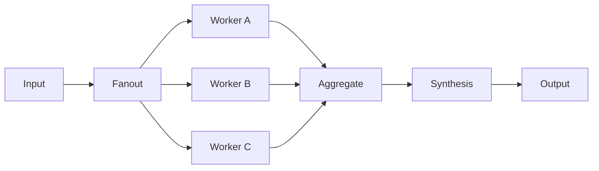

# Chapter 03 — Parallelization

Independent model tasks fan out concurrently, meet at a completion barrier, and feed one synthesis call. MAF's `BuildConcurrent` supplies the real fan-out/fan-in; deterministic code preserves branch attribution and fails rather than silently synthesizing incomplete work.



## Where to look in code

- [`ParallelizationWorkflow.RunAsync`](ParallelizationWorkflow.cs): `BuildConcurrent`, completed typed output, visible branch results, then synthesis.
- `GetWorkers` / `GetSynthesizer`: the two scenarios as prompt data, not duplicated workflows.
- `GetWorkflowOutput`: reads completed `ChatMessage`s and orders them by worker definition, not arrival time; no token reconstruction.
- [`BufferedWorkflowChatClient`](BufferedWorkflowChatClient.cs): compatibility adapter for the workflow's internal streaming entry point. Underlying model calls stay buffered and concurrent.
- [`Program`](Program.cs): sample inputs, selectors, and deployment alias.

## Notebook → C# mapping

| Notebook in `chapter_notebooks/` | C# behavior |
|---|---|
| `Chapter_03_Parallelization_(Google_ADK).ipynb` | `research`: renewable energy, electric vehicles, and carbon capture run in parallel before synthesis. No Google Search equivalent is attached here: results use model knowledge and must not claim live verification. |
| `Chapter_03_Parallelization_(LangChain).ipynb` | `topic`: summary, related questions, and key terms share the original topic, then feed synthesis. The sample remains “The history of space exploration.” |

Each successful request makes three worker calls and one synthesis call. Console output shows every branch before the final synthesis.

## Run

Use .NET 10 and [shared Foundry configuration](../../README.md). From the repository root:

```powershell
dotnet run --project .\dotnet\src\Chapter03.Parallelization
dotnet run --project .\dotnet\src\Chapter03.Parallelization -- research
dotnet run --project .\dotnet\src\Chapter03.Parallelization -- topic --deployment fast
dotnet test .\dotnet\tests\Parallelization.Tests
```

Default/`all` runs both. Tests include a concurrency barrier, labeled synthesis inputs, model failure, cancellation, streaming-host compatibility, and a hosted smoke.

## When to use / when not to use

Use for independent analyses with a meaningful fan-in criterion. Avoid it for dependent subtasks, tiny tasks where overhead dominates, or required current research without retrieval. Decide the partial-result policy before deploying.

## Scenarios

- Financial, legal, and operational document review in parallel.
- Competitor, market, and regulatory analysis before a briefing.
- Independent rubric dimensions for evaluation.
- Summary, tags, and candidate questions for one report.

## Foundry and hosting

Foundry supplies model capacity and evaluations, not a distinct native parallelization implementation. Add supported retrieval for current research. The [hosted companion](../Chapter03.Parallelization.Hosted/README.md) accepts both scenarios; see [common hosting guidance](../../HOSTING.md) for deployment and permissions.

## Tradeoffs

Latency depends on the slowest branch and endpoint concurrency; throttling may erase gains. Four calls increase total usage. Attribution helps inspection but cannot prevent synthesis errors or conflicting findings. Sensitive-content tracing is enabled; restrict telemetry access and retention.
