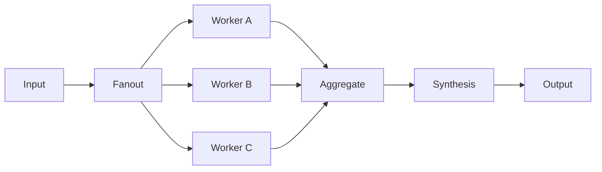

# Chapter 03 — Parallelization

> Book: *Agentic Design Patterns* (Antonio Gulli), Chapter 03. Implemented with Microsoft Agent Framework (C#) and a Microsoft Foundry model deployment.

## The Pattern in One Paragraph

Parallelization sends independent subtasks to separate agents concurrently, waits for all results, and then combines them. It reduces the serial portion of latency when tasks are genuinely independent, while adding coordination, model calls, and a fan-in step that must handle incomplete or failed branches.



## What This Demo Shows

| Variant | Source notebook | MAF / Foundry building blocks | What to observe |
|---|---|---|---|
| Sustainable technology research (`research`) | `Chapter_03_Parallelization_(Google_ADK).ipynb` | Three named `ChatClientAgent`s, `AgentWorkflowBuilder.BuildConcurrent`, a fan-in aggregator, and a synthesis agent | Renewable energy, electric vehicles, and carbon capture run independently; their labeled results are then synthesized. The notebook's Google Search tool is not configured here, so the agents explicitly do not claim live search or verified current findings. |
| Topic analysis (`topic`) | `Chapter_03_Parallelization_(LangChain).ipynb` | Summary, question-generation, and key-term agents in `BuildConcurrent`, then an independent synthesis agent | All three branches receive the same topic; each intermediate result is printed before the final answer. |
| Foundry-native | Both | Not applicable | Microsoft Foundry supplies model deployments and hosted-agent protocols, but this chapter's parallel fan-out/fan-in orchestration is implemented by MAF. Web search is a retrieval tool, not a separate parallelization primitive. |
| Hosted companion | Both request modes | Shared MAF workflow behind Foundry Agent Service Responses | A caller-provided request is run independently and the completed synthesis is returned. See [hosted setup and deployment](../Chapter03.Parallelization.Hosted/README.md). |

## Setup

1. Prerequisites: .NET 10 SDK and a Microsoft Foundry project with a chat model deployment and API key.
2. Configure shared user-secrets once; see [the .NET setup guide](../../README.md). Do not put credentials in source files.
3. Run both examples:
   ```powershell
   dotnet run --project dotnet/src/Chapter03.Parallelization
   ```
4. Run one example:
   ```powershell
   dotnet run --project dotnet/src/Chapter03.Parallelization -- research
   dotnet run --project dotnet/src/Chapter03.Parallelization -- topic
   ```
5. Optionally select a named deployment configured under `Foundry:ModelDeployments`:
   ```powershell
   dotnet run --project dotnet/src/Chapter03.Parallelization -- topic --deployment fast
   ```
6. For live validation without local secrets, use **Actions** → **Live Foundry smoke tests** after this workflow coverage is present on the default branch. It runs inside the protected `foundry-integration` environment using `Foundry__*` variables from GitHub environment secrets.

## Notebook → C# Mapping

| Python notebook element | C# (MAF) |
|---|---|
| Google ADK `RenewableEnergyResearcher`, `EVResearcher`, and `CarbonCaptureResearcher` | Named MAF `ChatClientAgent`s with the same domain responsibilities and concise summaries |
| Google ADK `ParallelAgent` and `SequentialAgent` | `AgentWorkflowBuilder.BuildConcurrent` for fan-out/fan-in, followed by the synthesis agent |
| ADK state `output_key` values and merger prompt | Worker outputs are labeled by a deterministic aggregator and supplied to `SynthesisAgent`; the synthesis prompt is restricted to these summaries |
| Google Search grounding | Not configured: this MAF API-key demo has no search tool, and its prompts explicitly prohibit claims of live search/current verification |
| LangChain `RunnableParallel` | Concurrent summary, question, and key-term agents receiving the same topic |
| LangChain `RunnablePassthrough` topic | The original topic is carried directly into the final synthesis input |
| LangChain synthesis prompt and `StrOutputParser` | `TopicSynthesisAgent` produces the final natural-language response |
| LangChain default sample `"The history of space exploration"` | The `topic` demo uses the same sample; the reusable hosted workflow instead accepts caller input |

## When to Use

- A request has several independent dimensions that can be researched or processed separately.
- Branches can accept the same input and their results can be combined after a clear completion barrier.
- Reducing wall-clock latency is worth additional model calls and orchestration.

## When NOT to Use

- Later subtasks depend on results from earlier tasks; use a sequential workflow instead.
- The task is already small enough for one model call, or the fan-out cost exceeds the latency benefit.
- The workflow requires verified current information but has no retrieval/search tool configured.
- A single failed branch must not invalidate the whole answer and no fallback or partial-result policy exists.

## Real-World Scenarios

1. **Market research** — assess competitors, customer segments, and regulatory context concurrently, then synthesize a sourced briefing.
2. **Document review** — run independent extraction passes for financial, legal, and operational fields before consolidating them.
3. **Support triage** — analyze a request for product, billing, and account dimensions in parallel, then draft one response.
4. **Ensemble evaluation** — apply independent rubric dimensions to one output and combine their findings for a reviewer.
5. **Data preparation** — compute independent summaries, tags, and candidate questions for the same report or dataset.

## Extending with Microsoft Foundry

- Configure tracing to compare per-branch latency and model usage; this demo opts into sensitive-content instrumentation, so use non-sensitive inputs and restrict telemetry access/retention.
- Use Foundry evaluation datasets to compare synthesis completeness, attribution, and branch consistency.
- Add a supported search/retrieval tool to the sustainable-technology scenario before relying on it for current research.
- The hosted project uses the same workflow and MAF model calls; hosting is deployment, not a separate Foundry-native parallelization implementation.

## Hosted Deployment Companion

- Suitability: the workflow is a bounded request/response operation with no persistent memory, user approval, or local-only dependency. Each request creates an isolated workflow and waits for the completed result.
- Project and deployment guide: [Chapter 03 hosted companion](../Chapter03.Parallelization.Hosted/README.md).
- Authentication: console model calls use shared API-key user-secrets or `Foundry__*`; hosted Azure execution uses `DefaultAzureCredential` / managed identity when the API key is blank. The deployment identity needs Foundry agent deployment permissions, and the runtime identity needs model inference permission.
- Packaging: `azure.yaml` uses .NET 10 bundled deployment, which publishes the host and referenced Chapter 03 and Shared projects locally. The host `.agentignore` excludes `.azure`, environment files, secrets, and build output.
- Request contract: each request runs three parallel model calls plus one synthesis call, returns a completed response, and does not preserve conversation history.

## Risks & Limitations

- Parallelization reduces latency only when work is independent and the model endpoint can serve concurrent requests; throttling can erase the benefit.
- Fan-in needs an explicit policy for failed or incomplete branches; decide whether to fail, retry, or return clearly labeled partial results.
- Three-way analysis plus synthesis uses four model calls per request, increasing total token usage and cost compared with one prompt.
- Research quality depends on the freshness and reliability of the underlying sources; model knowledge alone is not current evidence.
- Every branch sees the caller's topic; prompt quality and synthesis can still omit or distort branch findings.
