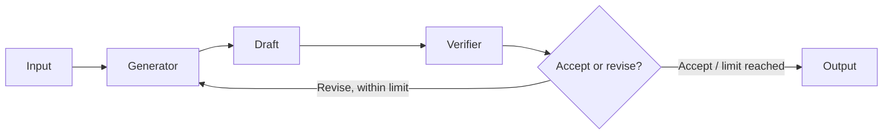

# Chapter 04 — Reflection

A generator drafts, an independent reviewer returns structured feedback, and a deterministic conditional edge either revises or completes. All three scenarios share one real MAF graph; a separate reviewer role is not independent evidence of correctness.



## Where to look in code

- [`ReflectionWorkflow.Create`](ReflectionWorkflow.cs): generation → verification, then conditional retry/completion edges; no pass-through decision executor.
- `VerificationExecutor.HandleAsync`: typed `ReflectionReview`, review validation, and round-budget outcome.
- [`ReflectionDemos.CreateAgents`](ReflectionDemos.cs): scenario-specific instructions over the shared graph.
- [`ReflectionContracts`](ReflectionContracts.cs) and [`ReflectionReview`](ReflectionReview.cs): per-run state, budget, outcome, and review schema.

## Notebook → C# mapping

| Notebook in `chapter_notebooks/` | C# behavior |
|---|---|
| `Chapter_04_Reflection_(ADK).ipynb` | `fact-check`: paragraph generation plus structured accuracy critique. No browsing or external verification is claimed. |
| `Chapter_04_Reflection_(LangChain).ipynb` | `product`: smart-mug copy is revised against house style (≤40 words, exact closing sentence, supported attributes). The writer's lifestyle-heavy prompt intentionally differs from the review criteria. |
| `Chapter_04_Reflection_(Iterative_Loop).ipynb` | `code-review`: factorial code with docstring and negative-input handling; code is reviewed, never executed. |

The one-pass notebook examples are intentionally adapted to the same bounded feedback graph. Every round has generation **and** review. `Accept` ends immediately, including on the last round; otherwise `MaxRoundsReached` explicitly means **not accepted**. The default is three rounds (at most six model invocations, excluding provider retries). No unreviewed final revision is returned.

## Run

Use .NET 10 and [shared Foundry configuration](../../README.md). From the repository root:

```powershell
dotnet run --project .\dotnet\src\Chapter04.Reflection
dotnet run --project .\dotnet\src\Chapter04.Reflection -- fact-check
dotnet run --project .\dotnet\src\Chapter04.Reflection -- product --deployment fast
dotnet run --project .\dotnet\src\Chapter04.Reflection -- code-review
dotnet test .\dotnet\tests\Reflection.Tests
```

Default/`all` runs all three. Custom API callers can pass `ReflectionWorkflowOptions(MaxRounds: ...)` with a positive budget. Console output shows drafts, critiques, outcome, and rounds used. Focused tests retain budget boundaries, acceptance/exhaustion, invalid reviews, cancellation between stages, failures, isolation, and hosted behavior.

## When to use / when not to use

Use when review criteria are concrete and feedback can improve a draft within a fixed budget. Avoid it for already adequate outputs or when a model review would replace authoritative evidence, executable tests, or mandatory human review.

## Scenarios

- Customer-message tone and required disclosures.
- Product descriptions constrained by supplied features.
- Generated-code review followed by deterministic testing.
- Publication drafts that flag claims for citation-backed review.

## Foundry and hosting

Foundry evaluations compare draft/revision quality offline; they do not replace this request-time reflection graph. The [hosted companion](../Chapter04.Reflection.Hosted/README.md) accepts all three scenarios. See [common hosting guidance](../../HOSTING.md) for deployment and permissions.

## Tradeoffs

Reviewers can reinforce the generator's errors, and more rounds add cost without guaranteeing improvement. Preserve acceptance versus exhaustion and use deterministic/domain checks for consequential outputs. Linked caller cancellation remains deliberate: cancellation between executor stages must prevent the next model call. Sensitive-content tracing includes drafts and reviews; restrict access and retention.
