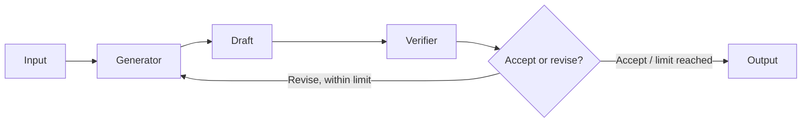

# Chapter 04 — Reflection

> Book: *Agentic Design Patterns* (Antonio Gulli), Chapter 04. Implemented with Microsoft Agent Framework (C#) and a Microsoft Foundry model deployment.

## The Pattern in One Paragraph

Reflection improves a model's first draft by asking for a critique and using that feedback to revise it. All three demos use the same real MAF `WorkflowBuilder` graph: generation and independent verification executors feed a deterministic decision gate, whose conditional edges either repeat generation or complete the workflow. A separate role does not make model-based verification authoritative: factual claims and code still need evidence and execution when correctness matters.



## What This Demo Shows

| Variant | Source notebook | MAF / Foundry building blocks | What to observe |
|---|---|---|---|
| Independent fact-check (`fact-check`) | `Chapter_04_Reflection_(ADK).ipynb` | Shared MAF graph and `RunAsync<ReflectionReview>` | A paragraph is reviewed for accuracy and appropriate qualification; specific corrections feed back into generation until acceptance or the round limit. |
| Product description (`product`) | `Chapter_04_Reflection_(LangChain).ipynb` | Same graph, product-specific prompts | Deliberately mismatched prompts: the writer is told to produce ~80–100 words of lifestyle copy, while the verifier enforces a hidden house style (≤ 40 words, exact closing line "Made for the way you live.", no invented attributes). The first draft therefore almost always fails, and the demo shows at least one feedback loop. |
| Iterative code review (`code-review`) | `Chapter_04_Reflection_(Iterative_Loop).ipynb` | Same graph, Python task-specific prompts | The console sample generates factorial; hosted callers can supply other Python tasks. The reviewer judges the original requirements without executing code. |
| Foundry-native | All three | Not applicable as a second runtime implementation | Foundry evaluations can score completed outputs offline, but do not replace this request-time generator/verifier/refinement flow. |
| Hosted companion | All three request modes | Shared MAF workflow behind Foundry Agent Service Responses | Stateless requests run with caller-provided input and return the final result. See [hosted setup and deployment](../Chapter04.Reflection.Hosted/README.md). |

## Setup

1. Prerequisites: .NET 10 SDK and a Foundry project with a deployed chat model and API key.
2. Configure the shared user-secrets once; see [the .NET setup guide](../../README.md). Do not add credentials to source files.
3. Run all three examples:
   ```powershell
   dotnet run --project dotnet/src/Chapter04.Reflection
   ```
4. Run one example:
   ```powershell
   dotnet run --project dotnet/src/Chapter04.Reflection -- fact-check
   dotnet run --project dotnet/src/Chapter04.Reflection -- product
   dotnet run --project dotnet/src/Chapter04.Reflection -- code-review
   ```
5. Optionally select a named deployment configured under `Foundry:ModelDeployments`:
   ```powershell
   dotnet run --project dotnet/src/Chapter04.Reflection -- product --deployment fast
   ```
6. For live validation without local secrets, use **Actions** → **Live Foundry smoke tests** after this workflow coverage is present on the default branch. It uses the protected `foundry-integration` environment and `Foundry__*` variables.

## Notebook → C# Mapping

| Python notebook element | C# (MAF) |
|---|---|
| ADK `DraftWriter` output saved to `draft_text` | Generation executor writes a paragraph and passes an immutable `ReflectionState` to verification. |
| ADK `FactChecker` structured dictionary (`status`, `reasoning`) | Independent verifier returns a shared typed `ReflectionReview` with `Accept` or `Revise` and reasoning. |
| LangChain smart-mug `generation_chain` and `critique_chain` | Separate agents inside generation and verification executors; drafts and reviews are printed for every round. |
| LangChain `refinement_chain` | A conditional feedback edge returns the original task, last draft, and review to the same generation executor; the revision is verified again. |
| Iterative-loop factorial task and `max_iterations = 3` | Factorial remains the sample; `ReflectionWorkflowOptions.MaxRounds` defaults to 3 for every scenario. |
| `CODE_IS_PERFECT` stopping condition | Shared `Accept` decision terminates early; a final `Revise` at the limit yields `MaxRoundsReached`, not acceptance. |
| Python model/client history | Every invocation receives explicit task/draft/review input; fresh agents and per-run state avoid hidden conversation history. |

Unlike the one-pass fact-check and product notebooks, this adaptation intentionally applies the same bounded feedback graph to all scenarios. Two agents are sufficient: orchestration lives in MAF executors and conditional edges, not in scenario-specific C# loops.

## Shared Workflow and Stopping Rules

`ReflectionWorkflow.Create(generator, verifier)` returns the actual MAF `Workflow`. `ReflectionWorkflow.RunAsync` runs it with non-streaming `InProcessExecution.RunAsync` and returns a typed `ReflectionResult`. `ReflectionDemos` supplies scenario prompts and formats the result; the engine has no scenario-specific branching.

```csharp
var (generator, verifier) = ReflectionDemos.CreateAgents(
    chatClient, ReflectionScenario.ProductDescription);
var result = await ReflectionWorkflow.RunAsync(
    generator,
    verifier,
    "A mug that keeps coffee hot and is controlled by a smartphone app.",
    new ReflectionWorkflowOptions(MaxRounds: 3),
    Console.WriteLine,
    cancellationToken);
```

Custom callers can supply their own `AIAgent` pair; the verifier must return the shared `ReflectionReview` contract. The positive round budget is configured in this API, not through a new console flag or hosted prompt syntax.

Each round is exactly one generation followed by one verification. Acceptance takes priority even on the last allowed round. Otherwise the graph revises only while budget remains, making at most three generator and three verifier invocations by default (excluding provider-internal retries). It never produces an unreviewed final revision.

Completion yields exactly one result containing `Accepted` or `MaxRoundsReached`, the last verified draft, review, and rounds used. Console and hosted text show that outcome explicitly; a budget-exhausted draft is marked **not accepted**. Empty drafts, malformed/incomplete reviews, unsupported decisions, workflow errors, and cancellation fail explicitly rather than masquerading as acceptance.

## When to Use

- A first draft benefits from a concrete critique before it is shown or used.
- A task can be decomposed into explicit review criteria and actionable feedback.
- Model outputs can be reviewed within a fixed call, time, or cost budget.
- A human or deterministic checker remains available for decisions that require authoritative correctness.

## When NOT to Use

- The initial output is already adequate and another model call adds cost without measurable value.
- The result requires external factual verification, but no trusted source or retrieval tool is available.
- The code or action must be proven correct; a model review alone is not a substitute for tests or policy checks.
- An unbounded or unconstrained revision loop could create runaway latency, cost, or self-reinforcing errors.

## Real-World Scenarios

1. **Customer communications** — critique a draft for clarity, tone, and required disclosures before rewriting it.
2. **Software assistance** — review generated code against a checklist, then run deterministic tests before acceptance.
3. **Knowledge publishing** — flag factual claims in a draft for citation-backed human review instead of treating the verifier's judgment as proof.
4. **Product content** — refine a description against a fixed feature list and explicit length or tone requirements.

## Extending with Microsoft Foundry

- Use Foundry evaluation datasets and evaluators to compare draft quality, critique usefulness, and whether the revision addresses feedback across many examples. Evaluation is an offline quality-measurement layer, not a separate in-request reflection implementation.
- Add trusted retrieval or primary-source citations before describing fact-check output as verified.
- Configure tracing to inspect the separate generation and verification calls. Sensitive-content capture is explicitly enabled by the demo; use non-sensitive inputs and restrict telemetry access and retention.
- A production workflow should add deterministic acceptance checks appropriate to the output (for example, unit tests for generated code) and treat model-review disagreement as a reason to escalate.

## Hosted Deployment Companion

- Suitability: the interaction is a bounded, stateless request/response operation with no human approval, durable memory, or local-only dependency.
- Project and deployment guide: [Chapter 04 hosted companion](../Chapter04.Reflection.Hosted/README.md).
- Authentication: console calls use shared API-key user-secrets or `Foundry__*`; hosted Azure calls use developer identity locally and managed identity in Azure. Deployment permissions and runtime inference access are separate.
- Packaging: `azure.yaml` uses bundled .NET 10 deployment. The host references the chapter project, which references Shared; the extension publishes these dependencies into the deployment package. `.agentignore` excludes environment files, `.azure`, secrets, and build artifacts.
- Validation/status: local workflow and Responses-protocol coverage exercise the shared graph. Hosted version 1 was deployed to `mvp-playground-foundry-proj` with `gpt-5-mini` and successfully invoked remotely on 2026-10-16, **before this graph refactor**. The runtime identity was granted Cognitive Services OpenAI User at the model-hosting account scope, with a 30-second propagation wait before the successful invocation. This refactor is local only; version 1 still runs the earlier implementation. A 15-case evaluation dataset and seven-dimension evaluator remain unchanged for review and no evaluations have run. See the [hosted evaluation setup](../Chapter04.Reflection.Hosted/README.md#evaluation-setup).
- Limitations/cleanup: every mode makes two calls per round, up to six by default. Responses contain only the final result, not streamed intermediate stages; sessions do not retain conversation state. Remove only this chapter's agent/version if deployed, not the shared Foundry project or unrelated services.

## Risks & Limitations

- Reflection can amplify an initial error or produce plausible but incorrect criticism. Separate roles are not the same as independent evidence or a different model.
- The fact-checker has no browsing or trusted knowledge source; its status is a model judgment, not a guarantee of factual accuracy.
- The code reviewer does not execute tests. Every scenario caps rounds at three by default, but its calls can still incur latency and model charges.
- Every final draft is reviewed, but `Accepted` remains a model judgment rather than proof. Reaching the budget does not imply acceptance.
- Generated evaluation examples/rubrics predate the shared loop/outcome contract and arbitrary Python task support. They remain review-required, not an acceptance gate.
- Agent Framework packages are preview-sensitive; versions are pinned in the shared central package file.
