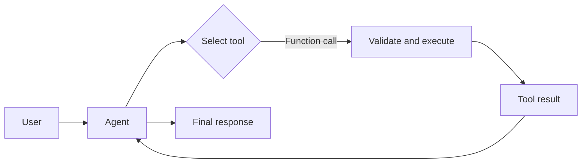

# Chapter 05 — Tool Use

> Book: *Agentic Design Patterns* (Antonio Gulli), Chapter 05. Implemented with Microsoft Agent Framework (C#) and Microsoft Foundry.

## The Pattern in One Paragraph

An agent cannot directly query systems or execute actions outside its model context. Tool use gives it a set of explicitly described functions; the model chooses when and how to call one, application code validates and executes the request, and the result returns to the model for a user-facing answer. Keep writes behind deterministic authorization and approval gates; the sample tools here are read-only.



## What This Demo Shows

| Variant | Source notebook | MAF / Foundry building blocks | What to observe |
|---|---|---|---|
| Simulated information search (`search`) | `Chapter_05_Tool_Use_(LangChain).ipynb` | `ChatClientAgent`, `AIFunctionFactory.Create` | The model calls a deterministic lookup for Paris, London weather, and an unknown topic; the returned data is explicitly simulated. |
| Calculator (`calculator`) | `Chapter_05_Tool_Use_(Executing_Code).ipynb` | `ChatClientAgent`, `AIFunctionFactory.Create`, bounded arithmetic parser | The agent uses a deterministic C# parser for `(5 + 7) * 3` and `10!`; it does not execute model-generated code. |
| Simulated stock lookup (`stocks`) | `Chapter_05_Tool_Use_(CrewAI).ipynb` | `ChatClientAgent`, `AIFunctionFactory.Create` | A structured function lookup returns the sample AAPL price; unknown tickers produce an explicit tool error. |
| Foundry-native web search (`foundry-web`) | `Chapter_05_Tool_Use_(Google_Search).ipynb` | `AIProjectClient.AsAIAgent`, Foundry hosted web-search tool | Microsoft Foundry retrieves current web information and returns source-grounded content. Requires Entra ID and a supported deployment. |
| Foundry-native code interpreter (`foundry-code`) | `Chapter_05_Tool_Use_(Executing_Code).ipynb` | Foundry hosted code-interpreter tool | A service-side sandbox runs the requested arithmetic, rather than a local allowlisted parser. |
| Foundry-native file search (`foundry-files`) | `Chapter_05_Tool_Use_(Vertex_AI_Search).ipynb` | Foundry hosted file-search tool and existing vector store | Queries an existing Foundry vector store for the Q2 strategy sample. The vector store must be prepared separately. |
| Hosted companion | All MAF function-tool scenarios | Shared Chapter 05 agent behind Foundry Agent Service Responses | Each caller request is processed independently with optional `search:`, `calculate:`, or `stock:` prefixes. See [the hosted guide](../Chapter05.ToolUse.Hosted/README.md). |

## Setup

1. Prerequisites: .NET 10 SDK, a Microsoft Foundry project, a model deployment, and an API key for the MAF console demos.
2. Configure shared user-secrets once; see [the .NET setup guide](../../README.md). Do not add credentials to source files.
3. Run the three MAF demos (the default; does not require Azure sign-in beyond configured user-secrets):
   ```powershell
   dotnet run --project dotnet/src/Chapter05.ToolUse
   ```
4. Run one MAF demo:
   ```powershell
   dotnet run --project dotnet/src/Chapter05.ToolUse -- search
   dotnet run --project dotnet/src/Chapter05.ToolUse -- calculator
   dotnet run --project dotnet/src/Chapter05.ToolUse -- stocks
   ```
5. Foundry-native demos use Entra ID (`az login`) and `Foundry:ProjectEndpoint` plus `Foundry:ModelDeployment`; they do not use the API key. Web search requires a compatible model and a configured Grounding with Bing Search connection in the Foundry project. Run web search or code interpreter:
   ```powershell
   dotnet run --project dotnet/src/Chapter05.ToolUse -- foundry-web
   dotnet run --project dotnet/src/Chapter05.ToolUse -- foundry-code
   ```
6. For file search, configure `Foundry:FileSearchVectorStoreId` with an existing vector store ID in the project, then run:
   ```powershell
   dotnet user-secrets set "Foundry:FileSearchVectorStoreId" "<vector-store-id>" --project dotnet/src/Shared
   dotnet run --project dotnet/src/Chapter05.ToolUse -- foundry-files
   ```
7. Optionally choose a configured named model deployment for MAF demos with `--deployment <name>`.
8. For live validation without local secrets, use **Actions** → **Live Foundry smoke tests** after the updated workflow coverage has been merged to the default branch. It runs inside the protected `foundry-integration` environment using `Foundry__*` variables from GitHub environment secrets.

## Notebook → C# Mapping

| Python notebook element | C# implementation |
|---|---|
| LangChain `search_information` with a small static dictionary | MAF `SearchInformation` function tool; preserves the Paris, London, population, mountain, and fallback sample results. |
| Google ADK `google_search` query for latest AI news | Foundry-native `foundry-web` mode; hosted web search is the live-search equivalent. The API-key-only MAF tool does not pretend its static index is live search. |
| Google ADK `BuiltInCodeExecutor` for `(5 + 7) * 3` and `10!` | MAF calculator tool uses a bounded decimal arithmetic parser; Foundry-native `foundry-code` uses the provider's sandboxed Code Interpreter. |
| CrewAI `get_stock_price` for AAPL | MAF `GetStockPrice` returns the same simulated sample quote and raises for unknown tickers. |
| Google ADK `VSearchAgent` querying a user-provided Vertex datastore | Foundry-native `foundry-files` queries a user-provided Foundry vector store. The original GCP datastore and its private documents are not copied or recreated. |
| CrewAI role/task/crew kickoff and LangChain `AgentExecutor` | One MAF `ChatClientAgent` per request, with only the scenario's selected function tools. |

## When to Use

- The model needs read access to deterministic application data or an explicitly authorized external capability.
- A tool has a narrow contract, typed parameters, clear output, and deterministic validation.
- Current information or private documents are needed and a supported, permissioned search integration is configured.
- A calculation or transformation is better performed deterministically than entrusted to model arithmetic.

## When NOT to Use

- The tool would perform irreversible writes without user confirmation, authorization, idempotency, and an audit trail.
- The model can answer reliably from context and tool latency, cost, or data exposure outweighs its benefit.
- You need live information but only a static simulated data source is configured.
- A prompt-generated code string would be executed directly on the application host. Use a dedicated sandbox with explicit resource and network controls instead.

## Real-World Scenarios

1. **Customer support** — retrieve a read-only order status from an authorized service, then summarize the returned fields without inventing missing data.
2. **Finance operations** — look up a simulated or authorized market feed and return its timestamp and source; do not represent stale cache values as live prices.
3. **Document assistant** — search an approved vector store for contract clauses or policy passages and cite the retrieved evidence.
4. **Operations analyst** — run bounded arithmetic or a sandboxed calculation over approved input instead of asking the model to estimate numerical results.
5. **Research assistant** — use a hosted web-search tool for time-sensitive facts, treat retrieved pages as untrusted data, and surface source attribution.

## Extending with Microsoft Foundry

- Foundry-hosted web search, file search, and code interpreter provide service-managed tools with different latency, cost, data handling, and execution boundaries from application-defined `AIFunction`s.
- Foundry Toolbox can centralize versioning, authentication, and policy for external MCP, web, and search tools.
- Add tracing and evaluation for tool-selection precision, argument validity, tool failure handling, grounded answer quality, and latency. This demo opts into sensitive MAF telemetry; restrict access and retention.
- The hosted companion exposes only the deterministic MAF function tools. It does not silently enable native web search, file search, or arbitrary code execution.

## Hosted Deployment Companion

- Suitability: ordinary request/response calls to the read-only sample functions are bounded and have no interactive approval, durable memory, or local-only dependency.
- Project and deployment guide: [Chapter 05 hosted companion](../Chapter05.ToolUse.Hosted/README.md).
- Authentication: local console uses API-key user-secrets or `Foundry__*`; hosted execution uses developer identity locally and managed identity in Azure when no API key is configured. Deployment and runtime inference permissions are separate.
- Packaging: `azure.yaml` uses bundled .NET 10 deployment, publishing the host and referenced Chapter 05 / Shared projects; `.agentignore` excludes `.azure`, environment files, secrets, and build output.
- Validation/status: deterministic tool and protocol tests are included. The hosted companion has not been deployed or remotely invoked; verify the current `instance_identity.principal_id` has **Cognitive Services OpenAI User** at the model-hosting Foundry account scope before any approved remote invocation.
- Limitations/cleanup: each request is stateless and returns one buffered response. Tool calls use simulated search/stock data and a bounded parser. Remove only this agent/version if deployed; never remove shared project resources.

## Risks & Limitations

- The MAF search and stock examples use fixed simulated data and do not verify current facts or prices.
- Model-selected function arguments are untrusted. Validate at the tool boundary; exceptions are surfaced to the agent rather than hidden.
- The arithmetic parser accepts only a short expression grammar and factorials from 0 through 27. It does not execute arbitrary code.
- Foundry-hosted tools need a compatible model, project configuration, and (for file search) an existing vector store. Code Interpreter and web grounding can add service charges. Grounding with Bing Search sends data outside the Azure compliance and Geo boundary; review its terms before use.
- Search results and retrieved documents are untrusted input and may contain prompt injection. Do not let them authorize consequential actions.
- Agent Framework packages are preview-sensitive; tool signatures and package versions are pinned in the shared central package file.
