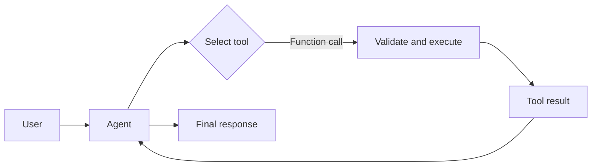

# Chapter 05 — Tool Use

The model chooses a described function and typed arguments; application code executes it and returns a result for the final answer. These local tools are read-only and deterministic. Tool selection is not authorization, and model-generated arguments are untrusted.



## Where to look in code

- [`ToolUseAgent.Create`](ToolUseAgent.cs): `AIFunctionFactory.Create`, scenario-specific tool sets, and function-enabled `ChatClientAgent`.
- [`ToolUseFunctions.Calculate`](ToolUseFunctions.cs): typed decimal operations (`Add`, `Subtract`, `Multiply`, `Divide`, `Factorial`), not an expression parser or code executor.
- `SearchInformation` / `GetStockPrice`: deliberately static sample fixtures; `Report` centralizes visible tool-call output.
- [`FoundryNativeDemo.RunAsync`](FoundryNativeDemo.cs): separate hosted web search, Code Interpreter, and File Search.

## Notebook → C# mapping

| Notebook in `chapter_notebooks/` | Selector and behavior |
|---|---|
| `Chapter_05_Tool_Use_(LangChain).ipynb` | `search`: preserves the Paris, London, population, mountain, and fallback lookup examples. |
| `Chapter_05_Tool_Use_(Executing_Code).ipynb` | `calculator`: `(5 + 7) * 3` becomes `Add(5,7)` then `Multiply(result,3)`; `10!` uses `Factorial(10)`. `foundry-code` preserves the separate sandboxed code-execution variant. |
| `Chapter_05_Tool_Use_(CrewAI).ipynb` | `stocks`: same simulated AAPL quote and explicit unknown-ticker error. |
| `Chapter_05_Tool_Use_(Google_Search).ipynb` | `foundry-web`: native web search for current AI news; unlike the sample dictionary, this requires a supported live-search configuration. |
| `Chapter_05_Tool_Use_(Vertex_AI_Search).ipynb` | `foundry-files`: query an existing Foundry vector store, not the original private GCP datastore. |

Calculator requests remain natural language or arithmetic text. The model translates them into typed calls; compound expressions require multiple calls. Factorial accepts integers 0–27; divide-by-zero, overflow, and unsupported operations fail. No model-generated code runs on the application host.

## Run

Use .NET 10 and [shared Foundry configuration](../../README.md). From the repository root:

```powershell
dotnet run --project .\dotnet\src\Chapter05.ToolUse
dotnet run --project .\dotnet\src\Chapter05.ToolUse -- calculator --deployment fast
dotnet run --project .\dotnet\src\Chapter05.ToolUse -- search
dotnet run --project .\dotnet\src\Chapter05.ToolUse -- stocks
dotnet run --project .\dotnet\src\Chapter05.ToolUse -- foundry-web
dotnet run --project .\dotnet\src\Chapter05.ToolUse -- foundry-code
dotnet run --project .\dotnet\src\Chapter05.ToolUse -- foundry-files
dotnet test .\dotnet\tests\ToolUse.Tests
```

Default/`all` runs the three local function demos. Native modes use Entra ID, not the console API key. Configure a compatible model and a Grounding with Bing Search connection for web search. For files, set `Foundry:FileSearchVectorStoreId` to a reader-owned existing index. `--deployment <alias>` selects a configured model for MAF modes. Deterministic tests check typed math, compound-call handoff, tool selection, boundary errors, and a hosted smoke.

## When to use / when not to use

Use for deterministic calculation, authorized data lookup, or supported external capabilities. Avoid unnecessary tools when context suffices, live-information claims over static fixtures, or consequential writes without deterministic authorization, approval, and idempotency.

## Scenarios

- Read-only order-status lookup for support.
- Finance calculations over authorized, timestamped data.
- Search of approved policy or contract documents.
- Citation-backed current-events research.

## Foundry and hosting

The native modes genuinely use service-managed tools; the [hosted companion](../Chapter05.ToolUse.Hosted/README.md) exposes only the local function tools. See [common hosting guidance](../../HOSTING.md) for deployment, configuration, and inference access. Native Code Interpreter/search may incur separate charges; Bing grounding sends data outside Azure's compliance/Geo boundary, so review its terms.

## Tradeoffs

Typed functions make capability boundaries clear but require the model to decompose compound calculations. Tool results inherit source freshness and reliability. Treat retrieved content as data, not permission to act. Sensitive-content tracing can include arguments/results; restrict access and retention.
