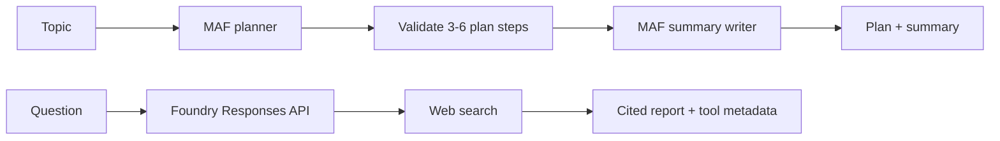

# Chapter 06 — Planning

A planner proposes ordered steps before a writer executes them. The real MAF graph has just two responsibilities: return a structured plan, validate its shape, then write a summary from that plan. A separate Deep Research variant gathers web evidence through Foundry's Responses API.



## Where to look in code

- [`PlanningWorkflow.RunAsync`](PlanningWorkflow.cs): two-executor `WorkflowBuilder`, with output directly from the writer rather than a pass-through completion executor.
- `PlannerExecutor.HandleAsync`: `RunAsync<PlanningPlan>` and the 3–6 nonempty-step contract.
- `WriterExecutor.HandleAsync`: original topic plus the same numbered plan shown in console output.
- [`PlanningAgents.Create`](PlanningAgents.cs): planner/writer responsibilities.
- [`DeepResearchDemo.RunAsync`](DeepResearchDemo.cs): deployment-alias check and delegation to shared `FoundryDeepResearch`.

## Notebook → C# mapping

| Notebook in `chapter_notebooks/` | C# behavior |
|---|---|
| `Chapter_06_Planning_(Code_Example).ipynb` | `plan-write`: CrewAI's sequential plan/writing tasks become MAF planner and writer agents; the sample remains reinforcement learning and an approximately 200-word summary. |
| `Chapter_06_Planning_(Deep_Research_API).ipynb` | `deep-research`: Foundry Responses background research, web search, polling, citations, and available tool/reasoning summaries; semaglutide economics remains the sample question. |

The console prints the plan before execution and the resulting summary. Plan-shape validation **does not establish business correctness** or authorize any action.

## Run

Use .NET 10 and [shared Foundry configuration](../../README.md). From the repository root:

```powershell
dotnet run --project .\dotnet\src\Chapter06.Planning
dotnet run --project .\dotnet\src\Chapter06.Planning -- plan-write --task "Reinforcement learning in robotics" --deployment fast
dotnet run --project .\dotnet\src\Chapter06.Planning -- deep-research
dotnet run --project .\dotnet\src\Chapter06.Planning -- all --task "The economic impact of semaglutide on healthcare"
dotnet test .\dotnet\tests\Planning.Tests
```

Default runs `plan-write` only. Deep Research requires a compatible Responses model (for example `o3-deep-research`) under `Foundry:ModelDeployments:deep-research`; `--research-deployment <alias>` chooses another configured research deployment. It may incur significant model/search cost and is not part of deterministic tests. Tests check plan boundaries, rejection before writing, topic/plan handoff, and one hosted smoke.

## When to use / when not to use

Use when an inspectable outline improves a multi-step deliverable or an investigation needs traceable evidence. Avoid it for a direct question, or when generated steps would replace mandatory workflows, domain validation, permissions, or clinical judgment.

## Scenarios

- Outline a technical explanation before drafting it.
- Propose a migration investigation for human review.
- Research policy or market evidence with citations.
- Produce a healthcare-economics briefing for qualified review.

## Foundry and hosting

Deep Research is a distinct optional Foundry extension; citations still need source review. The [hosted companion](../Chapter06.Planning.Hosted/README.md) runs plan-and-write only. Long-running research needs a durable job/polling design before being exposed through that request contract. See [common hosting guidance](../../HOSTING.md).

## Tradeoffs

Planning costs a call before execution and can omit constraints or add unnecessary steps. A writer can follow a well-formed but wrong plan. Research adds source-quality, prompt-injection, privacy, time, and cost risks. Keep budgets/cancellation and domain checks separate from model judgment. Sensitive tracing may export plans and topics; restrict access and retention.
