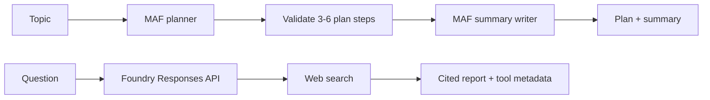

# Chapter 06 — Planning

> Book: *Agentic Design Patterns* (Antonio Gulli), Chapter 06. Implemented with Microsoft Agent Framework (C#) and Microsoft Foundry.

## The Pattern in One Paragraph

Planning turns a goal with several possible approaches into ordered steps before execution. This demo separates planning from writing: a planner returns a validated, structured plan, then a writer follows it to produce the requested summary. For research questions that need fresh evidence, Foundry's Deep Research model can instead coordinate web searches and return a citation-rich report.



## What This Demo Shows

| Variant | Source notebook | MAF / Foundry building blocks | What to observe |
|---|---|---|---|
| Plan and write (MAF) | `Chapter_06_Planning_(Code_Example).ipynb` | `WorkflowBuilder`, structured `RunAsync<PlanningPlan>`, planner and writer `ChatClientAgent`s | The bounded plan is validated and printed before the writer produces an approximately 200-word summary. |
| Deep Research (Foundry-native) | `Chapter_06_Planning_(Deep_Research_API).ipynb` | Foundry Responses API, `o3-deep-research` deployment, built-in `web_search_preview` | A long-running research task returns its report, citation annotations, search calls, and available reasoning summaries. |
| Hosted companion | Plan-and-write workflow | Existing MAF workflow + Foundry Responses protocol host | [Hosted companion guide](../Chapter06.Planning.Hosted/README.md). It handles each request independently and returns the completed plan and summary. |

## Setup

1. Prerequisites: .NET 10 SDK and a Microsoft Foundry project with a chat model deployment and API key.
2. Configure shared user-secrets once — see [dotnet/README.md](../../README.md). Keep API keys out of source and `appsettings.json`.
3. For cloud-agent validation, the `live-foundry-tests.yml` workflow uses the protected `foundry-integration` environment and maps its GitHub environment secrets to `Foundry__*` environment variables.
4. To run Deep Research, separately deploy an `o3-deep-research` model that supports the Responses API and configure it under the `deep-research` deployment alias:
   ```powershell
   dotnet user-secrets set "Foundry:ModelDeployments:deep-research" "<deep-research-deployment-name>" --project dotnet/src/Shared
   ```
   This deployment and web search may incur additional model and search costs. The Deep Research demo is deliberately not part of the live smoke suite.
5. Run locally:
   ```powershell
   dotnet run --project dotnet/src/Chapter06.Planning
   dotnet run --project dotnet/src/Chapter06.Planning -- plan-write --task "The role of reinforcement learning in robotics"
   dotnet run --project dotnet/src/Chapter06.Planning -- deep-research
   dotnet run --project dotnet/src/Chapter06.Planning -- all --task "The economic impact of semaglutide on healthcare"
   ```
   The default command runs only the MAF plan-and-write workflow. `deep-research` and `all` require the configured `deep-research` alias. Use `--research-deployment <alias>` to select another configured alias or `--deployment <alias>` to select the chat model.
6. Validate in GitHub Actions when local credentials are unavailable:
   - Open **Actions** → **Live Foundry smoke tests** after this change is merged to the default branch.
   - Run the workflow with `foundry-integration` secrets configured.

## Notebook → C# Mapping

| Python (CrewAI / OpenAI) | C# (MAF / Foundry) |
|---|---|
| CrewAI `Agent` + sequential `Task` produces a plan and an approximately 200-word summary about reinforcement learning | `PlanningAgents` defines planner and writer `ChatClientAgent`s; `PlanningWorkflow` validates the planner's structured result and sends it to the writer. |
| OpenAI Responses request uses `o3-deep-research`, `web_search_preview`, and a semaglutide research question | `DeepResearchDemo` calls the Foundry-compatible Responses API using the configured Deep Research deployment and built-in web search. It polls the background response and prints citations and available intermediate events. |

## When to Use

- The objective is clear but the sequence of work needs to be constructed before execution.
- A deliverable benefits from an explicit outline that can be inspected before the content is written.
- Research needs current web evidence, traceable sources, and a consolidated report.

## When NOT to Use

- The task is a single direct question that does not need sequencing or external evidence.
- The plan must be an enforceable business workflow: represent mandatory rules, permissions, and state transitions deterministically instead of relying on model-generated steps.
- A user needs a guaranteed source-verified or clinically authoritative answer; review citations and evidence, and use qualified human review.
- The available model deployment does not support the Responses API and Deep Research tools; the MAF plan-and-write variant remains available independently.

## Real-World Scenarios

1. **Technical writing** — outline a topic before drafting a concise explainer, so the structure is visible and independently revisable.
2. **Policy or market research** — use Deep Research to gather up-to-date sources and synthesize evidence for an analyst to review.
3. **Project discovery** — identify stages for a migration or investigation before assigning the plan to deterministic tools and approvals.
4. **Healthcare economics** — collect claims and cited public evidence about a treatment's system-wide costs, then send the report to a qualified reviewer rather than treating it as clinical advice.

## Extending with Microsoft Foundry

- Add Foundry tracing and evaluate plan completeness and summary fidelity against explicit criteria.
- Use Deep Research with trusted web sources or a configured remote MCP server when private data is required; restrict MCP access and review tool calls.
- Keep deterministic limits around generated plans, research budgets, external actions, and approvals. Web citations are evidence for review, not proof that claims are correct.

## Hosted Deployment Companion

- Suitability: the MAF plan-and-write workflow is a bounded request/response operation. Each Responses request creates fresh agents and has no persisted conversation state. Deep Research is excluded from the host because its background operation needs a durable job, polling, and timeout design.
- Project and deployment guide: [Chapter 06 hosted companion](../Chapter06.Planning.Hosted/README.md). The `chapter06-planning` service can be deployed independently through the multi-service `azure.yaml`.
- Authentication: local runs can use shared user-secrets. Hosted Azure execution uses managed identity. Before any remote invocation, check that the deployed runtime `instance_identity.principal_id` has **Cognitive Services OpenAI User** at the actual model-hosting Foundry account scope; obtain approval before any role assignment and allow propagation.
- Packaging: azd's bundled .NET 10 deployment publishes the host and referenced chapter/shared projects together. The host `.agentignore` excludes `.azure`, environment files, secrets, and build outputs.
- Request contract: the protocol returns a completed plan and summary and stores no conversation history.

## Risks & Limitations

- A model-generated plan can omit constraints or contain unnecessary steps; structural validation does not establish domain correctness.
- The writer can introduce factual errors. The plan is a structure, not a source of verified facts.
- Long-running research requires explicit time and cost budgets, cancellation, and handling of failed or incomplete work.
- Web research introduces source-quality, prompt-injection, privacy, latency, and cost risks. Review the report and citations before using it for consequential decisions.
