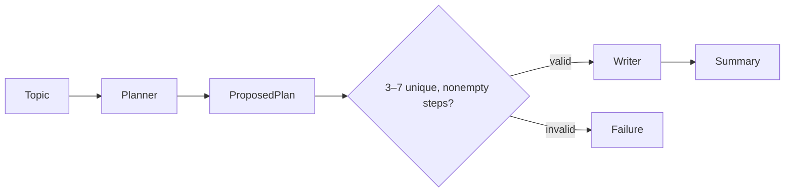

# Chapter 06 — Planning

> Book: *Agentic Design Patterns* (Antonio Gulli), Chapter 06. Implemented with Microsoft Agent Framework (C#) and Microsoft Foundry.

## The Pattern in One Paragraph

Planning decomposes a goal into steps before execution. The console demo uses a structured plan as an explicit contract between a planner and writer; deterministic validation checks the proposed plan before the writer can proceed. This bounded workflow demonstrates plan → validate → execute, not an autonomous replan loop.



## What This Demo Shows

| Variant | Source notebook | MAF / Foundry building blocks | What to observe |
|---|---|---|---|
| Plan and write (`plan-write`) | `Chapter_06_Planning_(Code_Example).ipynb` | MAF `WorkflowBuilder`, typed `RunAsync<PlanningPlan>`, deterministic validation executor, writer agent | The reinforcement-learning topic is planned, the structured plan is checked, and only a valid plan is passed to the writer. |
| Deep Research (`deep-research`) | `Chapter_06_Planning_(Deep_Research_API).ipynb` | Foundry Responses API, `web_search_preview`, reasoning summaries, search call metadata, citation annotations | The semaglutide research query returns report text, citations, and available intermediate research/search summaries. |
| Foundry-native | Both | Not applicable as a second planning implementation | Foundry hosts the model/Responses API, but does not provide a distinct plan-and-write primitive for this workflow. Deep Research is a separate Responses capability, not a reimplementation of the MAF workflow. |
| Hosted companion | Plan and write | Shared MAF workflow behind Foundry Agent Service Responses | Stateless caller requests execute the same plan validation and writing path. See [hosted setup and deployment](../Chapter06.Planning.Hosted/README.md). |

## Setup

1. Prerequisites: .NET 10 SDK and a Microsoft Foundry project with a chat model deployment and API key.
2. Configure shared user-secrets once; see the [dotnet setup guide](../../README.md). Do not put credentials in source files.
3. Run the planner/writer demo:
   ```powershell
   dotnet run --project dotnet/src/Chapter06.Planning -- plan-write
   ```
4. Run the separate Deep Research demo:
   ```powershell
   dotnet run --project dotnet/src/Chapter06.Planning -- deep-research
   ```
   The default Deep Research model deployment is `o3-deep-research-2025-06-26`. Ensure the selected Foundry project has an accessible deployment and Responses web-search support. Override it with `Foundry__DeepResearchModelDeployment` or `FOUNDRY_DEEP_RESEARCH_MODEL_DEPLOYMENT`; `--deployment <name>` can instead select a configured `Foundry:ModelDeployments:<name>` alias.
5. Run both variants with `all`. An optional `--deployment <name>` selects a configured model alias for plan-and-write:
   ```powershell
   dotnet run --project dotnet/src/Chapter06.Planning -- all
   dotnet run --project dotnet/src/Chapter06.Planning -- plan-write --deployment fast
   ```
6. For cloud validation without local secrets, use **Actions** → **Live Foundry smoke tests** after this workflow coverage is present on the default branch. The workflow runs within the protected `foundry-integration` environment and receives `Foundry__*` values from GitHub environment secrets. The Chapter 06 live smoke test covers plan-and-write only; it does not invoke the longer-running Deep Research model.

## Notebook → C# Mapping

| Python notebook element | C# mapping |
|---|---|
| CrewAI `Article Planner and Writer` | MAF planner and writer `ChatClientAgent`s inside one workflow. |
| Sequential task that first creates a bullet plan | Planner returns a typed `PlanningPlan` through structured output; the plan is printed as an intermediate stage. |
| Expected `### Plan` and `### Summary` output | Deterministic validation runs before writing; the final typed `PlanningResult` contains the validated plan and summary. |
| `gpt-4-turbo` | Shared Foundry model deployment selected through user-secrets or `Foundry__*` environment variables. |
| OpenAI `client.responses.create` with deep research and web search | Direct POST to the Foundry OpenAI-compatible `/openai/v1/responses` endpoint with `web_search_preview`, using the selected Deep Research deployment. |
| Inline citation annotations and reasoning/search metadata | Returned output text, citation title/URL, reasoning summaries, and web-search query/status are printed when provided by the API. |

## When to Use

- A task benefits from explicit decomposition before a separate execution or writing stage.
- The proposed plan can be checked with deterministic constraints before downstream work.
- The plan and task fit within a small, bounded request/response flow.
- Deep Research web search and citations are appropriate for an open-ended research question.

## When NOT to Use

- Tasks require a long-running autonomous loop, progress persistence, checkpoints, or resumption after interruption; this demo does not implement those.
- The plan needs authorization, tool access, or domain-specific policy checks beyond the current structural validation.
- The answer must be guaranteed factual; a model-generated plan or research report still requires source and human verification.
- The request does not justify the additional model calls or Deep Research latency/cost.

## Real-World Scenarios

1. **Technical explainers** — validate an outline before drafting a concise summary for a specific audience.
2. **Project intake** — generate a small ordered checklist, then verify required categories before producing a proposal.
3. **Research briefs** — use Deep Research search and citations to prepare a sourced first draft for expert review.
4. **Operational runbooks** — decompose an approved goal into bounded steps, then apply deterministic authorization checks before executing any action.

## Extending with Microsoft Foundry

- Use tracing to inspect planner and writer calls. Sensitive model inputs/outputs are explicitly captured by the MAF instrumentation; use non-sensitive prompts and restrict telemetry access and retention.
- Use Foundry evaluations to compare plan completeness and whether summaries follow accepted steps; evaluation setup and execution are not included here.
- Add domain-specific policy validation before the writer, and introduce explicit checkpoints/budgets before evolving this sample into multi-step autonomous planning.
- The Deep Research variant depends on the selected model deployment and Responses API web-search availability; an ordinary chat deployment alone may not support it.

## Hosted Deployment Companion

- Suitability: plan-and-write is a bounded stateless request/response workflow with no human approval or local-only dependency.
- Project and deployment guide: [Chapter 06 hosted companion](../Chapter06.Planning.Hosted/README.md).
- Authentication: the console uses shared API-key user-secrets or `Foundry__*`; the hosted Azure service uses developer credentials locally and managed identity in Azure. Deployment permissions are separate from model inference access.
- Packaging: `azure.yaml` uses bundled .NET 10 deployment so the host and referenced chapter/shared assemblies are published together; `.agentignore` excludes environment files, `.azure`, secrets, and build output.
- Validation/status: deterministic workflow and local Responses-protocol tests pass. This code change has not itself deployed a hosted version or made a remote Foundry call. The issue description reports a version 1 deployment and remote smoke test; reverify the current runtime identity, account-scoped inference role, active version, and response after deploying these changes.
- Limitations/cleanup: the hosted endpoint returns one completed result, does not stream intermediate stages, and does not retain conversation state. Model calls incur usage charges. Delete only this chapter's hosted agent/version if deployed; preserve the shared Foundry project and other services.

## Risks & Limitations

- Plans are structural model proposals, not verified facts or authorized actions. The current deterministic check enforces 3–7 nonempty, unique steps with a 200-character limit; it does not judge semantic correctness.
- The writer makes a separate model call and may omit, distort, or add to plan content.
- This implementation is deliberately bounded to one planner, one validation step, and one writer; it does not execute plan tasks, monitor progress, or replan.
- Deep Research may have significant latency and usage cost; returned citations and reasoning summaries depend on what the model/API returns and still need review.
- Agent Framework APIs and Foundry preview features can change; package versions are pinned in the shared central package file.
