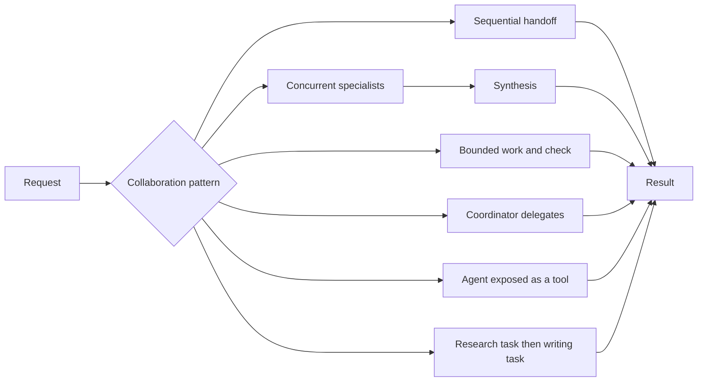

# Chapter 07 — Multi-Agent Collaboration

Distinct agents contribute specialized work within a deterministic topology. MAF agents, concurrent workflows, and agents-as-tools demonstrate six collaboration styles; different names alone do not create meaningful capability separation.



## Where to look / notebook → C# mapping

Each row maps a notebook in `chapter_notebooks/` to one small scenario file. All share `MultiAgentWorkflow.CreateAgent` and the dispatch in [`MultiAgentWorkflow.RunAsync`](MultiAgentWorkflow.cs).

| Selector | Source notebook | Pattern core |
|---|---|---|
| `sequential` | `Chapter_07_Multi_Agent_(ADK_Gemini_Sequential).ipynb` | [`RunSequentialAsync`](SequentialScenario.cs): explicit researcher → writer context handoff. |
| `parallel` | `Chapter_07_Multi_Agent_(ADK_Gemini_Parallel).ipynb` | [`RunParallelAsync`](ParallelScenario.cs): `BuildConcurrent`, attributable worker output, then synthesis. |
| `loop` | `Chapter_07_Multi_Agent_(ADK_Gemini_Loop).ipynb` | [`RunLoopAsync`](LoopScenario.cs): structured progress and a deterministic three-iteration ceiling. |
| `coordinator` | `Chapter_07_Multi_Agent_(ADK_Gemini_Coordinator).ipynb` | [`RunCoordinatorAsync`](CoordinatorScenario.cs): greeter `AsAIFunction()` versus deterministic `execute_task`. |
| `agent-tool` | `Chapter_07_Multi_Agent_(ADK_Gemini_AgentTool).ipynb` | [`RunAgentToolAsync`](AgentToolScenario.cs): artist → image agent → mock image function. |
| `crew` | `Chapter_07_Multi_Agent_(CrewAI_Gemini).ipynb` | [`RunCrewAsync`](CrewScenario.cs): interchangeable local or remote research/writing tasks with explicit handoff. |

The console shows intermediate notes, loop checks, delegation results, and final output. Research/news/weather use model knowledge, **not live sources**. The image result is explicitly mock data. Empty results, malformed progress, failures, and loop-budget exhaustion are errors rather than success-shaped placeholders.

## Run

Use .NET 10 and [shared Foundry configuration](../../README.md). From the repository root:

```powershell
dotnet run --project .\dotnet\src\Chapter07.MultiAgent
dotnet run --project .\dotnet\src\Chapter07.MultiAgent -- parallel --task "Analyze an extreme heat event."
dotnet run --project .\dotnet\src\Chapter07.MultiAgent -- agent-tool --task "A futuristic city"
dotnet run --project .\dotnet\src\Chapter07.MultiAgent -- all --deployment fast
dotnet test .\dotnet\tests\MultiAgent.Tests
```

Default is `crew`; all six selectors and `all` remain available. `agenttool` is also accepted. `--task` replaces the sample input and `--deployment` selects a configured model alias. Tests retain handoff, completion/failure, endpoint credential boundaries, call-ID handling, and request-isolation checks.

## When to use / when not to use

Use for distinct knowledge, tools, permissions, or deployment lifecycles with bounded handoffs. Avoid it when one agent/function suffices, agents differ only by persona, or shared context is so tightly coupled that coordination dominates.

## Scenarios

- Product-launch review by distinct research and content specialists.
- Parallel infrastructure/application incident analysis under a human-owned process.
- Research notes handed to an editor with explicit evidence boundaries.
- Support coordination among least-privilege specialist tools.

## Foundry and hosting

The [single-host companion](../Chapter07.MultiAgent.Hosted/README.md) serves all six modes in one process. The [distributed crew](../Chapter07.MultiAgent.Distributed/README.md) is **advanced/optional**: three independently hosted Responses endpoints with separate identities. Hosting does not create a separate Foundry-native collaboration primitive. See [common hosting guidance](../../HOSTING.md).

## Tradeoffs

More agents add calls, latency, context loss, and inconsistent conclusions. Parallel agreement is not evidence; tool delegation is not authorization. Keep deterministic policies and bounded loops. Remote specialists add timeout, authentication, and partial-failure concerns, useful only when their isolation/lifecycle matters. Sensitive tracing includes handoffs; restrict access and retention.
