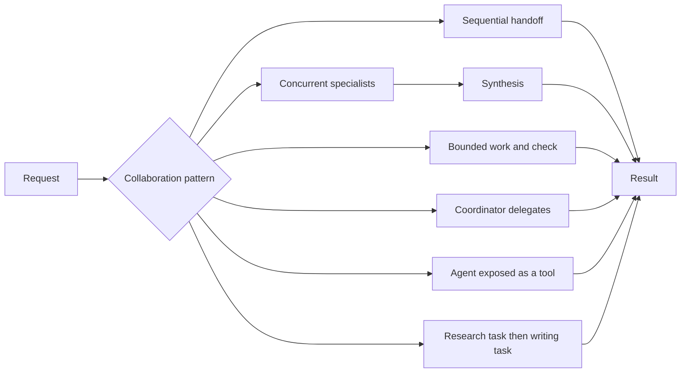

# Chapter 07 — Multi-Agent Collaboration

> Book: *Agentic Design Patterns* (Antonio Gulli), Chapter 07. Implemented with Microsoft Agent Framework (C#) on Microsoft Foundry.

## The Pattern in One Paragraph

Multi-agent collaboration divides a request among agents with distinct responsibilities, tools, or context, then coordinates their work. A deterministic application or MAF workflow should define the collaboration topology and bounds; agents contribute specialized reasoning rather than acting as interchangeable personas.



## What This Demo Shows

| Variant | Source notebook | MAF / Foundry building blocks | What to observe |
|---|---|---|---|
| `sequential` (MAF) | `Chapter_07_Multi_Agent_(ADK_Gemini_Sequential).ipynb` | Two `ChatClientAgent` instances with an explicit handoff | The writer receives the researcher's output as context. |
| `parallel` (MAF) | `Chapter_07_Multi_Agent_(ADK_Gemini_Parallel).ipynb` | `AgentWorkflowBuilder.BuildConcurrent`, fan-in, and a synthesizer | Weather and news perspectives run independently; the prompts disclose the lack of live data tools. |
| `loop` (MAF) | `Chapter_07_Multi_Agent_(ADK_Gemini_Loop).ipynb` | Structured `RunAsync<T>` and a deterministic three-iteration limit | The model reports progress and completion; code enforces nonempty output, continuation shape, and termination budget. |
| `coordinator` (MAF) | `Chapter_07_Multi_Agent_(ADK_Gemini_Coordinator).ipynb` | Coordinator `ChatClientAgent`, child agent exposed with `AsAIFunction()`, and deterministic executor function | The coordinator selects a delegate while the task executor itself is not an LLM. |
| `agent-tool` (MAF) | `Chapter_07_Multi_Agent_(ADK_Gemini_AgentTool).ipynb` | Parent and specialist `ChatClientAgent` instances exposed through `AsAIFunction()`, plus `AIFunctionFactory` | The artist calls an image-specialist agent, which calls a function; the image function intentionally returns mock data. |
| `crew` (MAF) | `Chapter_07_Multi_Agent_(CrewAI_Gemini).ipynb` | Research and writer `ChatClientAgent` instances with sequential task context | CrewAI roles/tasks are expressed as MAF agent responsibilities and an explicit task handoff. |
| Hosted companion | All six scenarios | Foundry Agent Service Responses protocol and the same MAF runner | A caller chooses one scenario per request; see the [hosted guide](../Chapter07.MultiAgent.Hosted/README.md). |
| Distributed hosted crew | Crew research-to-writing scenario | Three separate Foundry-hosted Responses endpoints | An orchestrator calls independently hosted research and writing specialists; see the [distributed guide](../Chapter07.MultiAgent.Distributed/README.md). |
| Foundry-native | — | Not applicable | Foundry hosting exposes the MAF implementation but does not provide a distinct native multi-agent collaboration primitive for these scenarios. |

## Setup

1. Prerequisites: .NET 10 SDK, a Microsoft Foundry project, a deployed chat model, and its API key.
2. Configure shared .NET user-secrets once, as described in [dotnet/README.md](../../README.md#configure-foundry-user-secrets).
3. For cloud-agent validation, the repository's `live-foundry-tests.yml` workflow uses the protected `foundry-integration` environment and the `Foundry__*` variables populated from GitHub environment secrets.
4. Run one example or all six:

   ```powershell
   dotnet run --project dotnet/src/Chapter07.MultiAgent
   dotnet run --project dotnet/src/Chapter07.MultiAgent -- parallel --task "Analyze the impact of an extreme heat event."
   dotnet run --project dotnet/src/Chapter07.MultiAgent -- all
   ```

   The default is `crew`. Available selectors are `sequential`, `parallel`, `loop`, `coordinator`, `agent-tool`, `crew`, and `all`. Add `--deployment <alias>` to select a configured model deployment.
5. Validate in GitHub Actions when local secrets are unavailable:
   - Open **Actions** → **Live Foundry smoke tests**.
   - Run the workflow manually from the default branch after this chapter is merged.
   - Optionally pass a deployment alias such as `fast` or `quality`.

## Notebook → C# Mapping

| Python (ADK / CrewAI) | C# (MAF) |
|---|---|
| `SequentialAgent` with `output_key` | Researcher and writer agents are run in sequence; the research result is passed explicitly as writer context. |
| `ParallelAgent` with worker `output_key`s | `AgentWorkflowBuilder.BuildConcurrent` fans out to two specialist agents and aggregates their assistant responses. |
| `LoopAgent` and state-based `ConditionChecker` | A structured progress response feeds a bounded loop; deterministic code checks completion and enforces a hard iteration cap. |
| `LlmAgent` parent with `sub_agents` and custom `BaseAgent` | A coordinator `ChatClientAgent` delegates to a greeter agent or deterministic function tool. |
| `AgentTool` wrapping an image-agent with a mock image function | `AsAIFunction()` exposes the image specialist as a tool to the artist; its leaf function returns an explicitly labeled mock result. |
| CrewAI `Agent`, `Task`, `Crew`, sequential process | Specialist `ChatClientAgent`s receive explicit instructions and the first task's result as the second task's context. |

## When to Use

- Different work units require meaningfully different knowledge, tools, permissions, or lifecycle.
- A task can be divided into independent work whose results are combined or reviewed.
- A coordinator needs to choose among a small, well-described set of specialists.
- A downstream task benefits from receiving a bounded upstream artifact rather than the full conversation.

## When NOT to Use

- A single agent or deterministic function can solve the task clearly and reliably.
- Agents differ only by name or persona and do not have distinct responsibilities or capabilities.
- The work is tightly coupled and requires repeated shared context, so handoffs add complexity without meaningful decomposition.
- A multi-step business process needs fixed policy or state transitions; use deterministic workflow logic for those rules.

## Real-World Scenarios

1. **Product launch review** — Research, compliance, and support specialists independently assess a launch brief before a coordinator produces a consolidated risk summary.
2. **Incident triage** — Infrastructure, application, and security agents analyze separate evidence sets in parallel; a human-owned incident process remains responsible for actions.
3. **Document production** — A researcher prepares scoped notes, an editor turns those notes into a customer-facing draft, and validators check required sections.
4. **Customer support routing** — A coordinator selects a billing, returns, or technical-support specialist whose tools and permissions are scoped to that task.

## Extending with Microsoft Foundry

- Use Foundry-hosted model deployments and managed identity for deployed agents; keep local console API keys in .NET user-secrets.
- Add tracing and Foundry evaluation suites to measure delegation accuracy, completion rate, and the quality of synthesized results.
- Connect specialist agents to distinct, least-privilege tools or deployments when the use case needs actual capability separation.
- The parallel notebook's “fetchers” do not have web/weather integrations; connect supported data tools before describing their output as current information.

## Hosted Deployment Companion

- Suitability: each request is a bounded request/response run with no interactive console input or cross-request memory.
- Project and deployment guide: [Chapter 07 Hosted Multi-Agent Agent](../Chapter07.MultiAgent.Hosted/README.md).
- Authentication: local developer credentials or Azure managed identity; before remote inference, verify/assign **Cognitive Services OpenAI User** to the deployed `instance_identity.principal_id` at the model-hosting Foundry account scope, with RBAC-write approval, and allow time for propagation. Recheck after redeployment.
- Packaging: azd bundled .NET deployment publishes the host and referenced Chapter 07 and Shared projects. Secrets, `.azure`, environment files, and build outputs are excluded.
- Request contract: submit `<scenario>: <task>` for one of the six scenarios, or omit the prefix to run the `crew` scenario. The host returns the completed result, creates a fresh run per request, persists no conversation state, and buffers the result until completion.
- Deployment: see the hosted guide for reusable local, deploy, and invoke commands. Use a reader-owned Foundry project and model deployment; deployment and model-inference permissions are separate, and model calls incur usage costs.

## Risks & Limitations

- Each additional agent introduces model cost, latency, and more opportunities for inconsistent or incorrect output.
- Parallel outputs may conflict; synthesis should preserve attribution and uncertainty rather than treating agreement as proof.
- A coordinator's tool descriptions and prompts influence delegation, but do not enforce authorization; keep access controls in deterministic code and tool boundaries.
- Loops need explicit iteration, time, or token budgets. A completion claim is not a substitute for domain validation.
- Agent handoffs can lose context or amplify upstream errors. Pass only relevant, well-formed artifacts and validate them at critical boundaries.
