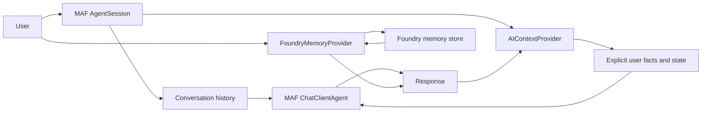

# Chapter 08 — Memory

> Book: *Agentic Design Patterns* (Antonio Gulli), Chapter 08. Implemented with Microsoft Agent Framework (C#) and Microsoft Foundry.

## The Pattern in One Paragraph

Memory gives an agent access to relevant context beyond the current prompt. Working memory keeps the active conversation and task state; longer-lived memory stores selected facts or useful prior interactions for later recall. The demo contrasts MAF session-scoped history and typed context-provider state with Foundry-managed semantic memory shared across sessions.



## What This Demo Shows

| Variant | Source notebook | MAF / Foundry building blocks | What to observe |
|---|---|---|---|
| Session memory (MAF) | `Chapter_08_Memory_(LangChain_LangGraph).ipynb`, `Chapter_08_Memory_(ADK_SessionService).ipynb`, `Chapter_08_Memory_(ADK_LlmAgent_output_key).ipynb`, `Chapter_08_Memory_(ADK_Explicit_State_Update).ipynb` | `ChatClientAgent`, `AgentSession`, `AIContextProvider`, `ProviderSessionState<T>` | Conversation history and explicitly shared facts survive turns; the typed session state demonstrates an explicit state update and an output-key-style stored response. The serialized session is restored before the final recall. |
| Foundry-managed memory (Foundry-native) | `Chapter_08_Memory_(ADK_MemoryService_InMemory).ipynb`, `Chapter_08_Memory_(ADK_SessionService).ipynb`, `Chapter_08_Memory_(LangChain_LangGraph).ipynb` | `AIProjectClient`, `FoundryMemoryProvider`, managed memory store | The provider extracts and retrieves user context from a Foundry memory store in a new MAF session. Updates are asynchronous, so the demo waits before testing recall. |
| Hosted companion | [Hosted guide](../Chapter08.Memory.Hosted/README.md) | `AgentHost`, Responses protocol, `FoundryMemoryProvider` | Runs the synthetic managed-memory demonstration in a fresh scope per request; caller messages are not written to managed memory. A personal-memory chatbot still requires authenticated scope ownership. |

## Setup

1. Prerequisites: .NET 10 SDK and a Microsoft Foundry project with a chat model deployment and API key.
2. Configure shared user-secrets once — see [dotnet/README.md](../../README.md). The MAF session variant uses the API-key configuration for model calls.
3. For cloud-agent validation, `.github/workflows/live-foundry-tests.yml` uses the protected `foundry-integration` environment and maps GitHub environment secrets to `Foundry__*` variables.
4. For the Foundry-managed variant, also sign in with an Entra identity authorized to use Foundry memory APIs, deploy an embedding model, and configure its alias and memory store:
   ```powershell
   dotnet user-secrets set "Foundry:ModelDeployments:embedding" "<embedding-deployment>" --project dotnet/src/Shared
   dotnet user-secrets set "Foundry:MemoryStoreName" "<memory-store-name>" --project dotnet/src/Shared
   ```
   The memory store uses the configured default chat deployment and embedding deployment. Store management and model usage can incur Azure charges. By default the demo generates a temporary scope, reuses it across its two sessions, and deletes that scope's memories at the end. For a local single-user experiment that should recall across runs, set `Foundry:MemoryScope` to a stable opaque identifier; do not use one shared scope for multiple users.
5. Run locally:
   ```powershell
   dotnet run --project dotnet/src/Chapter08.Memory                 # MAF session memory
   dotnet run --project dotnet/src/Chapter08.Memory -- foundry-memory
   dotnet run --project dotnet/src/Chapter08.Memory -- all --deployment fast
   ```
   The optional `--deployment <alias>` selects a configured `Foundry:ModelDeployments:<alias>` for the chat model.
6. Validate with GitHub Actions when local API-key credentials are unavailable:
   - After the workflow change is on the default branch, open **Actions** → **Live Foundry smoke tests**.
   - Run the workflow with the protected `foundry-integration` environment configured.
   - The live suite checks the MAF session variant; the Foundry-managed variant is not run there because it also requires Entra ID and an embedding deployment.

## Notebook → C# Mapping

| Python (LangChain / LangGraph / ADK) | C# (MAF / Foundry) |
|---|---|
| `ChatMessageHistory` and `ConversationBufferMemory` retain messages across prompts in one chain/session. | `SessionMemoryDemo` passes one `AgentSession` to each `ChatClientAgent.RunAsync` call and restores a serialized session for the last turn. |
| LangGraph `InMemoryStore` uses a namespace and key for user/application facts. | `ConversationMemoryProvider` stores a small allow-listed set of explicitly stated facts in typed `ProviderSessionState<T>` and adds them to later model context. |
| ADK `SessionService` and `LlmAgent.output_key` keep session data and save an agent result under a state key. | MAF session history and the provider's `LastResponse` field illustrate session state and response capture. Session serialization can persist this state; an external store is needed for durable application storage. |
| ADK `ToolContext` updates login count, status, timestamp, and validation state explicitly. | `LogUserLogin` performs a deterministic update in the session provider state rather than asking the model to infer or mutate these values. |
| ADK `InMemoryMemoryService` / `InMemorySessionService` illustrate ephemeral stores; database and Vertex AI services illustrate persistent alternatives. | The MAF variant demonstrates process-local `AgentSession` state. `FoundryMemoryProvider` uses Foundry-managed memory as the persistent service-backed alternative. |
| LangGraph's cross-session store and ADK's Vertex AI RAG memory retrieve relevant earlier context. | The Foundry-native variant uses a Foundry memory store and a stable scope shared by two sessions during one run. Azure AI Search or a vector store can be used when the application owns the retrieval corpus. |

## When to Use

- A follow-up depends on an earlier turn in the same conversation.
- An agent should reuse a small set of explicitly shared user preferences or profile facts.
- Session/task state must be inspectable, serializable, and distinct from model judgment.
- A user-facing application needs managed, cross-session memory with an explicit identity scope and retention policy.

## When NOT to Use

- A request is self-contained and has no value from prior interactions.
- The data must be authoritative or transactional; use a system of record and deterministic validation instead of model memory.
- The application cannot authenticate the owner of a persistent memory scope or enforce retention/deletion requirements.
- Retrieved memories could expose sensitive information or unsafe instructions without a review, filtering, and access-control policy.

## Real-World Scenarios

1. **Travel assistance** — keep a user's explicitly shared seat preference and use it when suggesting flights.
2. **Customer support** — retain recent case context within a session so the user does not need to repeat the issue.
3. **Developer assistance** — remember project conventions across a working session while keeping repository facts distinct from inferred preferences.
4. **Personalized onboarding** — retain a small, user-approved profile across sessions, with a defined scope, expiration, and deletion path.

## Extending with Microsoft Foundry

- Use `FoundryMemoryProvider` for managed semantic memory extracted from conversations; wait for asynchronous updates before depending on new facts.
- Keep memory scopes tied to authenticated user identity. Never use a shared demo scope for a multi-user deployment or trust a raw client-provided memory identifier.
- Define write policy, provenance, expiration, correction, and deletion behavior before using memory for consequential responses. Treat retrieved content as untrusted context.
- Use Foundry tracing and evaluations to measure memory relevance and detect incorrect, stale, or cross-scope recall. Avoid sensitive trace capture for production user data.
- Use Azure AI Search / File Search for curated source documents; that retrieval corpus is not the same as experience or preference memory.

## Hosted Deployment Companion

- Suitability: included as a scripted, synthetic-data demonstration. Each hosted request runs the Foundry-managed variant in a fresh temporary scope, recalls the sample preference across two MAF sessions, and deletes the scope's memories on success. Caller text is not sent to the inner model or stored as managed memory; the outer Responses conversation history remains platform-managed.
- Adaptation before personal-memory hosting: establish authenticated caller identity and a protected persistence layer for session-to-user scope ownership, then define retention, deletion, tenant isolation, and memory-write policy. The hosted companion deliberately does not offer cross-request personal memory.
- Request behavior: the MAF variant keeps state only in its in-process session and serializes it within the demonstration; Foundry-managed memory is durable in the configured store, with a run-specific sample scope.
- Hosting the existing workflow is not a separate Foundry-native implementation; the distinct Foundry-native variant is the managed memory provider.

## Risks & Limitations

- Conversation history grows with each turn and can consume model context; reduce or summarize history under an explicit policy.
- Model-generated responses may repeat incorrect facts, while memory extraction or retrieval can be incomplete or stale.
- Memory systems add storage, embedding, model-processing, latency, and operational costs.
- Retrieved memory is input context, not authorization or proof. Validate any sensitive or consequential fact against an authoritative source.
