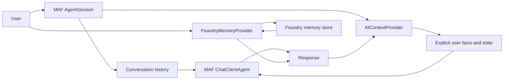

# Chapter 08 — Memory

> Book: *Agentic Design Patterns* (Antonio Gulli), Chapter 08. Implemented with Microsoft Agent Framework (C#) and Microsoft Foundry.

## The Pattern in One Paragraph

Memory gives an agent relevant context beyond the current prompt. **Session memory** keeps the active conversation plus small, explicitly written state; **long-term memory** extracts facts into a store and recalls them in later, unrelated sessions. The demo contrasts a MAF `AIContextProvider` over `AgentSession` state with Foundry-managed semantic memory.



## Where to Look in Code

| What | Where |
|---|---|
| Context provider: injects facts before each call, captures the last answer after it | `Demos/ConversationMemoryProvider.cs` — `ProvideAIContextAsync`, `StoreAIContextAsync` |
| Explicit (deterministic) state update | `ConversationMemoryProvider.Remember`, called from `SessionMemoryDemo.RunAsync` |
| Session serialization / restore | `SessionMemoryDemo.RunAsync` (`SerializeSessionAsync` → `DeserializeSessionAsync`) |
| Foundry-managed memory across sessions | `Demos/FoundryMemoryDemo.cs` — `FoundryMemoryProvider`, `WhenUpdatesCompletedAsync` |

## What This Demo Shows

| Variant | Source notebook | Building blocks | What to observe |
|---|---|---|---|
| Session memory (MAF) | `Chapter_08_Memory_(LangChain_LangGraph)`, `(ADK_SessionService)`, `(ADK_LlmAgent_output_key)`, `(ADK_Explicit_State_Update)` | `ChatClientAgent`, `AgentSession`, `AIContextProvider`, `ProviderSessionState<T>` | Facts written by code appear in later turns; the last answer is stored under an output key; recall still works after serialize/restore. |
| Foundry-managed memory (Foundry-native) | `(ADK_MemoryService_InMemory)`, `(ADK_SessionService)`, `(LangChain_LangGraph)` | `AIProjectClient`, `FoundryMemoryProvider` | A fact stored in session 1 is recalled in a **new** session 2 with no shared history. Updates are asynchronous, so the demo waits first. |
| Hosted companion | — | `AgentHost`, Responses protocol | [Hosted guide](../Chapter08.Memory.Hosted/README.md): stores a synthetic fact in a fresh scope and asks the caller's message as the recall question. |

## Notebook → C# Mapping

| Python (LangChain / LangGraph / ADK) | C# (MAF / Foundry) |
|---|---|
| `ChatMessageHistory` / `ConversationBufferMemory` | One `AgentSession` passed to every `RunAsync` call. |
| LangGraph `InMemoryStore` namespaced facts | `ProviderSessionState<ConversationMemoryState>` facts injected by the provider. |
| ADK `LlmAgent.output_key` | `StoreAIContextAsync` saves the last assistant answer as `LastResponse`. |
| ADK `ToolContext` explicit state update | `Remember(session, key, value)` — code, not the model, mutates state. |
| ADK `InMemoryMemoryService` / Vertex AI memory | `FoundryMemoryProvider` with a managed memory store and scope. |

## Setup and Run

1. Configure shared user-secrets once — see [dotnet/README.md](../../README.md).
2. Foundry-managed variant only: `az login` with memory-store permissions, plus an embedding deployment:
   ```powershell
   dotnet user-secrets set "Foundry:ModelDeployments:embedding" "<embedding-deployment>" --project dotnet/src/Shared
   dotnet user-secrets set "Foundry:MemoryStoreName" "<memory-store-name>" --project dotnet/src/Shared
   ```
   By default a temporary scope is created and its memories deleted at the end. Set `Foundry:MemoryScope` to a stable opaque value only for a local single-user experiment.
3. Run:
   ```powershell
   dotnet run --project dotnet/src/Chapter08.Memory                    # session memory
   dotnet run --project dotnet/src/Chapter08.Memory -- foundry-memory
   dotnet run --project dotnet/src/Chapter08.Memory -- all --deployment fast
   ```

The live GitHub workflow covers the session variant; the Foundry-managed variant needs Entra ID and an embedding deployment.

## When to Use

- Follow-ups depend on earlier turns in the same conversation.
- A small set of explicitly shared preferences should shape later answers.
- Session state must be inspectable and serializable, separate from model judgment.
- A user-facing app needs cross-session memory with an authenticated scope and retention policy.

## When NOT to Use

- Requests are self-contained.
- Data must be authoritative or transactional — use a system of record.
- You cannot authenticate the owner of a persistent memory scope or enforce deletion.

## Real-World Scenarios

1. **Travel assistance** — reuse a stated seat preference when suggesting flights.
2. **Customer support** — keep case context within a session so the user does not repeat it.
3. **Developer assistance** — remember project conventions for a working session.
4. **Personalized onboarding** — a user-approved profile across sessions with expiry and deletion.

## Extending with Microsoft Foundry

- Tie memory scopes to authenticated identity; never trust a client-supplied scope.
- Define write policy, provenance, expiry, and deletion; treat recalled memory as untrusted context.
- Use tracing/evaluations to detect stale or cross-scope recall. Use File Search / Azure AI Search for curated documents — that is retrieval, not memory.

## Risks & Tradeoffs

- History grows every turn and consumes context; summarize or trim under an explicit policy.
- Extraction and retrieval can be incomplete, stale, or wrong; memory is context, not proof.
- Managed memory adds storage, embedding, latency, and cost.
