# Chapter 09 — Learning and Adaptation

> Book: *Agentic Design Patterns* (Antonio Gulli), Chapter 09. Implemented with Microsoft Agent Framework (C#) and Microsoft Foundry.

## The Pattern in One Paragraph

Learning and adaptation uses evaluation evidence to improve an agent's prompt, skill, or policy over time. This demo runs an offline loop: score a starting prompt against a fixed benchmark, ask a MAF curator agent to propose a change from the failed checks, then score that proposal. The update is returned for human review; it is never written to production configuration or promoted automatically.

```mermaid
flowchart LR
    Start[Starting prompt] --> Cases[Run fixed benchmark]
    Cases --> Score[Deterministic evaluator]
    Score --> Findings[Curate failed checks]
    Findings --> Proposal[MAF prompt proposal]
    Proposal --> Recheck[Re-evaluate proposal]
    Recheck --> Review[Human review]
    Review -->|approved separately| Deploy[Controlled rollout]
```



## What This Demo Shows

| Variant | Source notebook | MAF / Foundry building blocks | What to observe |
|---|---|---|---|
| Offline prompt adaptation (`maf`) | `Chapter_09_Adaptation_(OpenEvolve).ipynb` | `ChatClientAgent`, a deterministic benchmark evaluator, bounded curation loop | The original prompt and a revised prompt are scored against the same support-policy cases; only a strictly better proposal becomes the result. |
| Foundry cloud evaluation (`foundry`) | Same | Foundry `EvaluationClient`, model-target evaluation runs, built-in `task_adherence` evaluator | Foundry runs the same cases with the baseline and proposed instructions, then stores the evaluation and run records in the project. |
| Hosted companion | Same | The MAF loop behind Foundry Agent Service Responses | A request supplies the starting instructions and receives a single bounded, stateless proposal. See [hosted setup and deployment](../Chapter09.LearningAdaptation.Hosted/README.md). |

## Setup

1. Prerequisites: .NET 10 SDK and a Foundry project with a deployed chat model.
2. Configure the shared user-secrets for the console demo — see [dotnet/README.md](../../README.md). The `maf` mode requires the project endpoint, API key, and model deployment.
3. Run the MAF adaptation demo:
   ```powershell
   dotnet run --project dotnet/src/Chapter09.LearningAdaptation -- maf
   ```
4. Run with a larger bounded proposal budget or a named deployment:
   ```powershell
   dotnet run --project dotnet/src/Chapter09.LearningAdaptation -- maf --iterations 2
   dotnet run --project dotnet/src/Chapter09.LearningAdaptation -- maf --deployment fast
   ```
   The iteration budget is capped at three to keep model usage and latency bounded.
5. To also run Foundry's native cloud evaluation, sign in with `az login` using an identity with the **Foundry User** role on the project and access to the configured model deployment:
   ```powershell
   dotnet run --project dotnet/src/Chapter09.LearningAdaptation -- foundry
   ```
   This mode runs the MAF adaptation first, then submits two Foundry model-target evaluation runs. `all` is an alias for `foundry`.
6. The Foundry evaluation definition is retained in the project so its runs can be inspected. Each execution creates a uniquely named evaluation record; use Foundry's evaluation management UI to remove only records you own when they are no longer needed. Model inference and evaluator calls may incur charges.
7. For cloud-agent validation without local user-secrets, the protected `foundry-integration` GitHub Environment supplies `Foundry__*` variables. The live workflow runs the MAF smoke test after the workflow coverage is present on the default branch; the native cloud evaluation additionally needs a configured Entra ID identity.

## Notebook → C# Mapping

| Python notebook element | C# (MAF / Foundry) |
|---|---|
| `OpenEvolve(initial_program_path, evaluation_file, config_path)` | A built-in support prompt and a typed, in-memory benchmark replace external program, evaluator, and configuration files. |
| `await evolve.run(iterations=1000)` | `LearningAdaptationWorkflow.RunAsync` evaluates a baseline, curates a prompt proposal from failed checks, and evaluates within a caller-configurable one-to-three iteration budget. |
| `best_program.metrics` | Per-case pass/fail results and aggregate passed-case counts are printed. Foundry mode also submits baseline and proposal runs to its `task_adherence` evaluator. |
| Print best metrics | The best prompt and scores are returned as a review proposal; no source, skill, policy, or deployment is changed. |

The source notebook is an OpenEvolve skeleton and does not include concrete program/evaluator files or benchmark metrics. This C# version makes the optimization target explicit: customer-support instructions are evaluated against three small, reproducible policy cases.

## Evaluation Contract

The deterministic evaluator passes a case only when every required phrase is present and no forbidden phrase appears, using case-insensitive matching. The fixed cases cover an eligible sealed return, a late return, and a damaged delivery. Candidate prompts must improve the number of passing cases to replace the current best proposal. This intentionally simple contract is auditable; real deployments should use domain-specific tests and a representative, versioned evaluation set.

`LearningAdaptationWorkflow` creates one `ChatClientAgent` for the prompt curator and isolated agents for each candidate evaluation call. Caller-provided prompt instructions are limited to 4,000 characters. The loop has a hard three-iteration maximum, propagates cancellation and provider errors, and never stores or deploys the output.

## When to Use

- You have repeatable examples and measurable acceptance criteria for improving prompts or agent instructions.
- Production observations can be converted into curated, privacy-reviewed evaluation cases.
- A candidate update can be reviewed and evaluated before a controlled release.
- Model judgment benefits from deterministic checks or a separate evaluation service.

## When NOT to Use

- There is no stable evaluation contract or representative test set.
- The evaluator can be gamed by wording or does not measure the intended outcome.
- The proposed change would take effect immediately without independent review, regression testing, or rollback.
- A fixed prompt update is not the right remedy for missing data, tool capability, model quality, or an incorrect system design.

## Real-World Scenarios

1. **Customer support** — turn reviewed resolution misses into policy-bound cases, then propose instruction changes without changing the live support agent.
2. **Document extraction** — compare candidate instructions against a golden set of documents and deterministic schema/content checks.
3. **Software assistants** — convert reviewed failure traces into regression cases, run tests against a revised coding prompt, then require code-owner approval.
4. **Operations assistants** — evaluate instruction changes against historical, privacy-scrubbed incidents before rolling them out to a small cohort.

## Extending with Microsoft Foundry

- The `foundry` mode uses Foundry's cloud Evaluation API with the built-in `task_adherence` evaluator to compare the same baseline and proposal test cases. The MAF variant's keyword contract remains a local, deterministic check; the cloud evaluator supplements it rather than replacing it.
- Cloud evaluation is asynchronous. A five-minute cancellation deadline covers polling delays and status requests for each run; caller cancellation also reaches creation, submission, and result-page requests. Cancelling a request does not undo server-side work already accepted.
- Scores require the expected number of usable task-adherence results across all result pages. Incomplete results fail explicitly rather than reporting a smaller denominator.
- Evaluation definitions and run results are retained by the Foundry project for inspection. Use a representative dataset, review region and data-retention requirements, and remove only evaluation records you own.
- Enable tracing to inspect each curation and candidate call. Sensitive-data capture is enabled for this demo; prompts and model content may appear in exported traces. Use non-sensitive data and restrict telemetry access and retention.
- For production, version datasets and candidate prompts, keep evaluator criteria independent of prompt changes, and gate promotion behind review, regression testing, staged rollout, and rollback.

## Hosted Deployment Companion

- Suitability: bounded request/response processing is supported. Every request has fresh state and a single adaptation attempt; no console input, durable memory, or local-only dependency is required.
- Project and deployment guide: [Chapter 09 hosted companion](../Chapter09.LearningAdaptation.Hosted/README.md).
- Authentication: console model calls use shared API-key user-secrets or `Foundry__*`; hosted Azure execution uses the developer identity locally and managed identity in Azure. Deployment permissions and runtime inference access are separate.
- Packaging: `azure.yaml` uses bundled .NET 10 deployment and includes the host, chapter, and Shared references. The host `.agentignore` excludes `.azure`, environment files, and build artifacts.
- Request contract: the last user message is the initial prompt (up to 4,000 characters); the response returns scores and the best prompt proposal. One iteration is run per hosted request. No prompt is promoted or retained in session state.
- Deployment instructions, required runtime role, costs, and safe agent-scoped cleanup are in the [hosted companion guide](../Chapter09.LearningAdaptation.Hosted/README.md).

## Risks & Limitations

- A benchmark can be incomplete or unrepresentative; deterministic phrase checks are easy to game and do not prove correctness.
- A model may produce a plausible instruction update that harms behavior outside the benchmark. Evaluate on held-out and adversarial cases before adopting it.
- Repeated model calls add latency and cost. The loop is capped, stops when the candidate fails to improve, and never performs an automatic rollout.
- Foundry's `task_adherence` evaluator is model-based and can disagree with deterministic rules; treat its score as evidence for review, not proof.
