# Chapter 09 — Learning and Adaptation

> Book: *Agentic Design Patterns* (Antonio Gulli), Chapter 09. Implemented with Microsoft Agent Framework (C#) and Microsoft Foundry.

## The Pattern in One Paragraph

Learning and adaptation uses evaluation evidence to improve an agent's prompt, skill, or policy. This demo runs an offline loop: score a starting prompt against a fixed benchmark, ask a curator agent to propose a change from the failed checks, then re-score the proposal. A candidate replaces the best prompt only if it passes **more** cases, and the result is returned for human review — never promoted automatically.



## Where to Look in Code

| What | Where |
|---|---|
| Bounded adaptation loop (baseline → curate → re-evaluate → keep only if better) | `LearningAdaptationWorkflow.RunAsync` |
| Deterministic evaluator (required / forbidden phrases) | `LearningAdaptationWorkflow.EvaluateAsync`, cases in `Models/EvaluationBenchmark.cs` |
| Review-only result | `Models/LearningAdaptationResult.cs` — `Format` |
| Foundry cloud evaluation (`task_adherence`) | `FoundryEvaluationDemo.RunAsync` |

```mermaid
flowchart LR
    Start[Starting prompt] --> Cases[Run fixed benchmark]
    Cases --> Score[Deterministic evaluator]
    Score --> Findings[Curate failed checks]
    Findings --> Proposal[MAF prompt proposal]
    Proposal --> Recheck[Re-evaluate proposal]
    Recheck --> Review[Human review]
    Review -->|approved separately| Deploy[Controlled rollout]
```

## What This Demo Shows

| Variant | Source notebook | Building blocks | What to observe |
|---|---|---|---|
| Offline prompt adaptation (`maf`) | `Chapter_09_Adaptation_(OpenEvolve).ipynb` | `ChatClientAgent`, deterministic benchmark, bounded loop | Baseline and candidate scored on the same cases; only a strictly better candidate wins. |
| Foundry cloud evaluation (`foundry` / `all`) | same | Foundry `EvaluationClient`, built-in `task_adherence` | Foundry runs the baseline and proposal against the same cases and stores the runs in the project. |
| Hosted companion | same | Responses protocol | [Hosted guide](../Chapter09.LearningAdaptation.Hosted/README.md): caller sends a starting prompt, gets one bounded proposal. |

## Notebook → C# Mapping

| Python (OpenEvolve) | C# (MAF / Foundry) |
|---|---|
| `OpenEvolve(initial_program, evaluation_file, config)` | `InitialInstructions` + typed in-memory `EvaluationBenchmark`. |
| `await evolve.run(iterations=1000)` | `LearningAdaptationWorkflow.RunAsync` with a 1–3 iteration budget. |
| `best_program.metrics` | Per-case PASS/FAIL and passed-case counts; optional Foundry `task_adherence` scores. |

The notebook is an OpenEvolve skeleton without concrete evaluator files; this port makes the target explicit — support instructions scored on three small policy cases (a toy evaluator, not a production metric).

## Setup and Run

1. Configure shared user-secrets once — see [dotnet/README.md](../../README.md).
2. Run:
   ```powershell
   dotnet run --project dotnet/src/Chapter09.LearningAdaptation -- maf
   dotnet run --project dotnet/src/Chapter09.LearningAdaptation -- maf --iterations 2
   dotnet run --project dotnet/src/Chapter09.LearningAdaptation -- maf --deployment fast
   dotnet run --project dotnet/src/Chapter09.LearningAdaptation -- foundry   # also: all
   ```
3. `foundry` needs `az login` with **Foundry User** on the project. It creates a uniquely named evaluation definition per run that stays in the project for inspection; remove only records you own. Polling has a five-minute deadline per run and fails explicitly if fewer or more results than benchmark cases are returned.

## When to Use

- You have repeatable examples and measurable acceptance criteria.
- Production observations can be curated into privacy-reviewed evaluation cases.
- Candidate updates can be reviewed and evaluated before a controlled release.

## When NOT to Use

- There is no stable evaluation contract or representative test set.
- The evaluator can be gamed by wording.
- Changes would take effect without review, regression testing, or rollback.
- The real fix is missing data, tools, or model capability rather than a prompt.

## Real-World Scenarios

1. **Customer support** — turn reviewed misses into policy cases and propose instruction changes offline.
2. **Document extraction** — compare instructions against a golden document set with schema checks.
3. **Coding assistants** — convert failure traces into regression cases; require code-owner approval.
4. **Operations assistants** — evaluate instruction changes on scrubbed historical incidents before a staged rollout.

## Extending with Microsoft Foundry

- Cloud evaluations (`task_adherence`, custom evaluators) supplement — not replace — deterministic checks.
- Version datasets and candidate prompts; gate promotion behind review, staged rollout, and rollback.
- Tracing captures sensitive data in this demo; use non-sensitive prompts and restrict trace access.

## Risks & Tradeoffs

- Small benchmarks are unrepresentative; phrase checks are easy to game and do not prove correctness.
- A plausible prompt update can harm behavior outside the benchmark — test on held-out and adversarial cases.
- Each iteration costs up to seven model calls; the loop is capped at three and stops when a candidate fails to improve.
- Model-based evaluators can disagree with deterministic rules; treat scores as evidence for review.
