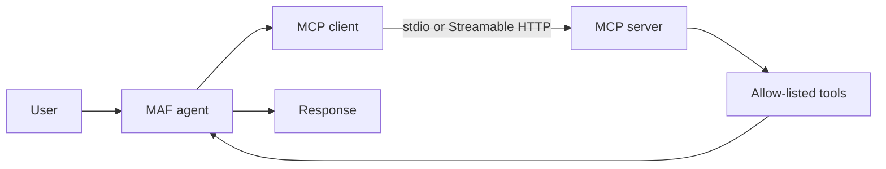

# Chapter 10 — Model Context Protocol (MCP)

> Book: *Agentic Design Patterns* (Antonio Gulli), Chapter 10. Implemented with Microsoft Agent Framework (C#) and Microsoft Foundry.

## The Pattern in One Paragraph

MCP standardizes how an agent discovers and invokes tools exposed by external servers. It is an interoperability boundary, not an orchestration architecture: the agent still needs a model, a deterministic tool allowlist, identity, authorization, and a policy for treating external results as untrusted.



## Where to Look in Code

| What | Where |
|---|---|
| Tool discovery + allowlist → `ChatClientAgent` | `McpAgent.RunAsync` |
| Streamable HTTP transport | `McpAgent.ConnectToHttpServerAsync`, used by `RunHttpGreetingDemoAsync` in `Program.cs` |
| stdio transport (child filesystem server) | `RunFilesystemDemoAsync` in `Program.cs` |
| MCP server exposing `greet` | `../Chapter10.MCP.Server/Program.cs` — `GreetingTools.Greet` |
| Foundry-native MCP tool | `FoundryNativeDemo.RunAsync` — `ResponseTool.CreateMcpTool` |

## What This Demo Shows

| Variant | Source notebook | Building blocks | What to observe |
|---|---|---|---|
| Filesystem assistant (`files`) | `Chapter_10_MCP_(Filesystem_Example_agent)` | `StdioClientTransport`, `ChatClientAgent` | Only list/read/write tools from a filesystem server confined to a demo directory. |
| Greeting assistant (`greet`) | `(FastMCP_Client_Agent_init)`, `(ADK_FastMCP_Server)` | `HttpClientTransport` (Streamable HTTP) | Connects to the separately running server and passes only `greet`. |
| MCP server | `(FastMCP_Server_Example)` | `ModelContextProtocol.AspNetCore` | Stateless `greet` tool at `/mcp`. |
| Foundry-native MCP (`foundry-native`) | greeting scenario | Foundry Agent Service MCP tool | Foundry calls the remote server itself; a uniquely named temporary agent is created and deleted. |
| Hosted companion | greeting scenario | Responses protocol | [Hosted guide](../Chapter10.MCP.Hosted/README.md) — remote HTTP MCP only; stdio stays console-only. |

## Notebook → C# Mapping

| Python (ADK / FastMCP) | C# (MAF / MCP SDK) |
|---|---|
| `MCPToolset` + `StdioServerParameters` (filesystem) | `McpClient.CreateAsync(new StdioClientTransport(...))` + allowlist |
| `MCPToolset` + `HttpServerParameters`, filter `greet` | `McpAgent.ConnectToHttpServerAsync` + `["greet"]` allowlist |
| `FastMCP` `@mcp.tool greet` | `GreetingTools.Greet` registered with `WithTools<GreetingTools>()` |
| Google Sheets snippets | Not ported — configuration fragments only. |

## Setup and Run

1. .NET 10 SDK; Node.js/`npx` for the filesystem example. Configure shared user-secrets — see [dotnet/README.md](../../README.md).
2. Start the MCP server, then run the agent in another terminal:
   ```powershell
   dotnet run --project .\dotnet\src\Chapter10.MCP.Server -- --urls http://localhost:8000
   dotnet run --project .\dotnet\src\Chapter10.MCP -- greet     # or: files | all (default)
   dotnet run --project .\dotnet\src\Chapter10.MCP -- all --deployment fast
   ```
   `CHAPTER10_MCP_SERVER_URL` overrides `http://localhost:8000/mcp`.
3. Foundry-native: `az login`, set `Foundry:McpServerUrl` (or `CHAPTER10_MCP_SERVER_URL`) to an endpoint **reachable by Foundry**, then:
   ```powershell
   dotnet run --project .\dotnet\src\Chapter10.MCP -- foundry-native [--deployment <name>]
   ```

## When to Use

- Integrate independently maintained tools behind a common protocol.
- Reuse one tool server across agent frameworks or clients.
- Discover tools at runtime while keeping execution outside the model.

## When NOT to Use

- A single in-process function is enough.
- The server cannot be trusted, authenticated, scoped, or monitored.
- Tools would expose broad filesystem/database/write access without authorization or approval.

## Real-World Scenarios

1. **Developer documentation** — a read-only docs MCP server with cited answers.
2. **Repository operations** — a narrow allowlist of issue or code-search tools.
3. **Back-office automation** — CRM operations behind a server enforcing per-user authorization and write approval.
4. **Local project assistance** — a filesystem server scoped to a user-selected directory.

## Extending with Microsoft Foundry

- Foundry Agent Service invokes remote MCP servers natively; the sample allow-lists `greet` with no approval because it is harmless — require approval for sensitive or mutating tools.
- Foundry Toolboxes centralize MCP endpoint credentials, policy, and versioning.
- Trace and evaluate tool selection, argument accuracy, and server latency.

## Risks & Tradeoffs

- MCP standardizes transport, not trust: tool metadata and results can carry injected instructions.
- Remote calls add latency, availability dependencies, and data exposure to the server operator.
- Servers can change behavior silently — pin versions and audit effective tools.
- A model-selected tool name or argument is not authorization; enforce it at the server.
