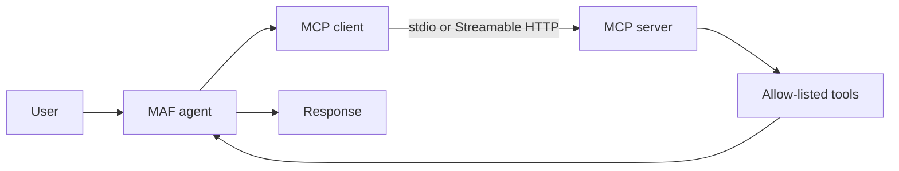

# Chapter 10 - Model Context Protocol (MCP)

> Book: *Agentic Design Patterns* (Antonio Gulli), Chapter 10. Implemented with Microsoft Agent Framework (C#) and Microsoft Foundry.

## The Pattern in One Paragraph

The Model Context Protocol standardizes how an agent discovers and invokes tools and contextual capabilities exposed by external servers. It is an interoperability boundary, not an orchestration architecture: the agent still needs a model, deterministic tool scoping, identity, authorization, and policies for interpreting external results.



## What This Demo Shows

| Variant | Source notebook | MAF / Foundry building blocks | What to observe |
|---|---|---|---|
| Filesystem assistant (MAF) | `Chapter_10_MCP_(Filesystem_Example_agent).ipynb` | `McpClient`, `StdioClientTransport`, `ChatClientAgent`, MCP tools | Discovers only list/read/write tools from a child filesystem server restricted to a dedicated demo directory. |
| Greeting assistant (MAF) | `Chapter_10_MCP_(FastMCP_Client_Agent_init).ipynb` and `Chapter_10_MCP_(ADK_FastMCP_Server).ipynb` | `HttpClientTransport` (Streamable HTTP), `ChatClientAgent`, C# MCP server | Connects to a separately running MCP server and passes its `greet` tool to the agent. |
| MCP server | `Chapter_10_MCP_(FastMCP_Server_Example).ipynb` | `ModelContextProtocol.AspNetCore`, Streamable HTTP | Exposes a stateless `greet` tool at `/mcp`. Start it before the greeting-agent variant. |
| Foundry-native MCP (optional) | Same greeting scenario | Foundry Agent Service MCP tool, allow-listed `greet` tool | Foundry invokes the remote MCP server directly; this is distinct from MAF's local MCP client. The sample creates and removes a uniquely named temporary agent. |
| Hosted companion | Same request/response behavior | Existing MAF agent + Foundry Responses protocol | See the [hosted guide](../Chapter10.MCP.Hosted/README.md). A remote Streamable HTTP server must be configured; local stdio/filesystem tools remain a console-only demo. |

## Setup

1. Install the .NET 10 SDK. For the filesystem example, install Node.js and `npx`; the official `@modelcontextprotocol/server-filesystem` package is fetched by `npx` on first use.
2. Configure shared Foundry user-secrets for the MAF demos — see [dotnet/README.md](../../README.md).
3. Start the sample MCP greeting server in one terminal:
   ```powershell
   dotnet run --project .\dotnet\src\Chapter10.MCP.Server -- --urls http://localhost:8000
   ```
4. In another terminal, run the greeting agent or filesystem agent:
   ```powershell
   dotnet run --project .\dotnet\src\Chapter10.MCP -- greet
   dotnet run --project .\dotnet\src\Chapter10.MCP -- files
   ```
   Run both MAF variants with `all`, or choose a named Foundry deployment with `--deployment <name>`.
5. For the Foundry-native MCP variant, configure an HTTP(S) MCP endpoint reachable by Foundry in shared user-secrets or `CHAPTER10_MCP_SERVER_URL`, then run:
   ```powershell
dotnet run --project .\dotnet\src\Chapter10.MCP -- foundry-native [--deployment <name>]
   ```
The optional deployment name resolves through `Foundry:ModelDeployments`, like the MAF demos; an unknown alias is rejected before connecting to Foundry. The native demo uses Entra ID through `DefaultAzureCredential`, so sign in locally and ensure the identity can create/invoke/delete agents in the project. The MCP endpoint must be reachable by Foundry, not just by the local process.
6. For cloud-agent validation, `.github/workflows/live-foundry-tests.yml` uses the protected `foundry-integration` environment and `Foundry__*` environment secrets. Add Chapter 10 coverage to `dotnet/tests/Foundry.SmokeTests` and the workflow after this change is merged to the default branch.

## Notebook → C# Mapping

| Python (ADK / FastMCP) | C# (MAF / MCP SDK) |
|---|---|
| `MCPToolset` with `StdioServerParameters` and filesystem server | `McpClient.CreateAsync(new StdioClientTransport(...))`, restricted to the demo directory and list/read/write tools |
| `MCPToolset` with `HttpServerParameters`, filtered to `greet` | `McpClient.CreateAsync(new HttpClientTransport(...))`; `McpAgent` passes only the `greet` tool to `ChatClientAgent` |
| `FastMCP` decorated `greet` function | `GreetingTools.Greet`, registered with `WithTools<GreetingTools>()` in the C# server project |
| Notebook `__init__.py` files | Package entry-point boilerplate; no separate C# equivalent |
| Incomplete Google Sheets stdio connection snippets | Not ported: the notebook contains configuration fragments only and does not include a complete Google Sheets agent or workflow. |

## When to Use

- Integrate independently maintained tools or context providers behind a common protocol.
- Reuse the same tool server from different agent frameworks or clients.
- Discover tool definitions at runtime while keeping tool execution outside the model.

## When NOT to Use

- A single in-process function is enough and another protocol boundary adds needless operational complexity.
- The tool server cannot be trusted, authenticated, scoped, or monitored appropriately.
- An MCP tool would expose broad filesystem, database, or write access without deterministic authorization or approval.

## Real-World Scenarios

1. **Developer documentation** — connect an agent to a read-only documentation MCP server and cite retrieved material.
2. **Repository operations** — provide a narrow allowlist of issue or code-search tools to an engineering assistant.
3. **Back-office automation** — expose selected CRM operations through a server that enforces per-user authorization and approval for writes.
4. **Local project assistance** — run a filesystem MCP server scoped to a user-selected working directory for list/read/write tasks.

## Extending with Microsoft Foundry

- Foundry Agent Service can invoke remote MCP servers as a native hosted tool. The sample allow-lists only `greet`; it permits automatic execution because this tool only returns a greeting. Use explicit approval for remote tools that read sensitive data or modify systems.
- Foundry Toolboxes can centralize MCP endpoint credentials, policy, and versioning for reuse across agents.
- Enable tracing and evaluation for tool selection, argument accuracy, server latency, and external-result grounding.

## Hosted Deployment Companion

- Suitability: stateless request/response is suitable for the remote HTTP MCP greeting workflow. The console filesystem demo uses a local stdio subprocess and local files, so it is intentionally not exposed by the hosted service.
- Project and deployment guide: [Chapter 10 hosted agent](../Chapter10.MCP.Hosted/README.md).
- Authentication: console MAF calls use the shared API-key configuration; hosted model inference uses local developer credentials or Azure managed identity. Configure MCP authentication at the trusted server boundary. Before remote invocation, verify runtime inference access for the deployed `instance_identity.principal_id` at the model-hosting Foundry account scope; follow the [shared hosted-agent guide](../../README.md#authentication-and-runtime-permissions).
- Packaging: azd bundled .NET deployment includes the chapter and shared project references. `.agentignore` excludes local build outputs, environment files, and `.azure` state.
- Request contract: one caller message is sent to the configured Streamable HTTP MCP server for each request; no conversation or MCP session state is persisted by this host. See the hosted guide for endpoint configuration and deployment commands.
- Deployment: use your own Foundry project, model, and reachable MCP endpoint; grant the hosted identity the documented model-inference role and allow RBAC propagation. Code deployment and model calls incur Azure charges.

## Risks & Limitations

- MCP standardizes transport and schemas, not trust. Tool metadata and results can contain malicious instructions; treat them as untrusted input and scope each agent's tool allowlist.
- Remote calls add latency, network and server availability dependencies, and potential data exposure to the server operator.
- Tool servers may change behavior without changing the consuming agent. Pin or review server versions and audit effective tools and credentials.
- Approval and authorization requirements should be enforced at the server boundary for consequential operations; a model-selected tool name or argument is not authorization.
