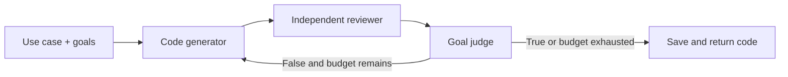

# Chapter 11 — Goal Setting and Monitoring

> Book: *Agentic Design Patterns* (Antonio Gulli), Chapter 11. Implemented with Microsoft Agent Framework (C#) on Microsoft Foundry.

## The Pattern in One Paragraph

Agents work more reliably when the request states how success will be judged and the system monitors progress against those goals. This demo generates Python code, obtains a separate critique against the requested goals, and asks a dedicated judge whether every goal has been met. A deterministic five-iteration budget controls the loop; the generated program is saved as an artifact and is never executed by the demo.



## What This Demo Shows

| Variant | Source notebook | MAF / Foundry building blocks | What to observe |
|---|---|---|---|
| Goal-guided code generation (MAF) | `Chapter_11_Goal_Setting_(Iteration).ipynb` | Three `ChatClientAgent` responsibilities, a typed progress state, `WorkflowBuilder` conditional loop, deterministic iteration budget, Foundry model deployment | The previous code and feedback inform each revision; only the exact `True` judgment stops early. |
| Foundry-native | Same | Not applicable: Foundry offers model hosting and tracing, but no distinct goal-loop primitive that replaces the application-controlled feedback and stopping logic. | Foundry tracing can observe the calls; the bounded loop remains deterministic application logic. |
| Hosted companion | Same | Existing MAF workflow hosted over the Foundry Responses protocol | One caller request is processed independently; see the [hosted guide](../Chapter11.GoalSettingMonitoring.Hosted/README.md). |

## Setup

1. Prerequisites: .NET 10 SDK and a Microsoft Foundry project with a chat model deployment and API key.
2. Configure shared user-secrets once as described in [dotnet/README.md](../../README.md).
3. For cloud-agent validation, the manual workflow uses the protected `foundry-integration` environment and `Foundry__*` variables from GitHub environment secrets.
4. Run the demo:
   ```powershell
   dotnet run --project dotnet/src/Chapter11.GoalSettingMonitoring
   ```
   Use `--use-case "..."`, `--goals "goal one;goal two"`, `--iterations 1` through `5`, and `--deployment <alias>` to customize the request. The generated `.py` file is written to a unique name under `generated-code/` in the current directory. The generated code is not executed.
5. Run deterministic tests with `dotnet test dotnet/tests/GoalSettingMonitoring.Tests/GoalSettingMonitoring.Tests.csproj`. Live Foundry validation is available through **Actions** → **Live Foundry smoke tests** after this workflow is active on the default branch.

## Notebook → C# Mapping

| Python / LangChain | C# / MAF |
|---|---|
| `run_code_agent` with the binary-gap use case and comma-separated goals | `GoalSettingRequest.BinaryGapSample`; the CLI accepts a caller-defined use case and semicolon-separated goals |
| `generate_prompt` and the generation call | `CodeGenerator` agent; on later rounds it receives the previous code and critique |
| `get_code_feedback` | Independent `GoalReviewer` agent critiques the code against all supplied goals |
| `goals_met` asking for only `True` or `False` | `GoalJudge` agent; the workflow accepts only an exact case-insensitive `True` or `False` response |
| `max_iterations=5`, then stop on success or budget exhaustion | Validated `MaxIterations` from 1 to 5 and conditional loop edges in the MAF `WorkflowBuilder` |
| `add_comment_header` and `save_code_to_file` | `GoalSettingDemo` adds a safe comment header and writes the generated program beneath `generated-code/` using a sanitized unique filename |

## When to Use

- A task has explicit, reviewable completion criteria and can benefit from bounded revisions.
- The system should expose intermediate drafts and reviewer feedback for inspection.
- A generated artifact can be returned as a proposal for downstream tests or human review.

## When NOT to Use

- Success criteria cannot be expressed clearly enough for an independent reviewer to apply.
- Correctness must be guaranteed solely by a language model's judgment; use deterministic checks or external tests for hard requirements.
- Each iteration triggers irreversible actions or expensive work without an approval and idempotency design.

## Real-World Scenarios

1. **Developer tooling** — draft a small utility against requirements, then request revisions for missed input and edge cases before a developer runs tests.
2. **Content preparation** — create a customer-facing FAQ draft and revise it until a reviewer confirms the required sections and tone are present.
3. **Data transformation** — produce a script from a schema and business rules, using a bounded review loop before sandboxed execution.
4. **Operational runbooks** — draft a runbook with required escalation, rollback, and ownership sections, then stop when the checklist is satisfied or the review budget is spent.

## Extending with Microsoft Foundry

- Route `ActivitySource` traces to your OpenTelemetry / Application Insights pipeline to inspect iteration counts and goal decisions.
- Capture prompts and responses only when telemetry access, retention, and data classification permit it; sensitive telemetry is enabled in this demo for debugging.
- Add deterministic tests, linters, or domain validators as independent gates; a model judge should not replace executable correctness checks.
- Evaluate the loop against a representative dataset before changing models or prompts.

## Hosted Deployment Companion

- Suitability: the workflow is a bounded request/response operation, has no interactive approval, and requires no durable state between requests.
- Project and deployment guide: [Chapter 11 hosted companion](../Chapter11.GoalSettingMonitoring.Hosted/README.md); the console demo remains available.
- Authentication: local execution uses developer identity or local API-key configuration; Azure execution uses managed identity. Deployment permissions and runtime inference permissions are separate.
- Packaging: azd uses bundled .NET 10 deployment, publishing the host and referenced chapter and shared projects. Secrets, `.azure`, environment files, and build artifacts are excluded.
- Request contract: the hosted agent accepts a plain use case with sample goals, or JSON with `useCase`, `goals`, and optional `maxIterations`; every request uses isolated, fresh state and returns the final code and goal status.
- Deployment: use the hosted guide with your own Foundry project and deployment. Verify or assign **Cognitive Services OpenAI User** to the deployed `instance_identity.principal_id` at the model-hosting Foundry account scope, allow RBAC propagation, and recheck after redeployment. Deployment incurs hosting and model-inference costs.

## Risks & Limitations

- An LLM reviewer or judge can miss defects or incorrectly report that goals are met; generated code still needs tests and human review.
- Clear prose goals may be subjective, and broad goals such as “functionally correct” are not substitutes for executable checks.
- Each round uses three model calls, so latency and cost grow with the iteration budget and the size of the generated code.
- The code artifact is not sandboxed or executed; running it is a separate, explicit step with its own security controls.
