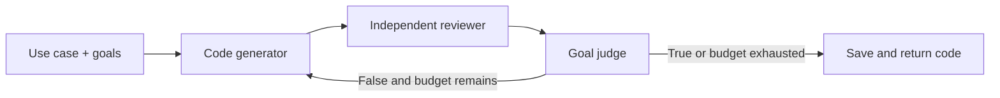

# Chapter 11 — Goal Setting and Monitoring

> Book: *Agentic Design Patterns* (Antonio Gulli), Chapter 11. Implemented with Microsoft Agent Framework (C#) on Microsoft Foundry.

## The Pattern in One Paragraph

Agents work more reliably when the request states how success will be judged and the system monitors progress against those goals. This demo generates Python code, obtains a separate critique against the goals, and asks a dedicated judge whether every goal is met. A deterministic iteration budget (1–5) bounds the loop; the program is saved as an artifact and never executed.



## Where to Look in Code

| What | Where |
|---|---|
| Loop wiring (conditional back-edge) | `GoalSettingWorkflow.RunAsync` — `WorkflowBuilder` edges from `assessment` |
| Revision input (previous code + feedback) | `GenerationExecutor.HandleAsync` |
| Strict `True`/`False` verdict and stop decision | `AssessmentExecutor.HandleAsync` |
| Goal/budget validation | `GoalSettingRequest.Validate` |
| Safe artifact header and unique filename | `GoalSettingDemo.RunAsync` |

## What This Demo Shows

| Variant | Source notebook | Building blocks | What to observe |
|---|---|---|---|
| Goal-guided code generation | `Chapter_11_Goal_Setting_(Iteration).ipynb` | Three `ChatClientAgent`s, typed progress state, `WorkflowBuilder` conditional loop | Each revision sees the previous code and critique; only an exact `True` stops early. |
| Foundry-native | — | Not applicable: Foundry has no goal-loop primitive replacing application-controlled stopping logic. | Foundry tracing observes the calls. |
| Hosted companion | Same | Responses protocol | [Hosted guide](../Chapter11.GoalSettingMonitoring.Hosted/README.md) |

## Notebook → C# Mapping

| Python / LangChain | C# / MAF |
|---|---|
| `run_code_agent` with binary-gap use case and goals | `GoalSettingRequest.BinaryGapSample`; CLI accepts a custom use case and `;`-separated goals |
| `generate_prompt` + generation call | `CodeGenerator` agent |
| `get_code_feedback` | `GoalReviewer` agent |
| `goals_met` (`True`/`False`) | `GoalJudge` agent; any other answer fails explicitly |
| `max_iterations=5` | Validated `MaxIterations` (1–5) and conditional edges |
| `add_comment_header`, `save_code_to_file` | `GoalSettingDemo` writes under `generated-code/` with a sanitized unique filename |

## Setup and Run

Configure shared user-secrets as described in [dotnet/README.md](../../README.md), then:

```powershell
dotnet run --project dotnet/src/Chapter11.GoalSettingMonitoring
dotnet run --project dotnet/src/Chapter11.GoalSettingMonitoring -- --use-case "Parse a CSV and count rows" --goals "Use the standard library;Handle an empty file" --iterations 3 --output-dir .\out --deployment <alias>
dotnet test dotnet/tests/GoalSettingMonitoring.Tests
```

## When to Use

- A task has explicit, reviewable completion criteria and benefits from bounded revisions.
- Intermediate drafts and reviewer feedback should be inspectable.
- A generated artifact is a proposal for downstream tests or human review.

## When NOT to Use

- Success criteria cannot be expressed clearly enough for an independent reviewer.
- Correctness must be guaranteed — use deterministic checks or tests for hard requirements.
- Each iteration triggers irreversible or expensive actions without approval and idempotency.

## Real-World Scenarios

1. **Developer tooling** — draft a utility, revising for missed edge cases before a developer runs tests.
2. **Content preparation** — revise an FAQ until required sections and tone are present.
3. **Data transformation** — produce a script from a schema with a bounded review before sandboxed execution.
4. **Operational runbooks** — stop when the escalation/rollback checklist is satisfied or the budget is spent.

## Extending with Microsoft Foundry

- Agent spans are emitted under `Chapter11.GoalSettingMonitoring` with sensitive data enabled for debugging; restrict telemetry access accordingly.
- Add deterministic tests, linters, or validators as independent gates; a model judge should not replace them.
- Evaluate the loop on a representative dataset before changing models or prompts.

## Risks & Tradeoffs

- An LLM reviewer or judge can miss defects or wrongly report success.
- Prose goals such as "functionally correct" are not substitutes for executable checks.
- Each round costs three model calls; latency and cost grow with the budget.
- The artifact is not sandboxed or executed; running it is a separate, explicit step.
