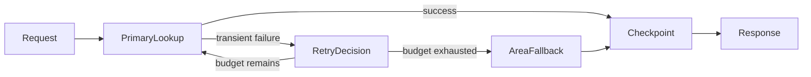

# Chapter 12 — Exception Handling and Recovery

> Book: *Agentic Design Patterns* (Antonio Gulli), Chapter 12. Implemented with Microsoft Agent Framework (C#) on Microsoft Foundry.

## The Pattern in One Paragraph

Agent workflows can fail because a provider is unavailable, a response is invalid, or an operation times out. Exception handling isolates retryable work, bounds retries, preserves request state at checkpoints, and selects a fallback or explicit failure path instead of restarting the entire agent. This demo applies that approach to a precise location lookup with a deterministic general-area fallback.



## What This Demo Shows

| Variant | Source notebook | MAF / Foundry building blocks | What to observe |
|---|---|---|---|
| Location lookup recovery (MAF) | `Chapter_12_Exception_Handling_(Fallback).ipynb` | `WorkflowBuilder`, typed workflow state, conditional edges, bounded activity retry, in-memory checkpoints, and three `ChatClientAgent` responsibilities | Primary success, retry of a transient failure, and precise-lookup fallback to general-area information |
| Foundry-native | Same | Not applicable: Foundry does not provide a distinct native location-recovery workflow primitive; hosting the MAF workflow is not a reimplementation. | The deterministic MAF workflow remains the recovery controller. |
| Hosted companion | Same | Foundry Agent Service Responses protocol hosting the same workflow | [Hosted deployment guide](../Chapter12.ExceptionHandling.Hosted/README.md) |

The address index and area records are deterministic sample data, not a live geocoding service. Prefix a sample address with `transient:` to simulate one transient provider failure or with `primary-unavailable:` to simulate an unavailable primary provider and exercise fallback.

## Setup

1. Prerequisites: .NET 10 SDK, a Foundry project with a model deployment and its API key.
2. Configure shared user-secrets once for local runs; see [dotnet/README.md](../../README.md#configure-foundry-user-secrets).
3. Cloud-agent validation uses `.github/workflows/live-foundry-tests.yml`, the protected `foundry-integration` environment, and `Foundry__*` variables sourced from GitHub environment secrets.
4. Run all sample scenarios:
   ```powershell
   dotnet run --project dotnet/src/Chapter12.ExceptionHandling
   ```
5. Run one scenario or select a configured model deployment:
   ```powershell
   dotnet run --project dotnet/src/Chapter12.ExceptionHandling -- fallback
   dotnet run --project dotnet/src/Chapter12.ExceptionHandling -- retry --deployment fast
   ```
6. Validate through GitHub Actions after the workflow containing this chapter is available on the default branch:
   - Open **Actions** → **Live Foundry smoke tests**.
   - Run the workflow manually and optionally choose a deployment alias such as `fast` or `quality`.

## Notebook → C# Mapping

| Python (Google ADK) | C# (MAF) |
|---|---|
| `primary_handler` attempts a precise lookup | `PrimaryLookupExecutor` performs the primary activity and calls the primary handler agent on success |
| State flag `primary_location_failed` controls the next sequential agent | Typed `ExceptionHandlingState` and conditional `WorkflowBuilder` edges control retry and fallback |
| `fallback_handler` uses the city when precise lookup failed | `FallbackLookupExecutor` deterministically extracts the city and invokes the fallback handler only after retry exhaustion |
| `response_agent` presents `location_result` | `ResponseExecutor` invokes the response handler using the saved primary or fallback result |
| Tool-backed precise/general location providers | Small deterministic sample lookup tables simulate provider success, transient failure, permanent unavailability, and area fallback |

## When to Use

- An operation is safe to retry and failures can be classified as transient or terminal.
- A fallback can return a useful, clearly qualified result when the primary operation is unavailable.
- A workflow has intermediate state worth preserving so recovery can resume from the failed activity.
- The retry budget and terminal behavior can be defined before the workflow runs.

## When NOT to Use

- Retrying can duplicate irreversible side effects and no idempotency key or deduplication boundary exists.
- A fallback would misrepresent lower-confidence data as equivalent to the primary result.
- A durable, long-running workflow needs restart recovery but has no persistent checkpoint store.
- Failure requires human judgment or approval; use an explicit human escalation path instead.

## Real-World Scenarios

1. **Travel search** — Retry a transient provider timeout, then use a city-level destination summary if exact hotel data remains unavailable.
2. **Customer support** — Retry an idempotent account-status read, then show a cached status with its timestamp and escalate stale results.
3. **Document processing** — Retry a transient OCR request, then route low-confidence extraction to a manual review queue rather than inventing missing fields.
4. **Inventory lookup** — Retry a read against the primary store, then return a clearly marked replica result with its freshness information.

## Extending with Microsoft Foundry

- Use Foundry model deployments for the handler agents while keeping retry limits, routing, and acceptance deterministic in MAF.
- Export workflow and agent spans to Application Insights to observe retry counts, failure causes, fallback frequency, and latency.
- Add explicit provider timeouts, circuit breakers, idempotency keys, and a durable checkpoint store when adapting the workflow to real external operations.
- Keep sensitive-data trace capture disabled or appropriately access-controlled before using real addresses or user data.

## Hosted Deployment Companion

- Suitability: the workflow accepts one request, uses request-local state, and returns one completed response; it does not require interactive input or durable cross-request state.
- Project and deployment guide: [Chapter 12 hosted companion](../Chapter12.ExceptionHandling.Hosted/README.md).
- Authentication: local developer credentials or user-secrets; hosted Azure execution uses managed identity. Before remote inference, verify or assign **Cognitive Services OpenAI User** to the deployed `instance_identity.principal_id` at the model-hosting Foundry account scope, allow RBAC propagation, and recheck after redeployment.
- Packaging: azd bundled deployment publishes the hosted project with its Chapter 12 and Shared project references; keep `.azure`, environment files, user-secrets, and build artifacts out of the upload.
- Request contract: submit a location address; the response is buffered until the workflow finishes. Each request starts with fresh state and no conversation history.
- Deployment: follow the hosted guide for permissions, deployment and invocation commands, costs, and safe cleanup of only reader-owned agents.

## Risks & Limitations

- A bounded retry still adds latency and cost, and should target only operations safe to repeat.
- The fallback is less precise than the primary result; callers must be told which path produced the answer.
- In-memory checkpoints aid within-request recovery and inspection but do not resume work after a host restart.
- The sample lookup table is illustrative; a real provider needs explicit timeout, error classification, freshness, privacy, and rate-limit policies.
