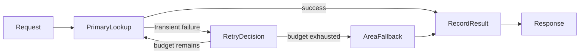

# Chapter 12 — Exception Handling and Recovery

> Book: *Agentic Design Patterns* (Antonio Gulli), Chapter 12. Implemented with Microsoft Agent Framework (C#) on Microsoft Foundry.

## The Pattern in One Paragraph

Agent workflows fail when a provider is unavailable, a response is invalid, or an operation times out. Exception handling isolates retryable work, bounds retries, keeps request state, and selects a clearly labelled fallback or an explicit failure instead of restarting the whole agent. This demo applies that to a precise location lookup with a general-area fallback.



`RetryDecision` is the set of conditional edges leaving `PrimaryLookup`; `Response` is a deterministic step that states which path produced the answer.

## Where to Look in Code

| What | Where |
|---|---|
| Retry/fallback routing (conditional edges) | `ExceptionHandlingWorkflow.RunAsync` and `ExceptionHandlingState.ShouldRetry` / `ShouldFallback` |
| Recoverable vs. propagated failures | `PrimaryLookupExecutor.HandleAsync` — only `LocationLookupUnavailableException` is caught |
| Fallback with failure context | `FallbackLookupExecutor.HandleAsync` |
| Labelled final answer | `ResponseExecutor.HandleAsync` |
| Simulated provider (`transient:` / `primary-unavailable:`) | `LocationLookupService.GetPreciseLocation` |

## What This Demo Shows

| Variant | Source notebook | Building blocks | What to observe |
|---|---|---|---|
| Location lookup recovery | `Chapter_12_Exception_Handling_(Fallback).ipynb` | `WorkflowBuilder`, typed state, conditional edges, bounded retry, two `ChatClientAgent` handlers | `primary` success, `retry` of a transient failure, `fallback` to general-area information. |
| Foundry-native | — | Not applicable: Foundry has no native recovery-workflow primitive. | MAF remains the recovery controller. |
| Hosted companion | Same | Responses protocol | [Hosted guide](../Chapter12.ExceptionHandling.Hosted/README.md) |

The address index and area records are deterministic sample data, not a live geocoding service.

## Notebook → C# Mapping

| Python (Google ADK) | C# (MAF) |
|---|---|
| `primary_handler` precise lookup | `PrimaryLookupExecutor` + `PrimaryLocationHandler` agent |
| `primary_location_failed` state flag | Typed `ExceptionHandlingState` + conditional edges |
| `fallback_handler` uses the city | `FallbackLookupExecutor` + `FallbackAreaHandler` agent, only after retry exhaustion |
| `response_agent` presents `location_result` | Deterministic `ResponseExecutor` — no third model call needed to restate a handler result |
| Tool-backed location providers | `LocationLookupService` sample tables |

## Setup and Run

Configure shared user-secrets ([dotnet/README.md](../../README.md#configure-foundry-user-secrets)), then:

```powershell
dotnet run --project dotnet/src/Chapter12.ExceptionHandling                 # all scenarios
dotnet run --project dotnet/src/Chapter12.ExceptionHandling -- fallback     # primary | retry | fallback
dotnet run --project dotnet/src/Chapter12.ExceptionHandling -- retry --deployment fast
dotnet test dotnet/tests/ExceptionHandling.Tests
```

## When to Use

- An operation is safe to retry and failures can be classified as transient or terminal.
- A fallback can return a useful, clearly qualified result.
- Retry budget and terminal behavior can be defined up front.

## When NOT to Use

- Retrying could duplicate irreversible side effects without idempotency.
- The fallback would misrepresent lower-confidence data as equivalent.
- Long-running work needs restart recovery but has no durable checkpoint store.
- Failure requires human judgment — escalate instead.

## Real-World Scenarios

1. **Travel search** — retry a provider timeout, then use a city-level summary.
2. **Customer support** — retry an account-status read, then show a timestamped cached status.
3. **Document processing** — retry OCR, then route low-confidence extraction to manual review.
4. **Inventory lookup** — retry the primary store, then return a clearly marked replica result.

## Extending with Microsoft Foundry

- Keep retry limits and routing deterministic in MAF; use Foundry deployments for the handler agents.
- Export agent spans to Application Insights to observe retries, fallback frequency, and latency.
- Add timeouts, circuit breakers, idempotency keys, and a durable checkpoint store for real providers.

## Risks & Tradeoffs

- Retries add latency and cost; target only operations safe to repeat.
- The fallback is less precise; the response states which path produced it.
- State is request-local; it does not survive a host restart.
- Sensitive trace capture is enabled for debugging — disable it before using real addresses.
