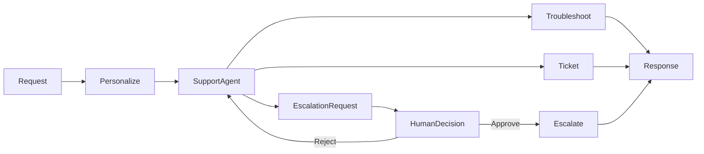

# Chapter 13 - Human-in-the-Loop

> Book: *Agentic Design Patterns* (Antonio Gulli), Chapter 13. Implemented with Microsoft Agent Framework (C#) and a Microsoft Foundry model deployment.

## The Pattern in One Paragraph

Human-in-the-loop workflows pause an agent before consequential actions so a person can review and approve or reject the proposed action. This customer-support example uses ordinary tools for troubleshooting and ticket creation, but requires explicit approval before the escalation tool runs. The model decides when a complex issue needs escalation; the deterministic approval gate decides whether that action executes.



## What This Demo Shows

| Variant | Source notebook | MAF / Foundry building blocks | What to observe |
|---|---|---|---|
| Customer support (MAF) | `Chapter_13_Human_in_the_Loop_(Customer_Support).ipynb` | `ChatClientAgent`, `AIFunctionFactory`, `ApprovalRequiredAIFunction`, `AgentSession` | Troubleshooting and ticket tools run through the agent; escalation pauses for an explicit y/n decision. |
| Foundry-native | Same | Not applicable: Foundry has no separate native primitive that replaces MAF's function-approval gate for this scenario. | The hosted deployment companion exposes the MAF behavior through Foundry's Invocations protocol; it is hosting, not a separate native implementation. |
| Hosted companion | Same | MAF approval-required tool, serialized `AgentSession`, Azure AI Agent Server Invocations protocol | The caller reviews the proposed tool call, then resumes the same session with an approve/reject decision. See [hosted deployment guide](../Chapter13.HumanInTheLoop.Hosted/README.md). |

## Setup

1. Prerequisites: .NET 10 SDK, a Microsoft Foundry project, a deployed chat model, and its API key.
2. Configure shared local user-secrets once; see [dotnet/README.md](../../README.md).
3. For cloud-agent validation without local credentials, use the protected `foundry-integration` GitHub Environment and the `Foundry__*` environment variables described in the shared guide. The live workflow uses the default branch, so merge its Chapter 13 smoke-test coverage before running it.
4. Run the support scenario, or supply a different request:

   ```powershell
   dotnet run --project dotnet/src/Chapter13.HumanInTheLoop
   dotnet run --project dotnet/src/Chapter13.HumanInTheLoop -- "My device still fails after troubleshooting."
   dotnet run --project dotnet/src/Chapter13.HumanInTheLoop -- "Please escalate this issue." --deployment fast
   ```

5. At each approval prompt, enter `y` to execute that tool; any other input rejects it. If the model requests multiple approvals, the console collects each decision before resuming the agent.

## Notebook -> C# Mapping

| Python (Google ADK) | C# (MAF) |
|---|---|
| `technical_support_agent` with troubleshooting, ticket, and escalation tools | `CustomerSupportAgent` built from a `ChatClientAgent` and `AIFunctionFactory` tools |
| `troubleshoot_issue` | `CustomerSupportTools.TroubleshootIssue` |
| `create_ticket` | `CustomerSupportTools.CreateTicket` |
| `escalate_to_human` | `CustomerSupportTools.EscalateToHuman`, wrapped with `ApprovalRequiredAIFunction` |
| `state["customer_info"]` personalization callback | A per-request `SupportCustomer` profile included as trusted-as-data context and explicitly treated as untrusted text by the agent |

## When to Use

- A tool call creates an external side effect that needs a human to review it first.
- The decision depends on policy, risk, or context that cannot be safely automated.
- The agent can prepare a clear action proposal and resume after a person decides.

## When NOT to Use

- The action is low-risk, reversible, and already governed by deterministic authorization checks.
- Approval would add latency without changing the decision or the safety of execution.
- A human cannot review the action's arguments and context before execution.

## Real-World Scenarios

1. **Customer support** — troubleshoot automatically, then request approval before transferring a complex case to a specialist.
2. **Refund handling** — assemble an evidence-backed refund proposal, then require an authorized employee to approve payment.
3. **IT operations** — diagnose an incident and draft a remediation command, but require an operator's approval before applying it.
4. **Healthcare administration** — prepare a non-clinical scheduling or records action for staff review before submitting it.

## Extending with Microsoft Foundry

- Use Foundry tracing to inspect tool selection and approval outcomes. The hosted demo enables sensitive-data capture for debugging; restrict access and retention and use synthetic customer data.
- Treat the approval-required escalation as a Safe-Action Gateway: keep authorization, policy validation, and auditing deterministic and outside the model.
- Add a governed ticketing or escalation integration only after defining its authorization, audit, and approval policy.
- Use Foundry evaluations to assess issue classification, appropriate escalation, personalization, and refusal to claim unperformed actions.

## Hosted Deployment Companion

- Suitability: The console interaction is interactive, but the same approval-required action can be exposed as a multi-request Invocations session with persisted MAF session state.
- Project and deployment guide: [Chapter 13 hosted companion](../Chapter13.HumanInTheLoop.Hosted/README.md).
- Authentication: local hosted runs use developer credentials; Azure uses the hosted runtime identity. Verify or assign **Cognitive Services OpenAI User** to the deployed `instance_identity.principal_id` at the model-hosting Foundry account scope before invocation.
- Packaging: the bundled .NET deployment publishes the hosted project, Chapter 13 logic, and Shared dependencies; do not include secrets or `.azure` state.
- Request contract: submit a support task and customer profile, then approve or reject the returned tool request in the same invocation session. The companion does not persist unrelated conversations.
- Deployment: use the selected chapter service and reader-owned Foundry project; see the linked companion for commands, permissions, and cost notes.

## Risks & Limitations

- Model-selected tools and issue classifications can be wrong; validate the action arguments and retain deterministic authorization outside the model.
- Human review adds latency and may block completion if the reviewer does not respond.
- The sample tools return simulated troubleshooting, ticket, and escalation outcomes; replace them with production integrations and audit controls before real use.
