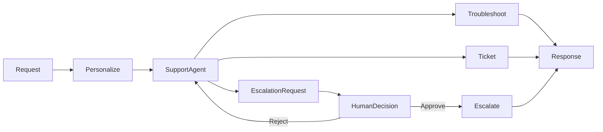

# Chapter 13 — Human-in-the-Loop

> Book: *Agentic Design Patterns* (Antonio Gulli), Chapter 13. Implemented with Microsoft Agent Framework (C#) and a Microsoft Foundry model deployment.

## The Pattern in One Paragraph

Human-in-the-loop workflows pause an agent before consequential actions so a person can approve or reject the proposed action. This customer-support example runs troubleshooting and ticket tools directly but requires explicit approval before the escalation tool runs. The model decides *when* escalation is needed; a deterministic approval gate decides *whether* it executes.



## Where to Look in Code

| What | Where |
|---|---|
| Approval gate on the escalation tool | `CustomerSupportAgent.Create` — `new ApprovalRequiredAIFunction(...)` |
| Profile personalization treated as untrusted data | `CustomerSupportAgent.BuildInstructions`, bounds in `SupportCustomer.Validate` |
| Console approve/reject loop | `Program.cs` — loop over `ToolApprovalRequestContent` and `CreateResponse(approved)` |
| Durable hosted approval, isolation, replay protection | `../Chapter13.HumanInTheLoop.Hosted/CustomerSupportInvocationHandler.cs` and `SupportSessionStore.cs` |

## What This Demo Shows

| Variant | Source notebook | Building blocks | What to observe |
|---|---|---|---|
| Customer support | `Chapter_13_Human_in_the_Loop_(Customer_Support).ipynb` | `ChatClientAgent`, `AIFunctionFactory`, `ApprovalRequiredAIFunction`, `AgentSession` | Escalation pauses for a y/N decision per request. |
| Foundry-native | — | Not applicable: Foundry has no separate primitive replacing MAF's function-approval gate here. | The hosted companion is hosting, not a separate implementation. |
| Hosted companion | Same | Invocations protocol + serialized `AgentSession` | Caller reviews the tool call, then resumes the same session. See the [hosted guide](../Chapter13.HumanInTheLoop.Hosted/README.md). |

## Notebook → C# Mapping

| Python (Google ADK) | C# (MAF) |
|---|---|
| `technical_support_agent` with three tools | `CustomerSupportAgent.Create` |
| `troubleshoot_issue`, `create_ticket` | `CustomerSupportTools.TroubleshootIssue`, `CreateTicket` |
| `escalate_to_human` | `CustomerSupportTools.EscalateToHuman` wrapped in `ApprovalRequiredAIFunction` |
| `state["customer_info"]` personalization callback | Per-request `SupportCustomer` profile embedded as untrusted JSON |

## Setup and Run

Configure shared user-secrets ([dotnet/README.md](../../README.md)), then:

```powershell
dotnet run --project dotnet/src/Chapter13.HumanInTheLoop
dotnet run --project dotnet/src/Chapter13.HumanInTheLoop -- "My device still fails after troubleshooting."
dotnet run --project dotnet/src/Chapter13.HumanInTheLoop -- "Please escalate this issue." --deployment fast
dotnet test dotnet/tests/HumanInTheLoop.Tests
```

Enter `y` at each approval prompt to execute that tool; anything else rejects it. Multiple approvals are collected before the agent resumes.

## When to Use

- A tool call creates an external side effect that a human should review first.
- The decision depends on policy, risk, or context that cannot be safely automated.
- The agent can present a clear proposal and resume after the decision.

## When NOT to Use

- The action is low-risk, reversible, and governed by deterministic authorization.
- Approval adds latency without changing the outcome.
- No one can review the action's arguments and context in time.

## Real-World Scenarios

1. **Customer support** — approve transfers of complex cases to a specialist.
2. **Refund handling** — an authorized employee approves an evidence-backed refund.
3. **IT operations** — an operator approves a drafted remediation command.
4. **Healthcare administration** — staff review a non-clinical scheduling action.

## Extending with Microsoft Foundry

- Trace tool selection and approval outcomes; the hosted demo captures sensitive data, so use synthetic customers.
- Keep authorization, policy validation, and auditing deterministic and outside the model (Safe-Action Gateway).
- Evaluate classification, appropriate escalation, and refusal to claim unperformed actions.

## Risks & Tradeoffs

- Model-selected tools can be wrong; validate arguments and keep authorization outside the model.
- Human review adds latency and can block completion.
- Tool outcomes are simulated; replace them with audited production integrations.
