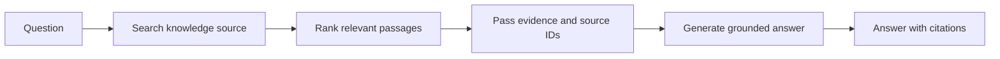

# Chapter 14 — Retrieval-Augmented Generation (RAG)

> Book: *Agentic Design Patterns* (Antonio Gulli), Chapter 14. Implemented with Microsoft Agent Framework (C#) and Microsoft Foundry.

## The Pattern in One Paragraph

Retrieval-augmented generation (RAG) retrieves relevant passages from a knowledge source and gives them to a language model as evidence. It keeps changing or private facts out of model weights and lets the application cite where an answer came from. Retrieval quality, corpus coverage, and source freshness still bound answer quality.



## Where to Look in Code

| What | Where |
|---|---|
| Keyword-overlap retrieval over the sample corpus | `RagKnowledgeBase.Retrieve` / `Search` |
| Retrieval exposed as a tool + grounding/citation instructions | `RagAgent.RunAsync` |
| Foundry-native File Search / Web Search and URL citations | `FoundryNativeDemo.RunAsync`, `FoundryNativeDemo.FormatResponse` |
| CLI parsing (mode, question, `--deployment`) | `RagCommandLineOptions.Parse` |

## What This Demo Shows

| Variant | Source notebook | Building blocks | What to observe |
|---|---|---|---|
| Local sample-corpus RAG (`rag`, default) | `Chapter_14_Knowledge_Retrieval_(RAG_LangChain).ipynb` | `ChatClientAgent`, `AIFunctionFactory.Create`, keyword-overlap ranking | The agent calls the search tool, prints retrieved passages, then answers with `[SOURCE-ID]` citations — or says it does not know when nothing matches. |
| Foundry File Search (`foundry-files`) | `Chapter_14_Knowledge_Retrieval_(RAG_VertexAI).ipynb` | `AIProjectClient.AsAIAgent`, File Search tool | Queries a reader-provided, populated Foundry vector store. |
| Foundry Web Search (`foundry-web`) | `Chapter_14_Knowledge_Retrieval_(RAG_Google_Search).ipynb` | `AIProjectClient.AsAIAgent`, Web Search tool | Searches the live web; source titles/URLs are appended from citation metadata. Needs a Bing grounding connection. |
| Hosted companion | Local RAG | `RagAgent` behind the Responses protocol | Stateless per-request answers over the same corpus. See the [hosted guide](../Chapter14.RAG.Hosted/README.md). |

## Notebook → C# Mapping

| Python notebook element | C# implementation |
|---|---|
| `TextLoader` + `CharacterTextSplitter` + Weaviate retriever | `RagKnowledgeBase`: three short in-code documents (one chunk each) ranked by distinct keyword overlap, top 3. No database or download needed. |
| Retrieval node followed by a grounded generation prompt | `RagAgent`: retrieval as a tool; instructions require searching first and citing source IDs. |
| Vertex AI RAG corpus (`similarity_top_k`, distance threshold) | `foundry-files`: service-managed File Search over a Foundry vector store. |
| ADK Google Search tool | `foundry-web`: Foundry Web Search / Bing grounding. |

## Setup and Run

Configure shared user-secrets ([dotnet/README.md](../../README.md)), then:

```powershell
dotnet run --project dotnet/src/Chapter14.RAG
dotnet run --project dotnet/src/Chapter14.RAG -- rag "What did the address say about the economy?"
dotnet run --project dotnet/src/Chapter14.RAG -- rag "Tell me about astrophysics"   # no relevant passage
dotnet user-secrets set "Foundry:FileSearchVectorStoreId" "<vector-store-id>" --project dotnet/src/Shared
dotnet run --project dotnet/src/Chapter14.RAG -- foundry-files "Summarize the indexed documents."
dotnet run --project dotnet/src/Chapter14.RAG -- foundry-web "What are the latest developments in AI?"
dotnet run --project dotnet/src/Chapter14.RAG -- all "What did the president say about the economy?" --deployment fast
dotnet test dotnet/tests/RAG.Tests
```

Format: `[rag|foundry-files|foundry-web|all] [--deployment <name>] [question]`. Only a leading word selects the mode; later mode words stay part of the question. Native variants use Entra ID (`az login`); `all` needs both native prerequisites.

## When to Use

- Answers depend on curated, changing, or private documents that should stay outside model weights.
- Users need source references to inspect the evidence.
- Retrieval can narrow a large corpus to a small relevant context.

## When NOT to Use

- A structured system of record or deterministic query answers the question better.
- The corpus is empty, stale, or too small to justify retrieval latency.
- The task requires exhaustive analysis beyond the retriever's result budget.

## Real-World Scenarios

1. **Customer support** — cite current policy clauses in replies.
2. **Internal policy assistant** — permission-scoped search of employee guidance.
3. **Engineering knowledge base** — retrieve runbooks before proposing diagnostics.
4. **Research assistant** — web retrieval for current information, separating sources from synthesis.

## Extending with Microsoft Foundry

- Replace keyword overlap with Azure AI Search or another permission-aware vector/hybrid index; keep citation fields explicit.
- File Search and Web Search move retrieval into managed tools; review data handling, connections, and charges.
- Trace and evaluate retrieval recall, citation correctness, groundedness, latency, and cost.

## Risks & Tradeoffs

- Keyword overlap is easy to inspect but misses synonyms and paraphrases (e.g. "economy" vs. "economic"); production retrieval needs embeddings or hybrid search plus a relevance threshold.
- Retrieval can omit decisive passages or return stale or conflicting ones; evaluate retrieval and generation separately.
- Retrieved text can contain prompt injection; it is treated as untrusted data and authorization belongs before retrieval.
