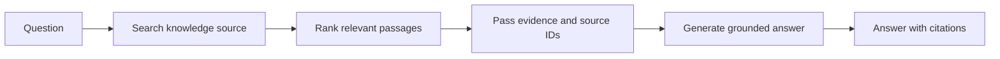

# Chapter 14 — Retrieval-Augmented Generation (RAG)

> Book: *Agentic Design Patterns* (Antonio Gulli), Chapter 14. Implemented with Microsoft Agent Framework (C#) and Microsoft Foundry.

## The Pattern in One Paragraph

Retrieval-augmented generation (RAG) retrieves relevant passages from a knowledge source and supplies them to a language model as evidence for an answer. It separates changing or private facts from model weights, improving grounding while allowing the application to show where an answer came from. Retrieval quality, corpus coverage, and source freshness still bound answer quality.



## What This Demo Shows

| Variant | Source notebook | MAF / Foundry building blocks | What to observe |
|---|---|---|---|
| Local sample-corpus RAG (`rag`) | `Chapter_14_Knowledge_Retrieval_(RAG_LangChain).ipynb` | `ChatClientAgent`, `AIFunctionFactory.Create`, deterministic chunking and lexical ranking | The agent calls a retrieval tool, sees up to five ranked chunks, then answers from those passages with source IDs. The small sample corpus is shipped in code so the demo is reproducible without provisioning a vector database. |
| Foundry File Search (`foundry-files`) | `Chapter_14_Knowledge_Retrieval_(RAG_VertexAI).ipynb` | `AIProjectClient.AsAIAgent`, Foundry File Search tool | Queries a reader-provided Foundry vector store. Configure a vector store ID and populate it with documents before running. |
| Foundry Web Search (`foundry-web`) | `Chapter_14_Knowledge_Retrieval_(RAG_Google_Search).ipynb` | `AIProjectClient.AsAIAgent`, Foundry hosted Web Search tool | Searches current web sources instead of a fixed corpus. Requires a compatible model and a configured Web Search / Bing grounding connection. |
| Hosted companion | Local sample-corpus RAG | Existing `RagAgent` behind Foundry Agent Service Responses | Accepts the caller's question, retrieves from the same sample corpus, and returns a buffered answer with citations. Requests are isolated and stateless. See [the hosted guide](../Chapter14.RAG.Hosted/README.md). |

## Setup

1. Prerequisites: .NET 10 SDK, a Microsoft Foundry project, a deployed chat model, and its API key for the local MAF demo.
2. Configure shared user-secrets once; see [the .NET setup guide](../../README.md). Do not put credentials in source or `appsettings.json`.
3. Run local-corpus RAG (the default):
   ```powershell
   dotnet run --project dotnet/src/Chapter14.RAG
   ```
4. Ask a different question:
   ```powershell
   dotnet run --project dotnet/src/Chapter14.RAG -- rag "What did the address say about the economy?"
   ```
5. Foundry-native variants use Entra ID (`az login`) and the configured project/model. For File Search, create and populate a Foundry vector store, then set its ID:
   ```powershell
   dotnet user-secrets set "Foundry:FileSearchVectorStoreId" "<vector-store-id>" --project dotnet/src/Shared
   dotnet run --project dotnet/src/Chapter14.RAG -- foundry-files "Summarize the indexed documents."
   ```
   Web Search additionally requires a configured Bing grounding connection in the Foundry project:
   ```powershell
   dotnet run --project dotnet/src/Chapter14.RAG -- foundry-web "What are the latest developments in AI?"
   ```
6. Run `all` to execute all three variants; it requires the native File Search and Web Search prerequisites above:
   ```powershell
   dotnet run --project dotnet/src/Chapter14.RAG -- all "What did the president say about the economy?"
   ```
7. Optionally select a configured model alias for the local or Foundry-native demo with `--deployment <name>`.
8. For live validation without local secrets, use **Actions** → **Live Foundry smoke tests** after the updated workflow coverage has been merged to the default branch. It runs inside the protected `foundry-integration` environment using `Foundry__*` variables from GitHub environment secrets.

## Notebook → C# Mapping

| Python notebook element | C# implementation |
|---|---|
| LangChain `TextLoader`, `CharacterTextSplitter(chunk_size=500, chunk_overlap=50)`, and Weaviate retriever | `RagKnowledgeBase` loads a small sample corpus, creates overlapping 500-character chunks, and ranks matching terms deterministically. The default sample avoids a database or external download; replace it with an approved document loader and vector index for larger corpora. |
| LangChain retrieval node followed by a grounded generation prompt | `RagAgent` exposes retrieval as an `AIFunctionFactory` tool to a `ChatClientAgent`; its instructions require retrieval before answering and citations by source ID. |
| Vertex AI RAG corpus with `similarity_top_k=5` and a distance threshold | Foundry-native `foundry-files` uses a configured Foundry vector store and service-managed File Search. The provider owns its semantic ranking and retrieval settings. |
| Google ADK Google Search tool | Foundry-native `foundry-web` uses Foundry Web Search / Bing grounding with the caller's query and source-aware instructions. |

## When to Use

- Answers depend on a curated, changing, or private document set that should remain outside model weights.
- Users need source references and a way to inspect the evidence behind an answer.
- Retrieval can narrow a large corpus to a small, relevant context before generation.

## When NOT to Use

- The question is best answered by a structured system of record or deterministic query rather than semantic passage retrieval.
- The corpus is empty, stale, poorly indexed, or too small to justify retrieval and its additional latency.
- The task requires exhaustive analysis of documents that will not fit within the retriever's configured result budget.

## Real-World Scenarios

1. **Customer support** — retrieve current policy passages and cite the clauses used in a reply.
2. **Internal policy assistant** — search permission-scoped employee guidance while keeping source documents in an approved index.
3. **Engineering knowledge base** — retrieve service runbooks and release notes before proposing diagnostic steps.
4. **Legal research** — find candidate contract clauses, retain document identifiers, and leave legal interpretation to qualified reviewers.
5. **Research assistant** — use web retrieval for current information and distinguish the retrieved sources from the model's synthesis.

## Extending with Microsoft Foundry

- Replace the demo's lexical sample search with Azure AI Search or another permission-aware vector/hybrid search provider; keep the retrieval contract and citation fields explicit.
- Foundry File Search and Web Search can move retrieval into a service-managed tool. Review model compatibility, data handling, connection configuration, indexing, and service charges before enabling them.
- Add tracing and evaluations for retrieval recall, source coverage, citation correctness, answer groundedness, latency, and cost.
- Treat retrieved documents as untrusted data, not instructions. Enforce document authorization before retrieval and preserve source metadata through generation.

## Hosted Deployment Companion

- Suitability: local-corpus RAG is an ordinary, bounded request/response workflow. The corpus is bundled with the host, each request is independent, and there is no interactive approval, local-only resource, or durable conversation state.
- Project and deployment guide: [Chapter 14 hosted companion](../Chapter14.RAG.Hosted/README.md).
- Authentication: local model calls use shared user-secrets or developer credentials; the hosted runtime uses managed identity. Deployment permissions and model-inference access are separate.
- Packaging: the shared `azure.yaml` uses bundled .NET 10 deployment, publishing the host and referenced Chapter 14 / Shared projects together. Agent-scoped cleanup is documented in the hosted guide; do not remove the shared project.
- Request contract: a plain-text question is searched against the sample corpus and returns one buffered answer with source IDs. No conversation is retained between requests. The hosted companion covers local-corpus RAG; the console retains the separate File Search and Web Search examples.
- Runtime inference: before remote invocation, verify or assign **Cognitive Services OpenAI User** to the deployed agent's current `instance_identity.principal_id` at the model-hosting Foundry account scope, allow RBAC propagation, and recheck after redeployment. See the [shared hosted-agent setup](../../README.md#configure-and-deploy-hosted-agents).
- Deployment: use the reader's own Foundry project and model; required permissions, commands, costs, and safe agent-scoped cleanup are described in the [hosted guide](../Chapter14.RAG.Hosted/README.md).

## Risks & Limitations

- Lexical matching in the local example is easy to inspect but misses semantic matches; production retrieval may need embeddings, hybrid search, filters, and a relevance threshold.
- Retrieval can omit decisive passages or return stale, irrelevant, or conflicting content. Evaluate retrieval and generation separately.
- Retrieved text can contain prompt injection or unauthorized data. Apply access control before retrieval and never treat document text as permission to take an action.
- More retrieved context can increase latency and model cost while making answers less focused; tune chunking and result counts against representative questions.
