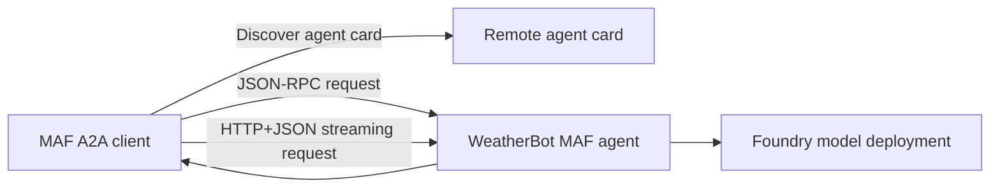

# Chapter 15 — Inter-Agent Communication (A2A)

> *Agentic Design Patterns*, Antonio Gulli, Chapter 15. C# / Microsoft Agent Framework (MAF).

A2A lets independently deployed agents discover capabilities through an agent card and exchange requests without sharing a framework. It provides interoperability, not orchestration, authorization, or shared memory. This console is a **client**: run the [hosted companion](../Chapter15.A2A.Hosted/README.md) as its server.



## Where to look in code

- [Program.cs](Program.cs): card discovery, explicit JSON-RPC `RunAsync` and HTTP+JSON `RunStreamingAsync` branches.
- [InterAgentAgent.cs](InterAgentAgent.cs), `Create`: remote specialist instructions and fresh request state.
- [Hosted Program.cs](../Chapter15.A2A.Hosted/Program.cs), `CreateAgentCard`: advertised skills, bindings, and server mappings.

## Notebook → C# mapping

| Notebook | Implementation |
|---|---|
| `Chapter_15_Inter_Agent_(Sync_Streaming_Requests)` | USD/EUR synchronous sample and JPY/GBP streaming sample, using the current SDK bindings instead of manually constructing older task JSON. |
| `Chapter_15_Inter_Agent_(A2A_AgentCard_WeatherBot)` | Typed `AgentCard` published at `/.well-known/agent-card.json`. |
| `Chapter_15_Inter_Agent_(A2A)` | Agent-card/hosting boundary; the notebook's incomplete Google Calendar integration is not claimed. |

Weather, rates, and calendar requests are **protocol examples**, not live integrations. The agent must disclose missing live data and never claim completed calendar actions. Foundry's hosted A2A endpoint is a deployment integration, not a separate native reasoning variant.

## Run

Configure .NET 10 and the server's model credentials via the [shared setup](../../README.md). From the repository root, start the server:

```powershell
$env:PORT = '5090'
$env:A2A_PUBLIC_URL = 'http://localhost:5090/'
dotnet run --project dotnet\src\Chapter15.A2A.Hosted
```

In another terminal:

```powershell
dotnet run --project dotnet\src\Chapter15.A2A -- all http://localhost:5090/
dotnet run --project dotnet\src\Chapter15.A2A -- sync http://localhost:5090/ "Explain why exchange rates need a current source."
dotnet run --project dotnet\src\Chapter15.A2A -- stream http://localhost:5090/
dotnet run --project dotnet\src\Chapter15.A2A -- card http://localhost:5090/
```

The default mode is `sync`; the URL defaults to `A2A_AGENT_URL` or `http://localhost:5090/`. Custom request words follow the URL. Only absolute HTTP(S) URLs are accepted; Ctrl+C cancels discovery/model work. The local listener is unauthenticated: keep it on a trusted network.

## When to use / not to use

**Use** for separately owned/versioned agents, capability discovery, and cross-framework delegation.
**Do not use** instead of a local method call, transactional orchestration, trusted caller identity, or a permission model.

## Real-world scenarios

1. Travel coordinators discover independent lodging and weather specialists.
2. Service desks delegate product-policy questions to another team's agent.
3. Procurement workflows query supplier-owned catalog agents.
4. Research coordinators obtain bounded contributions from domain specialists.

## Tradeoffs and Foundry extensions

Network calls fail independently; cards may be stale, so validate endpoint ownership and advertised skills. Connect authenticated domain tools for real data or actions; A2A itself does not grant those permissions. Streaming improves responsiveness without proving answer quality.

For Foundry-managed A2A endpoints, request semantics, and service-specific commands, see the [hosted guide](../Chapter15.A2A.Hosted/README.md). Shared deployment, inference RBAC, sensitive tracing, packaging, cost, and cleanup instructions live in [HOSTING.md](../../HOSTING.md).
