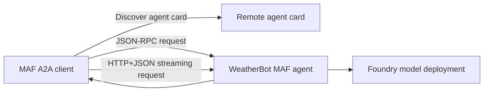

# Chapter 15 — Inter-Agent Communication (A2A)

> Book: *Agentic Design Patterns* (Antonio Gulli), Chapter 15. Implemented with Microsoft Agent Framework (C#) and Microsoft Foundry.

## The Pattern in One Paragraph

Agent-to-Agent (A2A) is a protocol boundary that lets independently deployed agents discover one another through agent cards and exchange messages using a shared contract. It supports request/response and streaming without requiring the caller to know the remote agent's framework or internal implementation. A2A provides interoperability, not orchestration, authorization, or shared memory.



## What This Demo Shows

| Variant | Source notebook | MAF / Foundry building blocks | What to observe |
|---|---|---|---|
| A2A client (MAF) | `Chapter_15_Inter_Agent_(Sync_Streaming_Requests).ipynb` | `A2ACardResolver`, `AgentCard.AsAIAgent`, `A2AClientOptions`, `RunAsync`, `RunStreamingAsync` | Discovers a remote card, sends the USD/EUR example synchronously over JSON-RPC, and streams the JPY/GBP example over HTTP+JSON. |
| WeatherBot card and A2A server | `Chapter_15_Inter_Agent_(A2A_AgentCard_WeatherBot).ipynb` | `Microsoft.Agents.AI.Hosting.A2A.AspNetCore`, `AddA2AServer`, `MapA2AHttpJson`, `MapA2AJsonRpc`, `MapWellKnownAgentCard` | Publishes the agent's description, skill, protocol bindings, and streaming capability for discovery. |
| Calendar-agent hosting sketch | `Chapter_15_Inter_Agent_(A2A).ipynb` | A MAF `ChatClientAgent` behind the same A2A server; Foundry hosted companion | Applies the notebook's agent-card/hosting boundary without its unavailable Google ADK and calendar credentials. No calendar operations are claimed. |
| Foundry-native | Same hosted service | Foundry hosted-agent A2A endpoint and declarative `agentCard` | Foundry publishes the card and exposes the MAF-hosted behavior through A2A; this is a deployment/protocol integration, not a separate native reimplementation. |
| Hosted companion | Same hosted service | A2A protocol server, Foundry hosted agent runtime, managed identity | See [hosted deployment guide](../Chapter15.A2A.Hosted/README.md) for local requests, the card contract, and deploy/invoke guidance. |

The weather, exchange-rate, and calendar examples are protocol demonstrations. This agent has no live weather, currency, or calendar data source; its instructions require it to disclose that and not invent current data or completed operations.

## Setup

1. Prerequisites: .NET 10 SDK, a Microsoft Foundry project, and a deployed chat-model deployment.
2. Configure shared local API-key user-secrets once; see [dotnet/README.md](../../README.md#configure-foundry-user-secrets).
3. Start the A2A server in one terminal:
   ```powershell
   $env:PORT = '5090'
   $env:A2A_PUBLIC_URL = 'http://localhost:5090/'
   dotnet run --project .\dotnet\src\Chapter15.A2A.Hosted
   ```
4. In another terminal, run all client examples:
   ```powershell
   dotnet run --project .\dotnet\src\Chapter15.A2A -- all http://localhost:5090/
   ```
5. Run a single mode (`card`, `sync`, or `stream`) or provide a custom request after the URL:
   ```powershell
   dotnet run --project .\dotnet\src\Chapter15.A2A -- sync http://localhost:5090/ "Explain why exchange rates need a current source."
   ```

## Notebook → C# Mapping

| Python / notebook material | C# (MAF) |
|---|---|
| JSON-RPC `sendTask` with the USD-to-EUR example | `A2AClientDemo` uses the discovered `AgentCard`, selects `ProtocolBindingNames.JsonRpc`, and calls `RunAsync`. |
| `sendTaskSubscribe` with the JPY-to-GBP example | `A2AClientDemo` selects HTTP+JSON and consumes `RunStreamingAsync` updates. |
| WeatherBot agent card and streaming skill | Hosted server publishes a typed `AgentCard` at `/.well-known/agent-card.json` and maps both A2A bindings. |
| Google ADK calendar agent, skill card, and HTTP server | The hosted companion demonstrates the same A2A hosting boundary with a Foundry-backed MAF agent; the incomplete notebook dependencies and calendar integration are not reproduced. |

## When to Use

- Agents are independently deployed, owned, identified, or versioned.
- A caller needs to discover a remote agent's capabilities before delegating a task.
- Different teams or frameworks need an interoperable agent request contract.
- A remote task benefits from streaming or a standard task-oriented protocol.

## When NOT to Use

- Agents are functions or components within the same application and a local method/workflow is sufficient.
- The caller needs tightly controlled orchestration, shared state, or transaction semantics that A2A does not provide.
- The remote agent's identity, authorization, or endpoint trust cannot be established.
- A workflow requires reliable live data or side effects, but the remote agent exposes no suitable authenticated tool or API.

## Real-World Scenarios

1. **Travel planning** — a trip coordinator discovers separate lodging, weather, and itinerary agents owned by their respective services.
2. **Customer support** — a service desk delegates product-policy questions to an independently maintained policy specialist and streams the answer.
3. **Enterprise procurement** — a purchasing workflow discovers supplier agents and requests catalog or fulfillment information over a governed identity boundary.
4. **Research collaboration** — a research coordinator asks independently hosted domain specialists for bounded contributions without coupling to their internal model frameworks.

## Extending with Microsoft Foundry

- Publish hosted agents through Foundry's A2A endpoints and agent cards, with narrow skill descriptions and caller authorization.
- Add explicit toolboxes or APIs for live weather, rates, or calendar changes; keep their authentication and permissions independent of the A2A protocol.
- Use Foundry tracing and evaluation to inspect delegated requests, latency, errors, and the quality of the final agent response.

## Hosted Deployment Companion

- Suitability: the demo is an ordinary request/response agent with streaming support and no durable memory or human-approval interaction; it can run behind the A2A protocol.
- Project and deployment guide: [Chapter 15 hosted companion](../Chapter15.A2A.Hosted/README.md); the console client and hosted server remain separate.
- Authentication: local server calls use the configured developer API key; Azure execution uses managed identity. Before remote invocation, verify or assign Cognitive Services OpenAI User to the current `instance_identity.principal_id` at the model-hosting Foundry account scope with RBAC-write approval, allow propagation, and recheck after redeployment.
- Packaging: azd's bundled .NET deployment includes project references and central package/build files; `.agentignore` excludes `.azure`, environment files, user-secrets, and build outputs.
- Request contract: text/plain A2A messages; JSON-RPC or HTTP+JSON; a fresh non-persistent run per request; final text returned by the model. Streaming is supported over the HTTP+JSON binding.
- Deployment: follow the companion guide with a reader-owned Foundry project and existing model; deployment and runtime inference permissions are separate, and each request incurs hosted-runtime and model usage costs.

## Risks & Limitations

- The protocol does not itself provide orchestration, authorization, trust, or persistence; each boundary needs its own explicit policy.
- Remote calls add network latency and can fail independently of the caller.
- Agent cards can become stale as capabilities change; validate advertised skills and endpoint ownership.
- Model-generated answers without connected domain tools can be incomplete; live-data requests must not be treated as authoritative.
