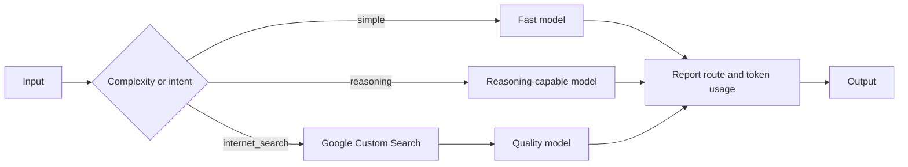

# Chapter 16 — Resource Optimization

> Book: *Agentic Design Patterns* (Antonio Gulli), Chapter 16. Implemented with Microsoft Agent Framework (C#) and Microsoft Foundry model deployments.

## The Pattern in One Paragraph

Resource optimization matches a request to the least expensive model and tools that can still handle it well. A router can use a deterministic complexity signal or a model classification to select a fast, reasoning, or current-information path. Recording the route and reported token usage makes the cost/quality tradeoff visible rather than relying on a single model for every request.



## What This Demo Shows

| Variant | Source notebook | MAF / Foundry building blocks | What to observe |
|---|---|---|---|
| Complexity router (`complexity`) | `Chapter_16_Resource_Optimization_(Code_Snippets).ipynb` | `WorkflowBuilder`, custom router and answer executors, `ChatClientAgent`, `UsageDetails` | Requests under 20 words use the simple route; longer requests use the reasoning route. The selected deployment and provider-reported token usage are printed. |
| Intent and search router (`research`) | `Chapter_16_Resource_Optimization_(OI_Google_Search).ipynb` | MAF workflow executors, classifier `ChatClientAgent`, route-specific answer agents, Google Custom Search REST API | The classifier chooses `simple`, `reasoning`, or `internet_search`. Current-information requests fetch three web results and answer from their titles, snippets, and links. |
| Foundry-native | Same scenarios | Not applicable | Foundry provides model deployments, but no separate native budget/complexity-routing primitive is used by these examples. The MAF workflow owns deterministic routing and usage reporting. |
| Hosted companion | Intent and search router | Existing MAF workflow, Foundry Responses protocol host, managed identity, native `web_search` tool | A caller's request is processed per-request without replaying console samples or persisting conversation state. The hosted search route uses Foundry's Bing-backed web search instead of Google credentials. See [hosted setup and deployment](../Chapter16.ResourceOptimization.Hosted/README.md). |

## Setup

1. Prerequisites: .NET 10 SDK and a Microsoft Foundry project with an OpenAI-compatible model deployment and API key.
2. Configure shared user-secrets once; see [the .NET setup guide](../../README.md). Do not put credentials in source files.
3. Optionally configure deployment aliases. Missing aliases fall back to the configured default deployment:
   ```powershell
   dotnet user-secrets set "Foundry:ModelDeployments:fast" "<fast-deployment-name>" --project .\dotnet\src\Shared
   dotnet user-secrets set "Foundry:ModelDeployments:reasoning" "<reasoning-deployment-name>" --project .\dotnet\src\Shared
   dotnet user-secrets set "Foundry:ModelDeployments:quality" "<quality-deployment-name>" --project .\dotnet\src\Shared
   ```
4. To run the current-information sample in the `research` demo, configure Google Custom Search credentials outside the repository:
   ```powershell
   dotnet user-secrets set "GoogleCustomSearch:ApiKey" "<google-custom-search-api-key>" --project .\dotnet\src\Shared
   dotnet user-secrets set "GoogleCustomSearch:SearchEngineId" "<programmable-search-engine-id>" --project .\dotnet\src\Shared
   ```
   The same values can be provided as `GOOGLE_CUSTOM_SEARCH_API_KEY` and `GOOGLE_CSE_ID`. Leave both unset when you do not need the search route; the sample batch reports that the current-information example was skipped, while a caller request routed to search fails explicitly.
5. Run all variants or select one:
   ```powershell
   dotnet run --project .\dotnet\src\Chapter16.ResourceOptimization
   dotnet run --project .\dotnet\src\Chapter16.ResourceOptimization -- complexity
   dotnet run --project .\dotnet\src\Chapter16.ResourceOptimization -- research
   ```
6. For cloud-agent validation, use the repository's **Live Foundry smoke tests** workflow from the default branch after this change is merged. It runs in the protected `foundry-integration` environment and maps `Foundry__*` values from GitHub environment secrets. The smoke test exercises complexity routing; the search route additionally needs Google credentials and is not part of that workflow.

## Notebook → C# Mapping

| Python notebook element | C# (MAF) |
|---|---|
| Short question to Gemini Flash and longer request to Gemini Pro | `RouteByComplexity` uses the notebook's 20-word threshold, then routes through simple or reasoning answer executors |
| The conceptual critic prompt | Not ported as a separate runnable variant; it is a prompt constant without an invocation or evaluation flow in this notebook |
| GPT classifier returning `simple`, `reasoning`, or `internet_search` JSON | `ResourceClassifier` `ChatClientAgent`, validated `ParseClassification`, and conditional `WorkflowBuilder` edges |
| GPT-4o-mini / o4-mini / GPT-4o response model selection | `Foundry:ModelDeployments:fast`, `reasoning`, and `quality` aliases; absent aliases use the configured default |
| Google Custom Search API request and result snippets | `GoogleCustomSearchClient`, which requests up to three results and passes titles, snippets, and links to the search answerer |
| Model response metadata and resource accounting | `UsageDetails` from `ChatResponse.Usage` is aggregated across classifier and answer calls when the provider reports it |

## When to Use

- Requests vary substantially in complexity, freshness requirements, or acceptable latency.
- You can define stable routing categories and measure the quality/cost tradeoff of each route.
- You want current information to trigger retrieval rather than paying for web lookup on every request.

## When NOT to Use

- The request volume or model cost is too small to justify classifier latency and multiple deployment configuration.
- Routing categories are ambiguous and a wrong model/tool choice creates unacceptable outcomes.
- A task requires current evidence but no approved and reliable retrieval source is available.

## Real-World Scenarios

1. **Customer support** — answer common policy questions with a fast model and send nuanced account cases to a stronger model.
2. **Financial operations** — use a low-cost model for simple explanations and a reasoning-capable deployment for multi-step variance analysis.
3. **News and market monitoring** — search for current prices or announcements, then synthesize only from returned source snippets.
4. **Developer assistants** — route syntax questions to a fast deployment and architecture or migration analysis to a stronger one.

## Extending with Microsoft Foundry

- Configure `fast`, `reasoning`, and `quality` aliases to compare Foundry deployments without changing workflow logic.
- Evaluate route accuracy, model quality, token usage, latency, and cost on a representative labeled request set before changing thresholds or prompts.
- Explore Foundry Local for a local small-model route where supported; keep the route policy deterministic and report the resolved model.
- Deploy the existing MAF workflow through the [hosted companion](../Chapter16.ResourceOptimization.Hosted/README.md). Hosting does not create a separate Foundry-native routing implementation.

## Hosted Deployment Companion

- Suitability: ordinary request/response processing is supported with a fresh, stateless workflow per request; current-information requests use Foundry's built-in Bing-backed `web_search` tool without external search credentials.
- Project and deployment guide: [Chapter 16 hosted agent](../Chapter16.ResourceOptimization.Hosted/README.md).
- Authentication: console execution uses API keys in shared user-secrets; hosted Foundry model inference uses developer credentials locally and managed identity in Azure. Before remote inference, verify or assign **Cognitive Services OpenAI User** to the deployed `instance_identity.principal_id` at the model-hosting Foundry account scope, allow RBAC propagation, and recheck after redeployment.
- Packaging: azd bundled deployment includes the host and referenced Chapter 16 and Shared projects; keep user-secrets, `.azure`, and environment files out of the package.
- Request contract: accepts one text prompt, classifies it, returns the selected deployment and final answer with search source URLs, and does not retain conversation history. A search-classified request uses the quality model via the Foundry project Responses API with Azure credentials.
- Deployment: the hosted guide documents permissions, local invocation, service-scoped deploy/invoke commands, runtime inference role and scope, RBAC propagation, expected costs, and agent-scoped cleanup.

## Risks & Limitations

- A classifier adds cost and latency and can select the wrong route; retain representative evaluations and a safe fallback policy.
- Model names and capabilities vary across deployments; a deployment alias is not itself a guarantee of lower cost or sufficient quality.
- Search snippets can be incomplete, stale, or contradictory. Treat them as evidence to cite, not as a complete source of truth.
- Reported token usage depends on provider support and may omit other costs such as search requests, retries, or hosting.
