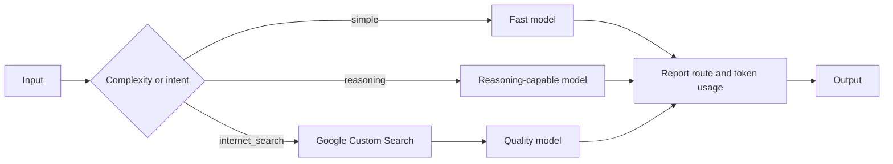

# Chapter 16 — Resource Optimization

> *Agentic Design Patterns*, Antonio Gulli, Chapter 16. C# / Microsoft Agent Framework (MAF).

Route each request to an appropriate model/tool tier rather than paying for the strongest model every time. Compare deterministic complexity routing with structured intent classification; show the resolved deployment, intermediate search evidence, and provider token usage so the cost/quality tradeoff stays visible.



## Where to look in code

- [ResourceOptimizationWorkflow.cs](ResourceOptimizationWorkflow.cs), `RunAsync`: classify → optional search → selected answerer; `RouteByComplexity` implements the 20-word threshold.
- [Models/OptimizationCategory.cs](Models/OptimizationCategory.cs): enum-constrained classifier schema, including `internet_search`.
- [GoogleCustomSearchClient.cs](GoogleCustomSearchClient.cs), `SearchAsync`: three-result retrieval boundary.
- [Hosted ResourceOptimizationAgent.cs](../Chapter16.ResourceOptimization.Hosted/ResourceOptimizationAgent.cs): deployment/citation presentation and structured Responses usage, including streaming.

## Notebook → C# mapping

| Notebook | Implementation |
|---|---|
| `Chapter_16_Resource_Optimization_(Code_Snippets)` | `complexity`: fewer than 20 words → simple; otherwise reasoning. The uninvoked critic prompt is not a separate scenario. |
| `Chapter_16_Resource_Optimization_(OI_Google_Search)` | `research`: typed intent classifier chooses simple, reasoning, or internet search; search snippets become answer context. |
| Model tiers and usage metadata | `fast`, `reasoning`, `quality` deployment aliases; built-in `AgentResponse.Usage` aggregates classifier and answer usage. |

Missing route aliases fall back to the configured default, case-insensitively. All routes can therefore use one model. Missing usage is reported as “not reported,” not zero; token totals do not include search, hosting, or currency pricing.

## Run

Configure .NET 10 and [shared Foundry settings](../../README.md). Optional aliases use `Foundry:ModelDeployments:fast`, `reasoning`, and `quality`. From the repository root:

```powershell
dotnet run --project dotnet\src\Chapter16.ResourceOptimization
dotnet run --project dotnet\src\Chapter16.ResourceOptimization -- complexity
dotnet run --project dotnet\src\Chapter16.ResourceOptimization -- research --deployment quality
dotnet test dotnet\tests\ResourceOptimization.Tests
```

For console search, configure `GoogleCustomSearch:ApiKey` and `GoogleCustomSearch:SearchEngineId` in shared user-secrets, or `GOOGLE_CUSTOM_SEARCH_API_KEY` and `GOOGLE_CSE_ID` environment variables. Without them the sample batch labels its skipped search example; an actual search-routed request fails explicitly rather than answering from model memory.

The [hosted companion](../Chapter16.ResourceOptimization.Hosted/README.md) retains the intent workflow but uses Foundry's native Bing-backed web search with Entra credentials instead of Google. Foundry has no distinct application-budget router used by this demo.

## When to use / not to use

**Use** when request complexity/freshness varies and measured savings outweigh classification overhead.
**Do not use** when routing errors are unacceptable, volume is too small to justify the extra call, or current evidence has no approved retrieval source.

## Real-world scenarios

1. Support: common policy answers on a fast deployment, nuanced cases on a stronger tier.
2. Finance: simple explanations versus multi-step variance analysis.
3. Market monitoring: retrieve recent announcements only when needed.
4. Developer assistance: syntax questions versus migration analysis.

## Tradeoffs and Foundry extensions

A classifier adds latency/cost and can misroute. Word count is an illustrative heuristic, not complexity measurement. Search snippets may be stale or contradictory. Evaluate routing accuracy, quality, latency, and usage on labeled requests; aliases are not guarantees of price or capability. Foundry tracing/evaluation can compare tiers, and Foundry Local can supply an optional small-model route.

See the [hosted contract](../Chapter16.ResourceOptimization.Hosted/README.md) and [HOSTING.md](../../HOSTING.md) for deployment, inference RBAC, sensitive tracing, packaging, costs, and scoped cleanup.
