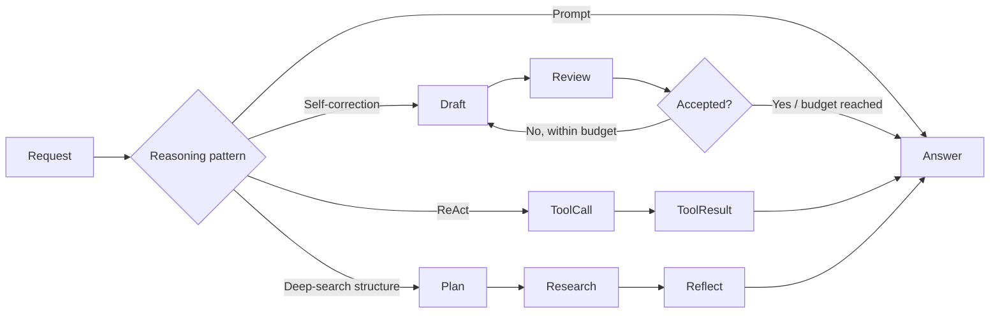

# Chapter 17 — Reasoning

> *Agentic Design Patterns*, Antonio Gulli, Chapter 17. C# / Microsoft Agent Framework (MAF).

Improve problem solving through observable work: inspect a draft, call an exact tool, decompose a question, and reflect on coverage. Return concise rationales and evidence summaries, **not private chain-of-thought**. Keep quantitative acceptance rules and iteration limits in code.



## Where to look in code

- [ReasoningWorkflow.cs](ReasoningWorkflow.cs): `RunSelfCorrectionAsync` retains original requirements and enforces 150 Unicode text elements, at most three rounds; `RunReActAsync` registers the factorial tool.
- Same file, `RunDeepSearchAsync`: at most three queries per round, two rounds, structured reflection, final synthesis; `RequireQueries` enforces the query budget.
- [ReasoningChatClientFactory.cs](ReasoningChatClientFactory.cs): Responses API adapter required by reasoning/tool-enabled deployments; retained for both local API keys and hosted Entra credentials.
- [FoundryNativeDemo.cs](FoundryNativeDemo.cs): distinct managed Web Search / Code Interpreter tools.

## Notebook → C# mapping

| Notebook | Command / implementation |
|---|---|
| `Chapter_17_Reasoning_(CoT_Prompt)` | `cot`: classical/quantum comparison with concise rationale. |
| `Chapter_17_Reasoning_(Self_Correction)` | `self-correction`: GreenTech Gadgets draft → independent structured review → bounded revision. |
| `Chapter_17_Reasoning_(Executing_Code)` | `react`: exact factorial for integers 0–20; `foundry-code-interpreter`: managed sandbox rather than arbitrary local code execution. |
| `Chapter_17_Reasoning_(Google_DeepSearch)` | `deep-search`: executable planning/reflection structure using **model knowledge only**; `foundry-web-search`: current evidence through a managed tool. |

The DeepSearch notebook supplies graph wiring, not node implementations or a runnable sample. The local adaptation never claims to browse or verify citations.

## Run

Use .NET 10 and [shared Foundry settings](../../README.md). From the repository root:

```powershell
dotnet run --project dotnet\src\Chapter17.Reasoning -- all
dotnet run --project dotnet\src\Chapter17.Reasoning -- cot --deployment quality
dotnet run --project dotnet\src\Chapter17.Reasoning -- self-correction
dotnet run --project dotnet\src\Chapter17.Reasoning -- react
dotnet run --project dotnet\src\Chapter17.Reasoning -- deep-search
dotnet run --project dotnet\src\Chapter17.Reasoning -- foundry-web-search
dotnet run --project dotnet\src\Chapter17.Reasoning -- foundry-code-interpreter
dotnet test dotnet\tests\Reasoning.Tests
```

Default `all` runs the four MAF examples and prints intermediate drafts, feedback, tool results, queries, and notes. Native modes are opt-in, require Entra sign-in/project tool permissions, and also accept `--deployment <alias>`.

The [hosted companion](../Chapter17.Reasoning.Hosted/README.md) accepts all four MAF scenarios with caller-provided text, fresh state, and one buffered completed response. Native tools remain separate console variants.

## When to use / not to use

**Use** for constrained draft improvement, explicit coverage checks, and exact tool-assisted answers.
**Do not use** instead of ordinary deterministic computation, to disclose hidden deliberation, or to obtain current facts from an unconnected model.

## Real-world scenarios

1. Communications teams revise short announcements against length and tone rules.
2. Researchers decompose broad questions and identify coverage gaps.
3. Finance assistants call narrowly scoped exact calculation tools.
4. Support assistants explain relevant factors without exposing private reasoning.

## Tradeoffs and Foundry extensions

Self-review can reinforce shared model bias; agreement is not evidence. Bounded rounds constrain latency/cost but do not guarantee acceptance. Factorial authorization/range checks remain deterministic. Use Foundry Web Search for current citations, Code Interpreter when a sandbox is actually needed, and evaluation datasets to measure improvement.

See [HOSTING.md](../../HOSTING.md) for deployment, inference RBAC, sensitive tracing, packaging, costs, and scoped cleanup; request prefixes and API selection remain in the [hosted guide](../Chapter17.Reasoning.Hosted/README.md).
