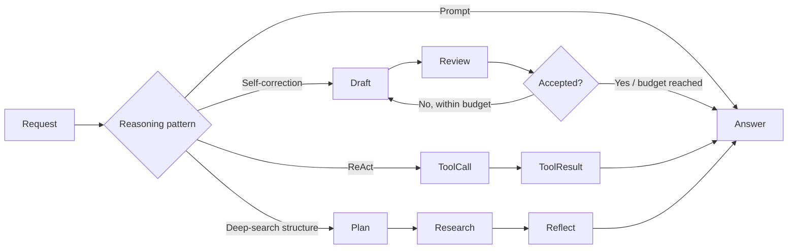

# Chapter 17 — Reasoning

> Book: *Agentic Design Patterns* (Antonio Gulli), Chapter 17. Implemented with Microsoft Agent Framework (C#) and Microsoft Foundry.

## The Pattern in One Paragraph

Reasoning patterns make a model's problem-solving process more reliable by structuring work into observable actions: decompose a task, use a tool, inspect a draft, or reflect on coverage before answering. The demo keeps deterministic boundaries around bounded model judgment and exposes concise progress and results rather than private chain-of-thought.



## What This Demo Shows

| Variant | Source notebook | MAF / Foundry building blocks | What to observe |
|---|---|---|---|
| Reasoned answer (`cot`) | `Chapter_17_Reasoning_(CoT_Prompt).ipynb` | `ChatClientAgent` on a Foundry model deployment | The quantum-computing question receives a direct answer and concise rationale; private chain-of-thought is not returned. |
| Bounded self-correction (`self-correction`) | `Chapter_17_Reasoning_(Self_Correction).ipynb` | Generator and structured reviewer agents; deterministic 150-character check and three-round cap | The social post is revised using reviewer feedback; the round limit and character limit are enforced in code. |
| ReAct (`react`) | `Chapter_17_Reasoning_(Executing_Code).ipynb` | `ChatClientAgent`, `AIFunctionFactory`, bounded factorial function | The agent calls a deterministic, range-limited factorial tool rather than executing arbitrary generated code. |
| Deep-search reasoning structure (`deep-search`) | `Chapter_17_Reasoning_(Google_DeepSearch).ipynb` | Bounded query planning, research calls, structured reflection, synthesis | Query planning and reflection are visible. This MAF version uses model knowledge only, not live web search or verified citations. |
| Foundry-native Code Interpreter (`foundry-code-interpreter`) | `Chapter_17_Reasoning_(Executing_Code).ipynb` | Foundry Agent Service Code Interpreter tool | Sandboxed code execution is available as a distinct managed capability. |
| Foundry-native Web Search (`foundry-web-search`) | `Chapter_17_Reasoning_(Google_DeepSearch).ipynb` | Foundry Agent Service Web Search tool | Current source-backed research is available through the managed tool, unlike the model-knowledge MAF variant. |
| Hosted companion | All MAF request modes | Existing MAF logic behind Foundry Agent Service Responses | A caller supplies the selected mode and task; the host returns the completed result without retaining conversation state. See the [hosted guide](../Chapter17.Reasoning.Hosted/README.md). |

## Setup

1. Prerequisites: .NET 10 SDK and a Foundry project with a chat-model deployment and API key.
2. Configure shared user-secrets once; see [dotnet/README.md](../../README.md). Never put credentials in source or `appsettings.json`.
3. Run all MAF/model-deployment variants:
   ```powershell
   dotnet run --project dotnet/src/Chapter17.Reasoning
   ```
4. Run one MAF variant:
   ```powershell
   dotnet run --project dotnet/src/Chapter17.Reasoning -- cot
   dotnet run --project dotnet/src/Chapter17.Reasoning -- self-correction
   dotnet run --project dotnet/src/Chapter17.Reasoning -- react
   dotnet run --project dotnet/src/Chapter17.Reasoning -- deep-search
   ```
5. Optionally select a named model deployment configured under `Foundry:ModelDeployments`:
   ```powershell
   dotnet run --project dotnet/src/Chapter17.Reasoning -- cot --deployment quality
   ```
6. Foundry-native variants require `az login`, project access, and the respective tool capability:
   ```powershell
   dotnet run --project dotnet/src/Chapter17.Reasoning -- foundry-code-interpreter
   dotnet run --project dotnet/src/Chapter17.Reasoning -- foundry-web-search
   ```
   They read the shared Foundry project endpoint and model deployment settings and authenticate with Entra ID. Add `--deployment <name>` to select a configured `Foundry:ModelDeployments` alias for either native mode.
7. For live MAF validation without local secrets, use **Actions** → **Live Foundry smoke tests** after the workflow coverage is on the default branch. It uses the protected `foundry-integration` environment and `Foundry__*` variables.

## Notebook → C# Mapping

| Python notebook element | C# (MAF / Foundry) |
|---|---|
| CoT instructions and the classical-versus-quantum example | `ChainOfThought` agent returns the requested answer and a concise rationale, not hidden internal reasoning. |
| Self-correction checklist, original 150-character prompt, and initial GreenTech Gadgets draft | Generator/reviewer calls retain the original task and draft; deterministic character-count validation and a three-round cap control acceptance. |
| ADK `SearchAgent`, `CodeAgent`, and `RootAgent` with `AgentTool` | MAF ReAct uses a local factorial function exposed by `AIFunctionFactory`; the Foundry-native Code Interpreter variant uses a managed sandbox. |
| LangGraph `generate_query`, `web_research`, `reflection`, `finalize_answer` nodes and conditional edges | MAF runs a bounded query-plan → model-knowledge research → structured reflection → synthesis sequence; Foundry Web Search supplies live search in the separate native variant. |

The DeepSearch notebook shows graph wiring but does not include its node implementations or request sample. The MAF version makes the control flow executable while labeling its research as model knowledge, not external retrieval. Select Foundry Web Search when current, source-backed information is required.

## Implementation Scope

- `cot` demonstrates one-pass prompted reasoning with a concise, user-facing rationale.
- `self-correction` uses a structured review and up to three generation rounds. The reviewer decides qualitative fit; code enforces the measurable character cap.
- `react` exposes only an exact factorial operation for integers 0 through 20. It does not execute arbitrary code.
- `deep-search` allows up to three queries per round and two rounds. It uses model knowledge only and never invents web citations.
- MAF model calls use the OpenAI Responses API adapter so reasoning deployments can handle the tool-enabled ReAct flow; console API-key and hosted Entra ID authentication remain separate.
- Foundry-native Code Interpreter and Web Search are separate opt-in modes because they use Entra ID and Agent Service tools rather than the shared API-key MAF client.

## Request Behavior

The console uses fixed sample tasks from the notebooks and prints intermediate steps. The hosted companion accepts caller-provided text with `cot:`, `self-correction:`, `react:`, or `deep-search:` prefixes; unprefixed text uses `cot`. Every hosted request starts with fresh workflow state, returns one completed response, and discards that state afterward. Responses streaming is buffered until the reasoning run finishes.

## When to Use

- A complex question benefits from a concise decomposition or a deliberate coverage check.
- A draft can be improved against explicit qualitative criteria and a bounded number of review rounds.
- A model needs a small deterministic tool to obtain exact results for a supported operation.
- Current research is needed and a managed search tool can provide inspectable sources.

## When NOT to Use

- A short, deterministic computation can be handled directly in ordinary application code.
- The response must expose private chain-of-thought rather than a concise explanation or evidence summary.
- A bounded loop cannot provide enough opportunity to improve the result, or model calls add cost without measurable quality gains.
- The answer requires current facts but the selected variant has no connected retrieval source.

## Real-World Scenarios

1. **Customer communications** — revise a brief announcement against tone, brand, and length constraints before publication.
2. **Research assistance** — decompose a broad question into focused queries, inspect coverage, and synthesize source-backed findings.
3. **Financial operations** — call a narrow, deterministic calculation tool for supported arithmetic rather than executing arbitrary generated code.
4. **Technical support** — produce a concise explanation that summarizes relevant factors while keeping internal deliberation private.

## Extending with Microsoft Foundry

- Use Foundry Web Search for current information and preserve its source references in the final response.
- Use Code Interpreter only when sandboxed execution provides a clear benefit over narrow deterministic application functions.
- Add traces to inspect agent calls and tool interactions. Sensitive-data capture is enabled in this demo's MAF agents; use non-sensitive sample inputs and restrict trace access and retention.
- Evaluate answer quality, coverage, and correction success on representative datasets. Keep tool authorization and hard acceptance rules in deterministic application code.

## Hosted Deployment Companion

- Suitability: each request is an ordinary, bounded request/response operation with no interactive approval, long-running task, local-only dependency, or durable memory.
- Project and deployment guide: [Chapter 17 hosted companion](../Chapter17.Reasoning.Hosted/README.md).
- Authentication: console MAF variants use API-key user-secrets or `Foundry__*`; the hosted process uses developer Entra ID locally and managed identity in Azure.
- Packaging: `azure.yaml` uses bundled .NET 10 publishing for the hosted project and its Chapter 17 and Shared references. `.agentignore` excludes environment files, `.azure`, secrets, and build artifacts.
- Request contract: a single caller-supplied prompt, optionally prefixed with a reasoning mode; fresh state per request and one final text response.
- Deployment: follow the hosted guide with a reader-owned Foundry project and model. Grant Cognitive Services OpenAI User to the deployed runtime `instance_identity.principal_id` at the model-hosting account scope when effective inference access is absent, and allow time for role propagation before invoking.

## Risks & Limitations

- Self-review can reinforce a generator's mistakes; reviewer agreement is not independent evidence.
- Model-knowledge research may be incomplete or stale. Use the Foundry Web Search variant for current, cited information.
- Tool use and reflection add model calls, latency, and cost. Fixed query and correction budgets prevent unbounded loops but do not guarantee correctness.
- The factorial tool intentionally supports a narrow range; deterministic validation must remain authoritative for any extension.
