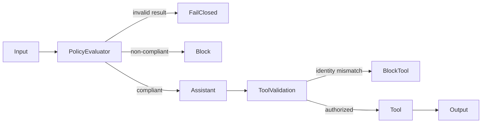

# Chapter 18 — Guardrails

> *Agentic Design Patterns*, Antonio Gulli, Chapter 18. C# / Microsoft Agent Framework (MAF).

Screen requests before model work and enforce authorization before protected tool operations. An LLM interprets policy; typed validation rejects malformed decisions; deterministic code owns access. These layers are complementary, not interchangeable.



## Where to look in code

- [GuardrailsAgent.cs](GuardrailsAgent.cs), `Create` / local `ApplyPolicyAsync`: structured policy middleware; only the screened latest user message reaches the assistant.
- Same file, `RequireValidEvaluation`: enum status, summary, policy-list consistency; invalid output fails closed.
- [GuardrailFunctions.cs](GuardrailFunctions.cs), `GetUserProfile`: exact comparison against server-owned authenticated identity **before** the simulated read.
- [Demos/ContentSafetyDemo.cs](Demos/ContentSafetyDemo.cs), `ShouldBlock`: deterministic severity threshold.

## Notebook → C# mapping

| Notebook | Implementation |
|---|---|
| `Chapter_18_Guardrails_(LLM_as_Guardrail)` | `policy`: named policy evaluator before the primary assistant. |
| `Chapter_18_Guardrails_(Practical_Examples)` | Typed `PolicyEvaluation`, validated status/summary/policies, plus native Content Safety. |
| `Chapter_18_Guardrails_(ADK_Validate_Tool)` | `tool-validation`: `AIFunctionFactory` with deterministic request-identity validation. |

Policy judgments are probabilistic; the notebook's “uncertain means compliant” business rule is retained. Malformed results still fail closed. Tool identity checks are deterministic and cannot be overruled by a model. Content Safety covers supported harm categories, **not** application scope or authorization.

## Run

Configure .NET 10 and [shared model settings](../../README.md). From the repository root:

```powershell
dotnet run --project dotnet\src\Chapter18.Guardrails -- policy
dotnet run --project dotnet\src\Chapter18.Guardrails -- tool-validation
dotnet run --project dotnet\src\Chapter18.Guardrails -- content-safety --text "Text to analyze"
dotnet test dotnet\tests\Guardrails.Tests
```

Default `all` includes Content Safety and therefore needs `Foundry:ContentSafetyEndpoint` and `Foundry:ContentSafetyApiKey` in shared user-secrets (or `Foundry__ContentSafetyEndpoint` / `Foundry__ContentSafetyApiKey`). It blocks severity **4 or higher**. `policy` and `tool-validation` need only model settings. The console prints policy reasons and authorization outcomes; profile data/identity are explicitly sample fixtures.

The [hosted companion](../Chapter18.Guardrails.Hosted/README.md) exposes the policy variant only: one request yields a block or guarded answer, without retaining caller history. Tool validation and Content Safety remain available console scenarios.

## When to use / not to use

**Use** before scoped assistants, at model-controlled tool boundaries, and whenever invalid judgments must stop execution.
**Do not use** an LLM classifier as the only security control, a guarantee of harmlessness, or a substitute for precise application policy.

## Real-world scenarios

1. Support requests pass a domain-policy gate before specialist handling.
2. Account tools reject caller-controlled IDs outside authenticated scope.
3. Knowledge assistants validate instruction-disclosure policy decisions.
4. Marketplaces combine harm scores with business rules and human review.

## Tradeoffs and Foundry extensions

Classification adds latency/cost and false positives/negatives. Prompt Shields and Foundry guardrail controls can add layers, but are not implemented by this text-analysis sample. Calibrate policies on representative datasets and keep authorization independent of model output.

See [HOSTING.md](../../HOSTING.md) for deployment, inference RBAC, sensitive tracing, packaging, cost, and scoped cleanup; request isolation and response semantics are in the [hosted guide](../Chapter18.Guardrails.Hosted/README.md).
