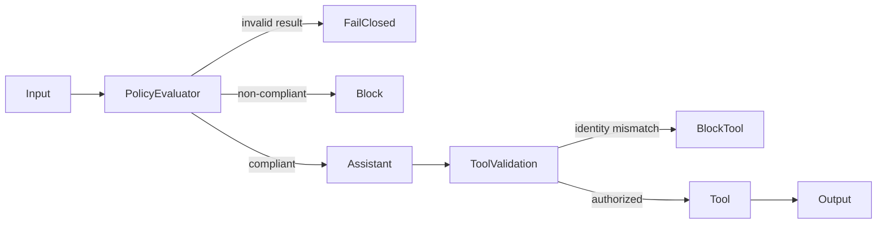

# Chapter 18 — Guardrails

> Book: *Agentic Design Patterns* (Antonio Gulli), Chapter 18. Implemented with Microsoft Agent Framework (C#) and Microsoft Foundry.

## The Pattern in One Paragraph

Guardrails check requests and tool arguments at deterministic boundaries around model work. A policy evaluator can classify user intent, typed validation can reject malformed decisions, and a tool must enforce caller authorization before any protected operation. The LLM helps interpret policy; application code remains responsible for validating the evaluator's contract and enforcing access.



## What This Demo Shows

| Variant | Source notebook | MAF / Foundry building blocks | What to observe |
|---|---|---|---|
| Policy middleware (MAF) | `Chapter_18_Guardrails_(LLM_as_Guardrail).ipynb` and `Chapter_18_Guardrails_(Practical_Examples).ipynb` | `ChatClientAgent`, agent run middleware, `RunAsync<PolicyEvaluation>` | The policy agent screens each request; only a valid compliant result reaches the primary assistant. Both notebooks' overlapping policy-screening ideas are combined, and the practical example's schema validation is deterministic. |
| Tool parameter validation (MAF) | `Chapter_18_Guardrails_(ADK_Validate_Tool).ipynb` | `AIFunctionFactory`, a server-owned authenticated user ID, deterministic function validation | A mismatched user ID is rejected before the simulated profile lookup. The model cannot grant access by changing its instructions. |
| Content Safety (Foundry-native) | `Chapter_18_Guardrails_(Practical_Examples).ipynb` | Azure AI Content Safety text-analysis API via `Azure.AI.ContentSafety` | Harm-category scores are checked against a deterministic severity threshold. This complements, but does not replace, domain-specific policy checks. |
| Hosted companion | Policy middleware (MAF) | Existing guardrail logic behind Foundry Agent Service's Responses protocol | One caller request is screened and answered or blocked; see [hosted guide](../Chapter18.Guardrails.Hosted/README.md). |

## Setup

1. Prerequisites: .NET 10 SDK, a Foundry project with a model deployment and API key.
2. Configure shared user-secrets once as described in [dotnet/README.md](../../README.md).
3. The native Content Safety variant additionally needs an Azure AI Content Safety resource endpoint and API key. Store them in shared user-secrets:

   ```powershell
   dotnet user-secrets set "Foundry:ContentSafetyEndpoint" "https://<content-safety-resource>.cognitiveservices.azure.com/" --project dotnet/src/Shared
   dotnet user-secrets set "Foundry:ContentSafetyApiKey" "<content-safety-api-key>" --project dotnet/src/Shared
   ```

   These settings can also be supplied as `Foundry__ContentSafetyEndpoint` and `Foundry__ContentSafetyApiKey`. The API key is used only by the local console variant; hosted Azure execution uses managed identity for the Foundry model.
4. Run all variants or select one:

   ```powershell
   dotnet run --project dotnet/src/Chapter18.Guardrails
   dotnet run --project dotnet/src/Chapter18.Guardrails -- policy
   dotnet run --project dotnet/src/Chapter18.Guardrails -- tool-validation
   dotnet run --project dotnet/src/Chapter18.Guardrails -- content-safety --text "Text to analyze"
   ```

   `all` (the default) includes the optional Content Safety call and therefore requires both Foundry model settings and Content Safety settings. `policy` and `tool-validation` require only the shared Foundry model settings. The model-backed policy demo uses the notebook's safe, non-compliant, and off-domain test categories; it does not send blocked requests to the answer agent.
5. If local Foundry credentials are unavailable, the protected `foundry-integration` GitHub Actions workflow includes a Chapter 18 live smoke test. The workflow checks out the default branch, so merge the workflow/test changes before running it from **Actions**.

## Notebook → C# Mapping

| Python (ADK / CrewAI) | C# (MAF / Foundry) |
|---|---|
| LLM-based pre-screening and CrewAI structured `PolicyEvaluation` output | `PolicyEnforcer` uses `ChatClientAgent.RunAsync<PolicyEvaluation>`; `RequireValidEvaluation` rejects malformed or inconsistent results before the primary agent is called. |
| ADK `before_tool_callback` compares a tool argument to session state | `GuardrailFunctions.GetUserProfile` compares the untrusted tool parameter with the server-owned authenticated user ID before returning simulated data. |
| CrewAI output guardrail parses and validates evaluator output | The typed MAF result and deterministic status/summary/policy checks enforce the output contract. |
| Content-policy screening | Azure AI Content Safety analyzes the supplied text for its supported harm categories; the demo blocks severity 4 or higher. |

## When to Use

- Before invoking a primary agent when requests need to pass a domain or safety policy.
- At function boundaries when the model proposes identifiers, amounts, or other caller-controlled parameters.
- When malformed model output must stop a workflow rather than be treated as an implicit success.

## When NOT to Use

- As the only security control for high-impact actions; authorization and validation must remain deterministic and independent of model judgment.
- When a policy requires a guaranteed classification. LLM and content classifiers can produce false positives and false negatives.
- When the request should be handled by a trusted subject-matter workflow but the policy instead blocks all off-domain discussion; define scope narrowly for the application.

## Real-World Scenarios

1. **Customer support** — screen incoming requests against support scope, then allow a specialist to answer only admitted questions.
2. **Account tools** — compare a requested account ID with authenticated caller context before retrieving or changing account data.
3. **Internal knowledge assistants** — reject requests to disclose hidden instructions and validate structured policy decisions before retrieval.
4. **Marketplace moderation** — combine Content Safety harm scores with deterministic blocklists and human review for borderline content.

## Extending with Microsoft Foundry

- Use Foundry's Guardrails + controls and Azure AI Content Safety to inspect supported harm categories, tune thresholds, and explore Prompt Shields. This sample calls the text-analysis API and does not implement Prompt Shields, image analysis, blocklists, or custom classifiers.
- Add tracing and evaluation datasets to measure false-positive and false-negative rates against an application-specific policy set.
- Keep prompts, tool arguments, and responses out of broadly accessible traces. Sensitive-data capture is enabled in this teaching demo; disable it before handling confidential inputs.

## Hosted Deployment Companion

- Suitability: the policy middleware is an ordinary request/response flow with no interactive approval, local-only dependency, or cross-request memory requirement.
- Project and deployment guide: [Chapter 18 hosted agent](../Chapter18.Guardrails.Hosted/README.md). The console and hosted paths share the MAF policy implementation.
- Authentication: local model access uses shared developer user-secrets; hosted Azure model access uses managed identity. Before remote invocation, verify or assign Cognitive Services OpenAI User to the deployed `instance_identity.principal_id` at the model-hosting Foundry account scope, allow for RBAC propagation, and recheck after redeployment.
- Packaging: azd uses bundled .NET 10 deployment to publish the host and referenced chapter/shared projects; secrets and `.azure` state are excluded.
- Request contract: the hosted agent screens one caller request, returns a block message for non-compliant input, and otherwise returns the guarded assistant's final response. Requests are isolated and stateless; completed output is buffered for the Responses protocol.
- Deployment: follow the hosted guide for project/model settings, permissions, deployment and invocation. Use your own project and model; do not deploy against the sample project configuration unchanged.

## Risks & Limitations

- A model-based policy evaluator can misclassify requests or share the primary model's blind spots. Treat its decision as one layer, not proof of safety.
- The sample follows the notebook's "uncertain means compliant" policy decision. Applications that require a conservative deny-on-uncertainty policy should change that business rule explicitly.
- Azure AI Content Safety only covers its supported harm categories in this demo; it does not decide whether a request is on-topic, academic cheating, brand-sensitive, or authorized.
- Additional classification calls increase latency and model/service costs. Tool checks are deterministic, but the example profile data and identity are simulated.
