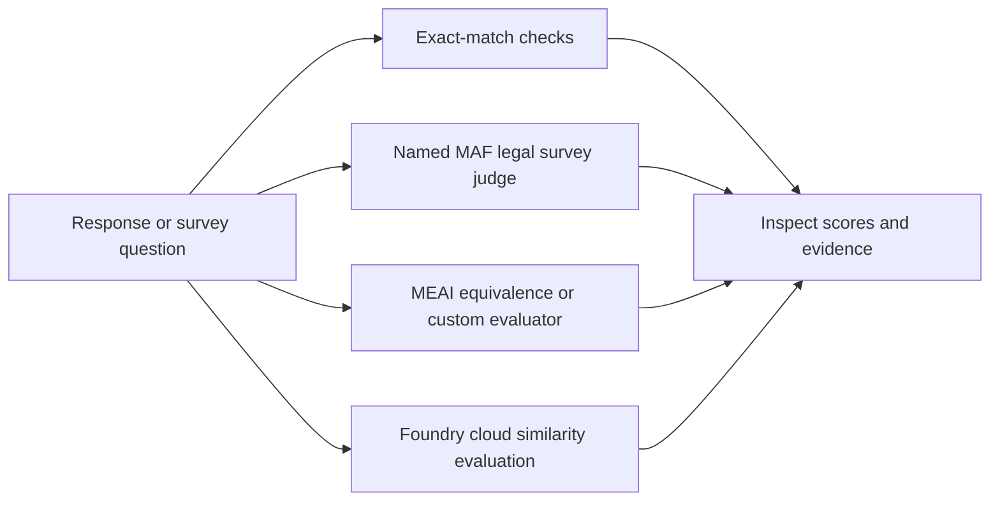

# Chapter 19 - Evaluation and Monitoring

> Book: *Agentic Design Patterns* (Antonio Gulli), Chapter 19. Implemented with Microsoft Agent Framework (MAF, C#) and Microsoft Foundry.

## The Pattern in One Paragraph

Measure an agent's outputs and execution rather than assuming plausible prose is correct. Use deterministic checks for exact requirements, provider usage and timing for operational measurements, and an independent rubric-driven judge for subjective quality. Keep the acceptance contract outside the model: a score is evidence for review, not proof of legal correctness or authorization to act.



## What This Demo Shows

| Variant / command | Source notebook | Building blocks | What to observe |
|---|---|---|---|
| `basic` | `Chapter_19_Evaluation_(Basic_Response_Evaluation).ipynb` | `ChatClientAgent`, `Stopwatch`, `AgentResponse.Usage` | Equivalent Paris sentences fail normalized exact match; a simulated weather tool is timed; two actual model calls expose latency and tokens. |
| `judge` | `Chapter_19_Evaluation_(LLM_as_Judge).ipynb` | Named `LegalSurveyJudge`, `RunAsync<SurveyJudgment>` | The original Swiss IP, FADP, and vague legal-tech questions receive five-criterion feedback and structured JSON. |
| `meai` | Both notebooks | `Microsoft.Extensions.AI.Evaluation.Quality.EquivalenceEvaluator`, custom `IEvaluator` | Semantic equivalence complements exact match; the same legal judge exposes a standard `NumericMetric` with an explicit threshold. |
| `foundry` (Foundry-native) | Basic response evaluation | `AIProjectClient`, OpenAI Evals API, `builtin.similarity` | Foundry scores the same precomputed Paris paraphrase in a cloud dataset run, with persisted per-item results. |
| Hosted companion | Legal survey judge | Existing judge + official Foundry Responses host | [Deploy the judge](../Chapter19.Evaluation.Hosted/README.md); a caller's question is evaluated, not the notebook batch. |

## Setup

1. Install .NET 10 and configure a Foundry chat-model deployment supporting structured outputs.
2. Set the shared endpoint, API key, and model deployment using [shared user-secrets setup](../../README.md). Console inference uses user-secrets or `Foundry__ProjectEndpoint`, `Foundry__ApiKey`, and `Foundry__ModelDeployment`. Optional aliases use `Foundry__ModelDeployments__<name>`.
3. Run from the repository root:

   ```powershell
   dotnet run --project dotnet\src\Chapter19.Evaluation
   dotnet run --project dotnet\src\Chapter19.Evaluation -- basic
   dotnet run --project dotnet\src\Chapter19.Evaluation -- judge --deployment fast
   dotnet run --project dotnet\src\Chapter19.Evaluation -- meai
   ```

   The default `all` runs `basic`, `judge`, and `meai` (nine inference calls). It deliberately does **not** create cloud evaluation resources.
4. To run the separate cloud variant, sign in with `az login` in the correct tenant, grant your identity the required [evaluation permissions](https://learn.microsoft.com/azure/foundry/observability/how-to/evaluation-permissions), and ensure the configured judge deployment supports the selected evaluator:

   ```powershell
   dotnet run --project dotnet\src\Chapter19.Evaluation -- foundry
   ```

   This command creates one evaluation and one run, uploads the synthetic Paris example inline, polls for at most five minutes, and prints the IDs and validated per-item result. It uses `DefaultAzureCredential` rather than the console API key for evaluation-service access. Keep the normal shared console settings configured. A polling timeout does not cancel the cloud job: use the printed IDs to inspect or cancel it in Foundry.
5. Without local credentials, use **Actions > Live Foundry smoke tests**, protected by the `foundry-integration` environment. That workflow supplies the `Foundry__*` variables from GitHub environment secrets. Select `FullyQualifiedName~Chapter19` to restrict the smoke run. It checks out the default branch, so merge the new chapter and smoke coverage first. Cloud evaluations require additional Entra ID permissions and are not included in this API-key-only workflow.

## Notebook -> C# Mapping

| Python | C# |
|---|---|
| `strip().lower()` exact match | Trim + ordinal case-insensitive equality, still returning 0 or 1 |
| `time.perf_counter()` and 150 ms sleep | `Stopwatch` and cancellable `Task.Delay`; elapsed time is measured, not asserted to equal 150 ms |
| Placeholder word counts | Actual provider-reported input/output token counts; absent usage is explicitly reported, never silently treated as zero |
| Two monitored prompts: capital and joke | Fresh MAF calls without shared conversation state, with per-call timing and cumulative usage |
| Gemini legal-survey judge | Shared Foundry `IChatClient` + named MAF `ChatClientAgent` |
| JSON response and `json.loads()` | Typed `RunAsync<SurveyJudgment>` and deterministic output validation |
| Five rubric criteria and three question examples | One shared rubric and all three original examples |
| Printed quality judgments | JSON plus optional MEAI `EvaluationResult` / `NumericMetric` adapter |

## Request and Scoring Behavior

The legal review retains the notebook's `overall_score`, `rationale`, `detailed_feedback`, `concerns`, and `recommended_action` keys. `detailed_feedback` is represented as an array instead of a formatted bullet string. Validation requires an integer score from 1 to 5, feedback naming all five criteria, nonempty rationale/action, and a concerns array (which may be empty). The model judges substance; code checks the contract.

The notebook's "good" example is a **sample label, not a gold-standard answer**. Its Swiss-law premise and intended audience deserve scrutiny too. The judge is asked to flag uncertain legal premises rather than certify them. No score ordering or exact model-generated score is promised.

The MEAI legal evaluator assesses a **survey question as the artifact in `modelResponse`**, not the judge's own prose. Its demonstration gate is `>= 4/5`; lower valid scores are reported as failed quality measurements, not execution failures. The CLI exits nonzero for invalid output, unavailable measurements, authentication/network errors, or cancellation. It is a teaching runner, not an automatic release gate.

## Choosing an Evaluation Approach

| Approach | Best fit | Important distinction |
|---|---|---|
| Deterministic C# / xUnit | Schemas, business rules, exact results, cancellation, routing, budgets | Fast and explainable; exact text matching is intentionally too strict for paraphrases. This chapter includes focused offline regression coverage. |
| **Microsoft.Extensions.AI.Evaluation (MEAI)** | Default .NET evaluation contracts, built-in quality metrics, custom domain rubrics | `IEvaluator` scores messages/responses. Quality evaluators use your `IChatClient`; the separate Safety package calls Foundry services. Reporting/caching and the `dotnet aieval` tool are optional additions. |
| **AgentEval** | Fluent tool-call/order/argument assertions, workflow trajectories, stochastic repetition, model comparisons | Independent, experimental .NET toolkit, not a Microsoft product. Complements MEAI rather than replacing it. Its MAF-native `IAgentEvaluator` adapter preserves full tool transcripts; timing/cost instrumentation needs its deeper harness. |
| **MAF built-in evaluation** | Lightweight local checks or batch orchestration directly on agents/workflows | `LocalEvaluator`, `FunctionEvaluator`, `EvalChecks`, and `agent.EvaluateAsync` provide a lighter alternative before adopting another harness. MEAI is the generic per-item interface; `IAgentEvaluator` is MAF's full-conversation batch interface. |
| **Foundry evaluations** | Shared datasets, cloud batch scoring, portal comparisons, safety, production monitoring | Managed evaluation service, separate authentication, permissions, regional support, retention, and costs. A local judge hosted on Foundry is not itself a native evaluation-service run. |

### AgentEval assessment

[AgentEval](https://github.com/AgentEvalHQ/AgentEval) is particularly relevant when testing **how** a tool-using agent reached an answer. Its [MEAI/MAF adapters](https://agenteval.dev/using-agenteval-with-maf-evals.html) let you reuse metrics with `agent.EvaluateAsync`; prefer its native `AsAgentEvaluator` path for full tool-call fidelity. Do not infer an agent is reliable from one successful stochastic run: repeated trials and pass-rate distributions are more informative.

AgentEval is assessed here, not installed or presented as an executable variant. The examined `AgentEval` package (`0.43.0-beta`) requires MAF `>= 1.23.0`, whereas this solution pins `1.22.0`; adding it would force a shared-framework upgrade or an isolated dependency boundary. Its umbrella package also brings reporting dependencies beyond this chapter's small console demo. Review the package's experimental disclaimer, pin a compatible release, and validate adapters against your chosen MAF version before adopting it. Do not assume examples from its main branch match an older NuGet release.

### Other useful approaches

- **MEAI NLP evaluators** (`F1`, BLEU, GLEU) offer repeatable, model-free reference-text comparisons; lexical overlap still does not prove semantic or legal correctness.
- **Human-reviewed golden datasets and pairwise/blind review** calibrate judges and thresholds. Keep holdout data separate from prompt tuning and measure evaluator agreement, false positives, and false negatives.
- [promptfoo](https://www.promptfoo.dev/docs/intro/) offers CLI/config-driven, cross-provider regression comparisons; use it when the evaluation boundary is a service rather than .NET internals.
- [DeepEval](https://deepeval.com/docs/getting-started) (Python/TypeScript) and [Ragas](https://docs.ragas.io/) (Python) fit separate evaluation pipelines, especially for RAG metrics. They introduce a separate runtime; they are not required to evaluate this .NET agent.
- **OpenTelemetry + Application Insights** supplies latency, token, tool, and error evidence; traces complement quality scoring rather than replace it. Use trace-derived, privacy-reviewed datasets for ongoing evaluation.

Recommendation: start with deterministic checks plus **MEAI**; add **AgentEval** when trajectory assertions or repeated-run benchmarking justify the dependency; use **Foundry** for shared cloud evaluation and operational monitoring.

## When to Use

- Compare prompts or models against a versioned, representative set of examples.
- Evaluate subjective qualities with an explicit, independently calibrated rubric.
- Catch tool-policy or operational regressions alongside answer-quality regressions.
- Review legal-survey wording before a qualified human approves the instrument.

## When NOT to Use

- As a substitute for legal advice, legal verification, or human approval.
- As an LLM judge for requirements that deterministic code can verify directly.
- To claim statistical reliability from the three illustrative questions in this demo.
- To automatically rewrite a production prompt based on the same data used to grade it.

## Real-World Scenarios

1. **Legal research operations** - Flag leading questions and undefined terms before researchers send a survey to counsel.
2. **Customer support** - Combine policy-grounded answer review with deterministic escalation and refund-rule checks.
3. **RAG knowledge assistants** - Measure retrieval/groundedness against vetted context, while separately measuring latency and token usage.
4. **Tool-using business agents** - Assert that lookup and approval happen before an action, then score final response usefulness.
5. **Model selection** - Repeat a held-out benchmark across deployment aliases, comparing quality distributions and operational cost rather than one lucky answer.

## Extending with Microsoft Foundry

The implemented native variant uses `builtin.similarity` on the notebook's basic-response scenario. Built-in relevance/coherence/safety evaluators answer different questions; they are not substitutes for the five-criterion legal rubric.

For cloud legal-survey scoring, register a [custom prompt-based evaluator](https://learn.microsoft.com/azure/foundry/concepts/evaluation-evaluators/custom-evaluators) using the shared rubric, mapping the survey question as the evaluated artifact. Adapt the output to Foundry's **`result` + `reason`** contract instead of copying the notebook JSON schema into the cloud prompt. Foundry also supports deterministic code-based and externally hosted endpoint-based evaluators; the hosted Responses companion is **not** the endpoint-evaluator HTTP contract.

Use versioned datasets, multiple runs, separate judge deployments where appropriate, and calibrated thresholds. Foundry's trace/conversation evaluations, synthetic data, comparisons, and continuous evaluation provide a path from this small local demo to EvalOps. Review supported regions, permissions, data governance, and pricing before enabling those services.

Sources: [MEAI libraries](https://learn.microsoft.com/dotnet/ai/evaluation/libraries), [MAF evaluation](https://learn.microsoft.com/agent-framework/agents/evaluation), [Foundry cloud evaluation](https://learn.microsoft.com/azure/foundry/observability/how-to/cloud-evaluation), [dataset evaluation](https://learn.microsoft.com/azure/foundry/observability/how-to/cloud-evaluation-datasets).

## Hosted Deployment Companion

The legal survey judge is a bounded request/response operation with no interactive console input or durable memory requirement, so it is suitable for hosting. The [separate companion](../Chapter19.Evaluation.Hosted/README.md) reuses the judge and rubric, returns one validated JSON judgment, and ignores prior turns for evaluation semantics. It uses the official Responses protocol integration, developer identity locally, and managed identity in Azure; the console API-key path is unchanged.

The guide covers bundled packaging, local invocation, deployment, sensitive tracing, required runtime inference access, costs, and agent-scoped cleanup. Artifact creation does not authorize deployment or RBAC writes. Before invoking a deployment, verify **Cognitive Services OpenAI User** (or equivalent) for the current `instance_identity.principal_id` at the actual model-hosting Foundry account scope, allow propagation, and recheck after redeployment.

The batch runner, MEAI comparisons, and cloud dataset jobs remain evaluation tooling rather than operations silently triggered by a hosted caller.

## Risks & Limitations

- Exact match misses valid paraphrases; semantic metrics can overlook factual or legal errors.
- LLM judges have bias, prompt-injection exposure, variance, and knowledge cutoffs; even an independent agent may share the generator's model biases.
- Evaluator agreement with human reviewers must be measured; a valid JSON shape does not imply a valid judgment.
- Latency and token usage measure operations, not correctness. Missing usage is missing evidence, not free execution.
- Repeated trials improve confidence but increase cost and time; tuning to a fixed benchmark risks overfitting.
- Traces and evaluation datasets can contain confidential material; apply access controls, retention rules, and redaction.
