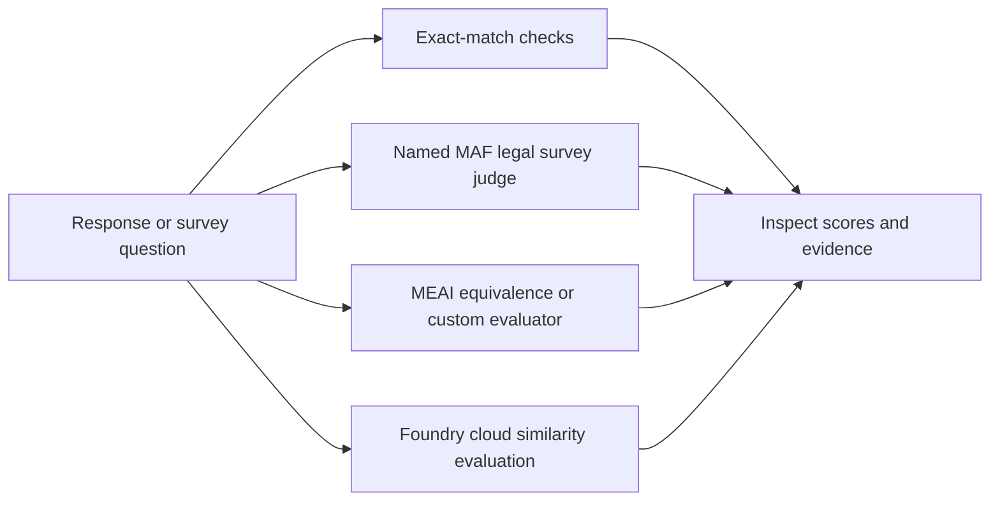

# Chapter 19 — Evaluation and Monitoring

> *Agentic Design Patterns*, Antonio Gulli, Chapter 19. C# / Microsoft Agent Framework (MAF).

Measure outputs rather than trusting plausible prose. Use deterministic checks for exact requirements, usage/timing for operations, and independent rubric-driven review for subjective quality. A score is evidence for review, not proof of legal correctness or authorization to act.



## Where to look in code

- [LegalSurveyJudge.cs](LegalSurveyJudge.cs), `EvaluateAsync`: shared five-criterion rubric and typed judgment.
- [Models/SurveyJudgment.cs](Models/SurveyJudgment.cs), `Validate`: score 1–5, all five feedback criteria, rationale/action and concerns contract.
- [LegalSurveyEvaluator.cs](LegalSurveyEvaluator.cs), `EvaluateAsync`: MEAI adapter; demonstration quality threshold ≥ 4/5.
- [Demos/BasicMetricsDemo.cs](Demos/BasicMetricsDemo.cs): normalized exact match, cancellable timing, actual provider usage.
- [Demos/FoundryEvaluationDemo.cs](Demos/FoundryEvaluationDemo.cs), `RunAsync` / `ValidateOutput`: bounded cloud lifecycle and strict per-item similarity contract.

## Notebook → C# mapping

| Notebook / variant | Implementation |
|---|---|
| `Chapter_19_Evaluation_(Basic_Response_Evaluation)` / `basic` | Paris paraphrases fail exact match; simulated weather-tool delay and two real model calls expose latency/tokens. |
| `Chapter_19_Evaluation_(LLM_as_Judge)` / `judge` | All three original Swiss IP/FADP/legal-tech examples, one typed five-criterion judge. Sample “good” labels are not gold standards. |
| `meai` | Built-in equivalence plus custom legal-survey `IEvaluator` / `NumericMetric`; the survey question is the evaluated artifact. |
| `foundry` | Native `builtin.similarity` cloud evaluation of the same precomputed Paris example. |

## Run

Configure .NET 10 and [shared model settings](../../README.md). From the repository root:

```powershell
dotnet run --project dotnet\src\Chapter19.Evaluation -- basic
dotnet run --project dotnet\src\Chapter19.Evaluation -- judge --deployment fast
dotnet run --project dotnet\src\Chapter19.Evaluation -- meai
dotnet run --project dotnet\src\Chapter19.Evaluation -- foundry
dotnet test dotnet\tests\Evaluation.Tests
```

Default `all` runs `basic`, `judge`, and `meai` (nine inference calls), **not** cloud-resource creation. `foundry` requires Entra sign-in and [evaluation permissions](https://learn.microsoft.com/azure/foundry/observability/how-to/evaluation-permissions). It creates one evaluation/run, uploads a synthetic inline example, prints IDs, polls for at most five minutes, and validates exactly one completed similarity result with a numeric 1–5 score and reason. Timeout does not cancel the cloud job: inspect/cancel it using those IDs. Cloud evaluation has separate persistence, permissions, retention, and charges.

Low valid scores are measurements, not execution errors. Invalid/missing measurements, authentication/network errors, and cancellation exit nonzero. The [hosted companion](../Chapter19.Evaluation.Hosted/README.md) evaluates one caller survey question; it never silently launches batch evaluations.

## When to use / not to use

**Use** for held-out model/prompt comparisons, calibrated subjective review, and quality/operational regression checks.
**Do not use** as legal advice, a substitute for deterministic assertions, or statistical reliability evidence from three illustrative questions.

## Real-world scenarios

1. Legal researchers flag leading survey questions before expert approval.
2. Support teams combine answer review with deterministic refund checks.
3. RAG teams evaluate evidence quality separately from latency.
4. Model owners compare held-out quality and cost distributions across aliases.

## Tradeoffs and Foundry extensions

Exact match rejects valid paraphrases; semantic judges can miss factual errors, share biases, and overfit benchmarks. Calibrate against human review and separate tuning/holdout sets. Missing usage is missing evidence, not free execution. Start with deterministic tests plus [MEAI](https://learn.microsoft.com/dotnet/ai/evaluation/libraries); [AgentEval](https://github.com/AgentEvalHQ/AgentEval), [promptfoo](https://www.promptfoo.dev/docs/intro/), [DeepEval](https://deepeval.com/docs/getting-started), and [Ragas](https://docs.ragas.io/) are optional external approaches, not installed variants.

Foundry adds shared datasets, custom rubrics, comparisons, and continuous evaluation. A local judge hosted through Responses is **not** Foundry's endpoint-evaluator contract. See the [hosted guide](../Chapter19.Evaluation.Hosted/README.md) and [HOSTING.md](../../HOSTING.md) for deployment/RBAC, sensitive tracing/data handling, packaging, costs, and scoped cleanup.
