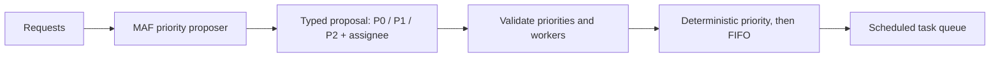

# Chapter 20 — Prioritization

> Book: *Agentic Design Patterns* (Antonio Gulli), Chapter 20. Implemented with Microsoft Agent Framework (C#) on Microsoft Foundry.

## The Pattern in One Paragraph

Prioritization turns incoming work into an ordered queue without letting a probabilistic model control the scheduler. The model proposes a typed priority and worker for each task; application code validates those proposals and deterministically orders tasks by priority, preserving arrival order for ties.



## What This Demo Shows
| Variant | Source notebook | MAF / Foundry building blocks | What to observe |
|---|---|---|---|
| Task prioritization (MAF) | `Chapter_20_Prioritization_(SuperSimplePM).ipynb` | `ChatClientAgent`, structured `RunAsync<PriorityProposal>`, deterministic `PriorityScheduler` | Urgent work is proposed as P0; the code validates proposals and orders ties by arrival. |
| Foundry-native | Same | Not applicable: Foundry has no separate native task-prioritization or deterministic scheduling primitive. | Prioritization stays application logic around the MAF model call. |
| Hosted companion | Same | Existing `PrioritizationWorkflow` behind Foundry Agent Service Responses | Send caller-provided task lines and receive a fresh, isolated schedule; see the [hosted guide](../Chapter20.Prioritization.Hosted/README.md). |

## Setup
1. Prerequisites: .NET 10 SDK and a Foundry project with a chat model deployment and API key.
2. Configure shared user-secrets once as described in [dotnet/README.md](../../README.md).
3. The console demo uses the Foundry model deployment through the shared API-key client. GitHub Actions can use the protected `foundry-integration` environment and `Foundry__*` variables described in the shared guide.
4. Run the notebook's two example tasks:
   ```powershell
   dotnet run --project dotnet/src/Chapter20.Prioritization
   ```
5. Provide one or more task requests to schedule:
   ```powershell
   dotnet run --project dotnet/src/Chapter20.Prioritization -- --task "Urgent: restore sign-in" --task "Review release notes"
   ```
6. Select a configured model alias when needed:
   ```powershell
   dotnet run --project dotnet/src/Chapter20.Prioritization -- --deployment quality
   ```

## Notebook → C# Mapping
| Python (LangChain) | C# (MAF) |
|---|---|
| `ChatOpenAI` and `create_react_agent` with the project-manager prompt | `ChatClientAgent` backed by the shared Foundry `IChatClient` |
| `create_new_task_tool` and the in-memory task manager | Request-scoped `ProjectTask` records with deterministic IDs |
| Model calls to assign priority and worker | Structured `RunAsync<PriorityProposal>` for each task |
| `ConversationBufferMemory` and listing the manager's current tasks | The console passes both notebook requests in one run; each hosted request has fresh state and returns its complete queue |
| Tool-driven priority ordering | Validated proposals followed by deterministic priority/FIFO scheduling |

## When to Use
- A team needs to turn incoming work requests into a transparent priority queue.
- Model judgment can extract urgency, but policy and queue ordering must remain testable and deterministic.
- A bounded request contains a manageable batch of independent tasks.

## When NOT to Use
- Priority depends on live, authoritative data such as contractual SLAs, production impact, or regulatory deadlines that the model cannot reliably access.
- Scheduling requires durable cross-request state, dependencies, capacity reservations, or transactional assignment; connect a persistent queue and deterministic policy service instead.
- The business requires approval before work is assigned or reprioritized; add an explicit human approval step rather than treating a model suggestion as authorization.

## Real-World Scenarios
1. **Incident triage** — classify new incident reports, then apply a stable queue order while a separate deterministic policy enforces severity and SLA rules.
2. **Product backlog intake** — propose urgency and a team for feature requests, preserving submit order when multiple items receive the same priority.
3. **Support operations** — sort a bounded set of incoming cases, then route validated assignments to a human-owned ticketing system.
4. **Release readiness** — prioritize submitted readiness tasks while leaving release gates and deployment decisions in deterministic application code.

## Extending with Microsoft Foundry
- Use tracing to inspect the model proposal and the deterministic schedule. Sensitive-data capture can include task text and model output; restrict its use and access.
- Evaluate priority proposals against a labeled task set before changing the prompt or deployment.
- Connect a durable work queue and a deterministic business-rules service when scheduling must span requests or use authoritative operational data.

## Hosted Deployment Companion
- Suitability: ordinary request/response work; each call contains task lines, returns the final schedule, and uses no persisted conversation state or interactive approval.
- Project and deployment guide: [Chapter 20 hosted companion](../Chapter20.Prioritization.Hosted/README.md); the console demo remains available.
- Authentication: local developer credentials or shared user-secrets; hosted Azure execution uses managed identity. Verify or grant **Cognitive Services OpenAI User** for `instance_identity.principal_id` at the model-hosting Foundry account scope, and allow RBAC propagation before remote invocation.
- Packaging: azd bundled .NET 10 deployment includes the hosted and referenced Chapter 20/Shared projects; `.agentignore` excludes secrets and build output.
- Request contract: each nonempty input line is a task; the response lists validated priority, assignee, and deterministic queue order. Requests are isolated; output is buffered until all task proposals complete.
- Deployment: follow the hosted guide for local invocation, service-scoped deployment, inference access, costs, and agent-scoped cleanup.

## Risks & Limitations
- Model judgment can misread urgency or an assignee; validate proposals, evaluate representative inputs, and keep the scheduler and consequential actions deterministic.
- Priority tiers simplify tradeoffs and do not encode every business constraint; FIFO ties can still delay equally ranked work.
- The in-memory demo does not persist tasks across requests. Production scheduling that needs durable state or cross-task dependencies requires a persistent queue and explicit transactional rules.
