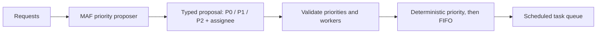

# Chapter 20 — Prioritization

> *Agentic Design Patterns*, Antonio Gulli, Chapter 20. C# / Microsoft Agent Framework (MAF).

Let a model propose urgency and worker assignment, but let deterministic code own queue order. Typed proposals are validated before scheduling; priority orders the queue and arrival order breaks ties.



## Where to look in code

- [PrioritizationWorkflow.cs](PrioritizationWorkflow.cs), `ProposeTaskAsync`: enum-constrained structured output, worker validation, one corrective retry.
- Same file, `RunAsync`: bounded batch, stable IDs, intermediate proposals, final schedule.
- [PriorityScheduler.cs](PriorityScheduler.cs), `Schedule`: deterministic ordering, valid state, and unique task IDs.
- [Models/ProjectTask.cs](Models/ProjectTask.cs): `TaskPriority` schema and request-scoped records.
- [Hosted PrioritizationAgent.cs](../Chapter20.Prioritization.Hosted/PrioritizationAgent.cs), `ParseTaskDescriptions`: newline **and** JSON batch contracts.

## Notebook → C# mapping

| `Chapter_20_Prioritization_(SuperSimplePM)` | C# |
|---|---|
| LangChain project-manager agent and task tool | `ChatClientAgent.RunAsync<PriorityProposal>`; model proposes, code validates. |
| In-memory task manager | Per-request `ProjectTask` records with deterministic `TASK-001` IDs. |
| Priority tool / current-task listing | `PriorityScheduler` returns P0 → P1 → P2, preserving FIFO ties. |
| Conversation memory | Both notebook examples are one console batch; hosted calls have fresh state, not a global task manager. |

Foundry has no separate native deterministic task scheduler used here; hosting wraps the same application policy.

## Run

Configure .NET 10 and [shared model settings](../../README.md). From the repository root:

```powershell
dotnet run --project dotnet\src\Chapter20.Prioritization
dotnet run --project dotnet\src\Chapter20.Prioritization -- --task "Urgent: restore sign-in" --task "Review release notes"
dotnet run --project dotnet\src\Chapter20.Prioritization -- --deployment quality
dotnet test dotnet\tests\Prioritization.Tests
```

Without `--task`, the two original login/marketing examples run. Repeated `--task` accepts a batch of **1–20** descriptions; one optional `--deployment` selects an alias. Each task allows at most **two** model calls, including a corrective retry. Allowed workers are Worker A, Worker B, and Review Team; an omitted worker defaults to Worker A. Unknown workers, missing/undefined priorities, or exhausted retries fail explicitly. Proposed urgency is model judgment; stable scheduling is guaranteed by code.

The [hosted companion](../Chapter20.Prioritization.Hosted/README.md) accepts newline tasks or `{"tasks":["..."]}`, returning a fresh queue after all proposals complete.

## When to use / not to use

**Use** for bounded intake batches where model judgment extracts urgency and code must own queue order.
**Do not use** for authoritative SLA severity, durable dependency/capacity scheduling, or consequential assignment without approval.

## Real-world scenarios

1. Incident triage proposes urgency before deterministic SLA enforcement.
2. Backlog intake preserves submission order among equally ranked work.
3. Support teams prepare suggestions for a human-owned ticket queue.
4. Release teams rank readiness tasks without delegating release gates.

## Tradeoffs and Foundry extensions

Models can misread urgency/assignees; three tiers omit richer business constraints. FIFO does not prevent starvation from sustained higher-priority arrivals. The demo has no persistence or external assignment side effects. Add a transactional queue and deterministic business-rules service for production, and evaluate proposal accuracy on labeled examples.

See [HOSTING.md](../../HOSTING.md) for deployment, inference RBAC, sensitive tracing, packaging, costs, and scoped cleanup. Keep caller batch formats and limits in the [hosted contract](../Chapter20.Prioritization.Hosted/README.md).
