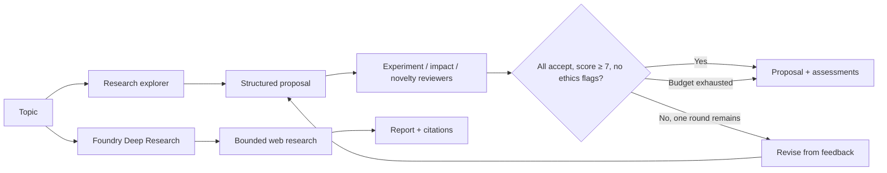

# Chapter 21 — Exploration & Discovery

> Book: *Agentic Design Patterns* (Antonio Gulli), Chapter 21. Implemented with Microsoft Agent Framework (C#) and Microsoft Foundry.

## The Pattern in One Paragraph

Exploration and discovery help investigate questions whose solution space is not yet known. The MAF demo turns a topic into a testable research proposal, then uses three independent reviewer perspectives to expose gaps and guide one bounded revision. An optional Foundry Deep Research variant explores public web sources and returns citations when the question needs current evidence.



## What This Demo Shows

| Variant | Source notebook | MAF / Foundry building blocks | What to observe |
|---|---|---|---|
| Bounded proposal and review (MAF) | `Chapter_21_Exploration_Discovery_(Agent_Laboratory).ipynb` | `ChatClientAgent`, structured `RunAsync<T>`, three reviewer agents, deterministic loop and acceptance checks | The proposal is reviewed for experimental value, impact, and novelty, with at most two review rounds and a three-minute request budget. |
| Cited web discovery (Foundry-native) | Same research topic | Foundry Responses API, Deep Research deployment, built-in `web_search` with domain filters | A background research request returns a report, citation annotations, and available search-step metadata. |
| Hosted companion | MAF proposal-and-review loop | Existing MAF workflow + Foundry Responses protocol host | [Hosted companion guide](../Chapter21.ExplorationDiscovery.Hosted/README.md). Each request is isolated and returns a completed proposal. |

## Setup

1. Prerequisites: .NET 10 SDK and a Microsoft Foundry project with a chat model deployment and API key.
2. Configure shared user-secrets once — see [dotnet/README.md](../../README.md). Never store API keys in source or `appsettings.json`.
3. For cloud-agent validation, `.github/workflows/live-foundry-tests.yml` uses the protected `foundry-integration` environment and maps its secrets to `Foundry__*` environment variables. Live validation for this chapter is added to that workflow; run it after the workflow changes are on the default branch.
4. To run the Foundry-native variant, use a Deep Research deployment that supports the Responses API and built-in web search, and configure its alias:
   ```powershell
   dotnet user-secrets set "Foundry:ModelDeployments:deep-research" "<deep-research-deployment-name>" --project dotnet/src/Shared
   ```
   Deep Research requires one to ten explicit `--domain <host>` values. The Responses API applies these as an allowlist and caps the request at eight tool calls; the background task has a 15-minute timeout. Model and web-search usage may incur additional cost. It is separate from the MAF proposal/review loop.
5. Run locally:
   ```powershell
   dotnet run --project dotnet/src/Chapter21.ExplorationDiscovery
   dotnet run --project dotnet/src/Chapter21.ExplorationDiscovery -- explore --topic "Test whether adaptive batching reduces inference cost without harming tail latency."
   dotnet run --project dotnet/src/Chapter21.ExplorationDiscovery -- deep-research --topic "How has adaptive batching affected inference latency and cost?" --domain arxiv.org --domain nature.com
   ```
   The default runs the MAF loop. Use `--deployment <chat-model-alias>` to select a configured chat deployment, or `--research-deployment <alias>` for Deep Research. Both variants accept topics of at most 4,000 characters.
6. Validate in GitHub Actions when local credentials are unavailable:
   - Open **Actions** → **Live Foundry smoke tests** after this change is merged to the default branch.
   - Run the workflow with the protected `foundry-integration` environment configured.

## Notebook → C# Mapping

| Python scaffold | C# (MAF / Foundry) |
|---|---|
| `PostdocAgent` phases for plan formulation and results interpretation | `ResearchExplorer` creates a structured investigation proposal and revises it using reviewer feedback. The demo does not claim to run the proposed experiment. |
| `ProfessorAgent` report-writing responsibility | The final `ExplorationResult` composes the proposal, risks, evidence needs, and review outcomes into a concise report. |
| Three `ReviewersAgent` perspectives for experiment quality, impact, and novelty | Three structured MAF reviewer agents run independently; deterministic code validates ratings and accepts only when every reviewer accepts with an overall score of at least 7 and no ethical concern is flagged. |
| AI-lab experiment workflow and artifacts | The notebook contains role and prompt fragments but no runnable dataset, experiment executor, or result samples. The C# demo makes the discovery stage executable without inventing experiment results. |
| Literature search for fresh and traceable evidence | Foundry Deep Research uses `web_search` with an explicit domain allowlist and returns citations; it is a separate native capability rather than a claim that the MAF proposal loop browses the web. |

## When to Use

- The question is open-ended and needs candidate hypotheses, investigation steps, and explicit evidence needs.
- A team wants multiple perspectives to challenge a research proposal before investing in data collection or engineering work.
- Current public information and traceable sources are required; use the Deep Research variant for that evidence-gathering stage.

## When NOT to Use

- The question has a known answer or a deterministic procedure; use a direct query or ordinary code instead.
- The outcome must be treated as a verified literature review, experimental finding, or expert judgment without human source review.
- An agent is expected to execute experiments or take external actions without explicit tools, permissions, and deterministic approval gates.
- The task requires persistent project memory or a multi-hour research job; use an explicit persistence and durable-job design.

## Real-World Scenarios

1. **ML experiment design** — propose a controlled comparison of inference settings, define measurable outcomes, then have reviewers identify confounders before any run.
2. **Platform investigation** — outline evidence to collect when comparing migration options and expose assumptions before selecting an architecture.
3. **Product discovery** — turn a broad user problem into testable questions and evidence needs for a product team to validate.
4. **Policy research** — use Foundry Deep Research to gather dated public sources and citations, then have a qualified analyst assess source quality and applicability.

## Extending with Microsoft Foundry

- Use Foundry Deep Research and web search for current, citation-bearing discovery. Review source quality and citations; citations alone do not prove a claim.
- Deep Research uses an explicit domain allowlist, an eight-call tool budget, and a 15-minute timeout; see [web search domain filtering](https://learn.microsoft.com/azure/foundry/openai/how-to/web-search) for the service boundary.
- Add Foundry tracing and evaluation criteria for proposal testability, evidence coverage, and reviewer agreement.
- Route private or enterprise evidence through an approved, narrowly scoped MCP or search connection rather than exposing unrestricted data sources.
- Preserve deterministic limits on iterations, elapsed time, model calls, accessible domains, and external actions.

## Hosted Deployment Companion

- Suitability: the MAF proposal/review flow is a bounded request/response operation. Deep Research is intentionally not hosted here because its long-running background work needs a durable job and polling design.
- Project and deployment guide: [Chapter 21 hosted companion](../Chapter21.ExplorationDiscovery.Hosted/README.md); the `chapter21-exploration-discovery` service is deployed from the hosted project folder with its own `azure.yaml`.
- Authentication: local hosted runs use developer credentials when the API key is unset; Azure uses managed identity. Before remote invocation, verify `instance_identity.principal_id` has **Cognitive Services OpenAI User** at the actual model-hosting Foundry account scope, after approval for any role assignment; allow time for RBAC propagation.
- Packaging: bundled .NET 10 deployment publishes the host and referenced Chapter 21 and Shared projects. `.agentignore` excludes secrets, `.azure`, and build outputs.
- Request contract: one user topic produces one completed proposal and reviewer report. Each request has a fresh isolated session; no conversation history is persisted.

## Risks & Limitations

- Model-generated plans and reviews are judgment aids, not evidence that an experiment is valid or a research claim is true.
- Reviewer agreement can reflect shared model bias; independent prompts do not guarantee independent evidence or expertise.
- Exploration consumes more model calls and latency than direct question answering. The bounded revision count and request timeout constrain that cost but do not guarantee acceptance.
- Web research adds source-quality, prompt-injection, privacy, latency, and cost risks. Review citations and evidence before using findings for consequential decisions.
