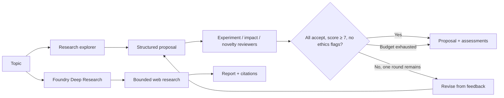

# Chapter 21 — Exploration & Discovery

> *Agentic Design Patterns*, Antonio Gulli, Chapter 21. C# / Microsoft Agent Framework (MAF).

Turn an open question into a testable investigation proposal, challenge it from three independent perspectives, and allow one bounded revision. Keep proposal generation separate from evidence: no experiment or literature search has happened merely because reviewers agree. Optional Foundry Deep Research gathers public-source evidence separately.



## Where to look in code

- [ExplorationWorkflow.cs](ExplorationWorkflow.cs), `RunAsync`: explorer → parallel experiment/impact/novelty panel → deterministic acceptance or revision.
- Same file, `ValidateProposal` / `ValidateAssessment`: shape, score, and list checks; acceptance requires every decision Accept, overall ≥ 7, and **no ethical concern**.
- [Models/ReviewerAssessment.cs](Models/ReviewerAssessment.cs): concise review schema retaining summary, strengths/weaknesses, questions, limitations, confidence, decision, and explicit ethics flag.
- [DeepResearchDemo.cs](DeepResearchDemo.cs), `RunAsync`: optional native research with mandatory deployment alias and public-domain allowlist.

## Notebook → C# mapping

| `Chapter_21_Exploration_Discovery_(Agent_Laboratory)` | Implementation |
|---|---|
| Postdoc planning and revision | Typed `ResearchExplorer` proposal and reviewer-feedback loop. |
| Three harsh-but-fair reviewer perspectives | Independent structured calls in parallel; code owns the acceptance gate. |
| Professor report writing | `ExplorationResult.Format` presents proposal, evidence needs, risks, and reviews. |
| Incomplete experiment/literature scaffold | Explicitly unverified proposal; optional native Deep Research is a separate citation-bearing capability. |

## Run

Configure .NET 10 and [shared model settings](../../README.md). From the repository root:

```powershell
dotnet run --project dotnet\src\Chapter21.ExplorationDiscovery
dotnet run --project dotnet\src\Chapter21.ExplorationDiscovery -- explore --topic "Test adaptive batching against latency and cost." --deployment quality
dotnet run --project dotnet\src\Chapter21.ExplorationDiscovery -- deep-research --topic "How does adaptive batching affect inference latency?" --research-deployment deep-research --domain arxiv.org --domain nature.com
dotnet test dotnet\tests\ExplorationDiscovery.Tests
```

`explore` is the default. Topics are at most **4,000 characters**. The MAF loop allows **two rounds, at most eight model calls total** (one explorer plus three reviewers per round), and a **three-minute** linked cancellation budget. It prints proposals, review conclusions, and revision outcomes; rejection at the budget returns “needs human review,” not false acceptance.

Deep Research requires a configured `Foundry:ModelDeployments:deep-research` alias (or selected `--research-deployment` alias), **1–10** `--domain` hosts, an **eight-tool-call** cap, and a **15-minute** background timeout. Tool calls are not the MAF loop's model-call budget. Both modes support Ctrl+C. The [hosted companion](../Chapter21.ExplorationDiscovery.Hosted/README.md) serves only the bounded MAF loop; durable research jobs need their own persistence/polling design.

## When to use / not to use

**Use** for open-ended hypotheses, evidence planning, and multiple perspectives before investing in experiments.
**Do not use** for known deterministic answers, verified findings without human source review, autonomous experiments, or multi-hour durable projects.

## Real-world scenarios

1. ML teams design controlled inference-setting comparisons.
2. Platform teams identify evidence needed for migration decisions.
3. Product teams turn broad problems into testable discovery questions.
4. Policy analysts gather dated public sources and review applicability.

## Tradeoffs and Foundry extensions

Reviewer agreement can reflect shared bias rather than independent evidence. Extra calls increase cost and latency; bounded budgets do not guarantee acceptance. Web research adds privacy, prompt-injection, and source-quality risks: inspect citations. Foundry evaluation/tracing can measure testability and reviewer agreement; approved enterprise retrieval should retain explicit domain/data/action scope.

See [HOSTING.md](../../HOSTING.md) for deployment, inference RBAC, sensitive tracing, packaging, costs, and scoped cleanup; the [hosted contract](../Chapter21.ExplorationDiscovery.Hosted/README.md) specifies isolation and buffered results.
