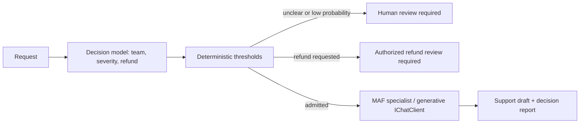

# Decision Models - bounded judgments inside agentic workflows

> A supplemental demo spanning Antonio Gulli's Routing, Prioritization, Guardrails, and Evaluation patterns. Uses Microsoft Agent Framework (MAF), Microsoft.Extensions.AI (MEAI), Microsoft Foundry, and [ElBruno.AI.Decisions](https://github.com/elbruno/ElBruno.AI.Decisions).

## The pattern in one paragraph

Not every agent step needs generated text. A decision model answers a bounded question with a selected label, probabilities, or an ordered score; application code decides what those numbers permit. This demo classifies a support request, scores its impact, and assesses whether it requests a refund. A MAF workflow then either invokes the selected generative specialist or returns an explicit review requirement, without performing account actions.



## What this demo shows

| Variant | Source / inspiration | Building blocks | What to observe |
|---|---|---|---|
| `microsoft` | Foundry's support-ticket decision example | `FoundryDecisionClient`, `SystemOne`, Microsoft-Decision-1 | Choice, Score, and Noul probabilities; no generated rationale |
| `openai` | Azure OpenAI Decisions support-routing example | Same library with `OpenAIDecisions`, gpt-6-luna | A distinct endpoint and wire contract, not a chat-completion emulation |
| `maf` | Chapter 02's classifier-to-specialist pattern, applied to support | `WorkflowBuilder`, typed executors, conditional edges, named `ChatClientAgent` specialists | Only an admitted request incurs a generative call |
| `all` (default) | Same three support examples | Both native providers, then MAF with Microsoft decisions | Comparable questions and criteria, not a statistical benchmark |
| [Hosted companion](../DecisionModels.Hosted/README.md) | Same reusable workflow | Official Foundry Responses host | Processes caller text; independent requests; buffered final output |

This is an original cross-pattern supplement, not a new numbered book chapter or a replacement for the existing chapter demos. The two native variants are distinct model APIs; merely hosting the workflow is not another native decision primitive.

## What a decision model does

| Primitive | Microsoft-Decision-1 | Azure OpenAI Decisions | Meaning |
|---|---|---|---|
| Classification | `choice` with a criteria dictionary | `choice` with a choices array | One supplied label and a probability per option |
| Ordered judgment | `score` with ordered criteria | `score` with ordered levels | Probability-weighted average of **zero-based** level indexes |
| Proposition | `noul` | `predicate` | Estimated probability that the proposition is true, not an automatic Boolean |
| Evidence | `state`: text or JSON | `input`: text or user messages, including images | Shared evidence against which questions are judged |
| Questions / answers | Named objects | Arrays; correlate by question name | The wire formats are not interchangeable |
| Endpoint | `/providers/microsoft/v1/systemone` | `/openai/v1/decisions` | Both use a **deployment name** in `model` |

Microsoft-Decision-1 produces numerical judgments rather than free-form prose, explanations, tool calls, or chain-of-thought. Use a generative model to draft or explain content. The Azure OpenAI Decisions API currently requires a gpt-6-luna deployment; an arbitrary chat deployment, including the default chat model used by this repository, is not interchangeable with it. Microsoft documents an East US 2 exclusion from the Decisions API rollout; verify current regional support before deploying.

**Probability is not certainty.** A selected label's probability and the provider's separate `Confidence` are different fields. This demo thresholds the former and prints both. Changing wording, label order, evidence, or the rubric can change results; restricted options still force a choice unless an abstention label is supplied. `unclear` is an explicit option, not a magically detected failure state.

**Scores are not integers.** With severity levels 0 through 3, a distribution `[0, 0.5, 0.5, 0]` has score `1.5`. Two very different distributions can have the same average. Preserve the distribution, do not silently round a score into a category, and do not compare unrelated rubrics as if they had the same units.

**Usage is provider-reported.** Missing token counts remain `null`; zero is a valid reported value. The library does not infer a total. Zero output tokens on a decision endpoint does not mean inference is free, and equal token counts across providers do not imply equal cost or computation.

**Refusals are not negative judgments.** The OpenAI API can refuse an individual question. The shared `IDecisionClient` operations surface that as `DecisionException`; the demo fails explicitly rather than treating a refusal, HTTP failure, or malformed distribution as approval. Provider-specific `DecideAsync` supports named multi-question/image input and per-question refusal handling if an application needs those capabilities.

## Setup and run

Use .NET 10 and configure the shared [Foundry user-secrets](../../README.md). Preserve your generative default; configure the two decision deployments separately:

```powershell
dotnet user-secrets set "Foundry:ProjectEndpoint" "https://<resource>.services.ai.azure.com/api/projects/<project>" --project dotnet\src\Shared
dotnet user-secrets set "Foundry:ApiKey" "<your-api-key>" --project dotnet\src\Shared
dotnet user-secrets set "Foundry:ModelDeployment" "<generative-chat-deployment>" --project dotnet\src\Shared
dotnet user-secrets set "Foundry:ModelDeployments:decision" "<microsoft-decision-deployment>" --project dotnet\src\Shared
dotnet user-secrets set "Foundry:ModelDeployments:openaiDecision" "<gpt-6-luna-deployment>" --project dotnet\src\Shared

dotnet run --project dotnet\src\DecisionModels
dotnet run --project dotnet\src\DecisionModels -- microsoft
dotnet run --project dotnet\src\DecisionModels -- openai
dotnet run --project dotnet\src\DecisionModels -- maf --provider openai
dotnet run --project dotnet\src\DecisionModels -- maf --input "Checkout is down for every customer."
dotnet run --project dotnet\src\DecisionModels -- --help
```

`microsoft` requires only its decision alias; `openai` requires only its own alias. `maf` defaults to Microsoft decisions and additionally needs the generative default. `all` needs both aliases. `--input` replaces the sample batch with one caller-supplied request. `--provider` selects the decision backend for the MAF variant; it does not change the native variants. Ctrl+C propagates cancellation.

Cloud credentials use `Foundry__ProjectEndpoint`, `Foundry__ApiKey`, `Foundry__ModelDeployment`, `Foundry__ModelDeployments__decision`, and `Foundry__ModelDeployments__openaiDecision`. Missing aliases fail explicitly: the demo never substitutes a chat-completion model or synthetic results.

For GitHub Actions, keep credentials in the protected `foundry-integration` environment used by `.github/workflows/live-foundry-tests.yml`; never put keys in source or workflow literals. Default CI picks up this solution's deterministic tests. The existing live chapter smoke suite does not invoke this supplement: an authorized live job must map the two additional alias secrets and run the commands above. Workflow changes must be merged to the default branch before the repository's protected live workflow can use them.

### Deploying the models

Use your project's parent Foundry account. First inspect existing deployments, available SKUs, regional API support, quota, and current pricing; reuse a matching deployment when possible. Microsoft documents this CLI shape:

```powershell
az cognitiveservices account deployment create --name "<account>" --resource-group "<resource-group>" --deployment-name "<decision-deployment>" --model-name "Microsoft-Decision-1" --model-format Microsoft --model-version "1" --sku-name "<supported-SKU>" --sku-capacity <available-capacity>
```

Select an available `DataZoneStandard` deployment when data-zone processing is required, or `GlobalStandard` where supported and appropriate. These differ in processing locality, not in the decision question schema. Do not assume global processing meets regional residency requirements. Deploy gpt-6-luna separately using its supported model version, SKU, and capacity. See the official [Microsoft decision deployment guide](https://learn.microsoft.com/azure/foundry/foundry-models/how-to/use-foundry-models-microsoft-decision) and [OpenAI Decisions prerequisites](https://learn.microsoft.com/azure/foundry/openai/how-to/decisions).

## Implementation scope and request behavior

The native demo makes **three sequential requests per input** using the portable `ChooseAsync`, `ScoreAsync`, and `AssessAsync` methods. Both services can evaluate multiple questions against shared evidence, but batching is not used here so each intermediate result and its usage remain visible. The shared path is text-only; JSON text can be supplied as evidence, but it is not converted to native structured state.

`DecisionWorkflow` owns the questions, choices, and rubric. `ApplyPolicy` validates the exact label set, scale length, and distribution sums, then applies illustrative thresholds:

| Condition | Application outcome |
|---|---|
| Selected team is `unclear`, or its probability is below `0.8` | `human-review`; no chat call |
| Otherwise, refund probability is at least `0.5` | `refund-review`; no chat call |
| Otherwise | `draft-response`; invoke only the selected specialist |
| Expected severity is at least `1.5` | `urgent`; otherwise `normal` |

Equality meets each threshold. Review for ambiguity takes precedence over refund review. Priority is a proposal in the report, **not a real scheduler**. Review outcomes are returned to the caller, **not persisted queues or completed human approvals**. The draft specialists have no account/action tools. No refund, booking, ticket creation, or production change takes place.

The numbers are teaching policy, not calibrated production defaults. Establish appropriate thresholds with labeled data and asymmetric error costs before automation.

## Notebook to C# and agentic-pattern mapping

| Book / notebook concept | Decision-model adaptation |
|---|---|
| Chapter 02 ADK coordinator and specialist delegation | Bounded `choice` result routes to a named MAF specialist |
| Chapter 02 LangGraph branch and `unclear` handler | Typed conditional edges and an explicit abstention/review branch instead of parsing a generated route token |
| Chapter 02 OpenRouter transport example | Foundry-native decision client rather than another generic chat transport |
| Chapter 16 resource optimization | One focused decision can avoid an unnecessary generative call; measure total latency and costs rather than assuming savings |
| Chapter 18 guardrails | Proposition assessment informs a review gate; deterministic authorization is still mandatory |
| Chapter 19 evaluation | Replace an open-ended judge with an ordered score rubric when a bounded numerical judgment is sufficient |
| Chapter 20 prioritization | Expected severity becomes typed priority; a real deterministic scheduler would own execution |
| Bounded Agentic Island | Model judgment occurs inside a code-owned contract with finite outcomes |
| Evaluator Contract | Explicit questions, allowed labels, score levels, and measurable acceptance thresholds |
| Safe-Action Gateway | A refund signal requests review; it never authorizes a money-moving tool |

The three routing notebooks were reviewed; their travel scenarios remain in [Chapter 02](../Chapter02.Routing/README.md). This supplement intentionally uses the support scenario from the decision API documentation rather than replaying travel examples or porting every other chapter.

## MEAI and the library boundary

The pinned community package is `ElBruno.AI.Decisions.Foundry` **0.7.0**, which brings the core `ElBruno.AI.Decisions` package. It already exposes `IDecisionClient` and a `DecisionRoutingChatClient` that implements MEAI's `IChatClient`. The native providers themselves do **not** generate chat. This demo consumes the published decision contract and MEAI chat clients separately, then composes them through MAF executors; it does not vendor library code or depend on an unreleased migration branch.

The library's ready-made MEAI router is useful for selecting among separately configured chat clients. Its `MinimumConfidence` checks **provider confidence**; our workflow deliberately checks the **selected probability** and also applies refund/severity policy. Substituting one for the other changes policy semantics. Jev-specific MEAI tool/assessment wrappers in the upstream examples are not APIs of the Foundry provider. A future Microsoft.Extensions.AI decision abstraction or an upstream migration should be adopted only after verifying the released contracts, not inferred from package naming.

## When to use

- Fixed-category routing, prioritization, or grading where probabilities feed explicit application rules.
- High-volume workflows where a bounded judgment is enough and a generated explanation is unnecessary.
- A cheap-to-review triage step before more expensive generative or human work, after measuring actual costs.

## When not to use

- Content generation, arbitrary JSON extraction, multi-step planning, or explanations; use a generative model for those.
- Deterministic validation already expressible as code, such as required fields, allowed tool names, or account permissions.
- Sole authorization for consequential financial, medical, employment, or legal decisions.
- Guaranteed prompt-injection protection or a substitute for Content Safety, access control, or human approval.

## Real-world scenarios

1. **Support intake** - choose a team, prioritize a queue, and send uncertain classifications to review.
2. **Model/agent routing** - select a specialist or model tier from a fixed catalog before generation.
3. **RAG ranking** - score passages against a relevance rubric while retaining source-based grounding checks.
4. **Output evaluation** - grade a generated answer against an explicit rubric, then apply an evaluator contract.
5. **Tool-action triage** - identify proposed sensitive actions before a separate authorization/approval gateway.

## Extending with Microsoft Foundry

Use native multi-question requests when context reuse and fewer network calls matter. For OpenAI-only image decisions, use the provider-specific typed `DecideAsync` rather than silently dropping images into this text-only path. Add representative labeled datasets, evaluate each backend independently, measure latency distributions and token costs, and monitor class-specific false positives/negatives, abstention rates, drift, and calibration. Threshold agreement across models is not evidence of correctness.

Attach the workflow's `DecisionModels` activity source to Application Insights through the hosted companion. Specialists enable sensitive MAF telemetry for debugging; prompts and draft content can be captured. Use synthetic input, restricted telemetry access/retention, and disable sensitive capture before processing private customer data.

## Hosted deployment companion

The stateless request/response workflow is suitable for hosting because no console interaction, local files, durable memory, or in-flight approval is required. [DecisionModels.Hosted](../DecisionModels.Hosted/README.md) uses the official Responses integration, the same workflow, managed identity, bundled .NET dependencies, and request-scoped execution. It returns a final report and draft/review requirement; the streaming protocol buffers until completion. Deploying this companion is separate from deploying the two models.

## Design-pattern tradeoffs

Misrouting can be a hidden error even when the response schema is perfect. Probabilities can be overconfident under distribution shift, and wording/order sensitivity can undermine reproducibility. Repeated independent questions cost network round trips; one score can conceal a multimodal distribution. Review thresholds trade automation coverage against error risk, and a generative specialist can still make an incorrect claim after an accurate route. Keep deterministic permissions and outcome checks outside model judgment.

## Sources

- [Microsoft-Decision-1: deployment, question types, behavior, risks](https://learn.microsoft.com/azure/foundry/foundry-models/how-to/use-foundry-models-microsoft-decision)
- [Azure OpenAI Decisions: contracts, supported model, refusals, images](https://learn.microsoft.com/azure/foundry/openai/how-to/decisions)
- [OpenAI Decisions guide](https://developers.openai.com/api/docs/guides/decisions)
- [ElBruno.AI.Decisions published API and samples](https://github.com/elbruno/ElBruno.AI.Decisions/tree/v0.7.0)
- [Repository pattern mapping](../../../.github/skills/maf-pattern-demo/references/pattern-mapping.md), [book-pattern research](../../../ai-research/agentic-design-patterns-report-1.md), and [enterprise extensions](../../../ai-research/enterprise-agentic-design-patterns-2026-extension-report-2.md)
