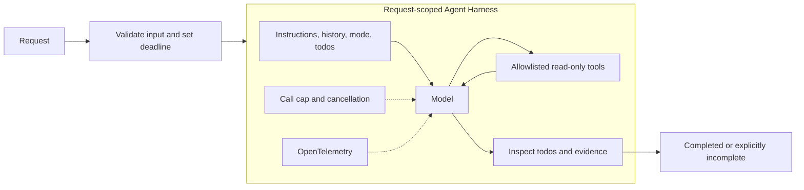

# Enterprise Extension 01 - Agent Harness

> An original enterprise extension to the repository's 21 book patterns, not a new Antonio Gulli chapter or a notebook port. Implemented with Microsoft Agent Framework (MAF), C#, and a Microsoft Foundry model deployment.

## The Pattern in One Paragraph

An **Agent Harness** is the runtime around a model that assembles context, invokes permitted tools, maintains task and conversation state, bounds execution, and exposes progress and outcomes. It is a **meta-pattern**, not a new reasoning technique: routing, planning, reflection, RAG, and multi-agent collaboration can all run inside a harness. The model proposes and judges; application code owns authority, lifecycle, budgets, and completion contracts. A good prompt helps, but cannot replace these runtime controls.



## What This Demo Shows

| Variant | Source | MAF / Foundry building blocks | What to observe |
|---|---|---|---|
| MAF + model deployment | [Repository enterprise research](../../../ai-research/enterprise-agentic-design-patterns-2026-extension-report-2.md#1-agent-harness); no source notebook | Real `HarnessAgent`, `HarnessAgentOptions`, `TodoProvider`, `AgentModeProvider`, `TodoCompletionLoopEvaluator`, function tools, compaction, tracing | A synthetic incident investigation with visible evidence, todo state, and deterministic completion checks |
| Foundry-native | No second implementation in this project | Foundry's managed GitHub Copilot harness is a distinct runtime choice, not the C# MAF harness | See [Foundry choices](#extending-with-microsoft-foundry); hosting our code does not turn it into a native reimplementation |
| Hosted companion | Same reusable `HarnessRunner` | Foundry `AgentHost` and Responses protocol | [Hosted guide](../Extension01.AgentHarness.Hosted/README.md); processes caller input instead of replaying a sample batch |

## Setup

Prerequisites: .NET 10 SDK, a Foundry project with a tool-capable chat-model deployment, and an API key for the console. Configure shared user-secrets or `Foundry__*` environment variables using the [.NET setup guide](../../README.md#configure-foundry-user-secrets). No separate search service, external API, or notebook is required.

Run from the repository root:

```powershell
dotnet run --project .\dotnet\src\Extension01.AgentHarness
dotnet run --project .\dotnet\src\Extension01.AgentHarness -- --request 'Investigate identity authentication latency.' --deployment quality
dotnet build .\dotnet\AgenticDesignPatterns.slnx
dotnet test .\dotnet\tests\AgentHarness.Tests
```

The default request investigates checkout latency. The console prints its execution envelope, every domain-tool result, final todos, termination reason, and JSON result. Exit codes are `0` for completed, `2` for incomplete, and nonzero for errors.

The **Live Foundry smoke tests** workflow uses the protected `foundry-integration` GitHub Environment. Its `FOUNDRY_PROJECT_ENDPOINT`, `FOUNDRY_API_KEY`, and `FOUNDRY_MODEL_DEPLOYMENT` secrets become `Foundry__ProjectEndpoint`, `Foundry__ApiKey`, and `Foundry__ModelDeployment`. Optional deployment aliases use `Foundry__ModelDeployments__<name>`. After merging to the default branch, run the workflow from **Actions**, optionally filtering on `AgentHarnessSmokeTests`. Protected secrets are intentionally not used with unmerged branch code.

## Research / Notebook to C# Mapping

There is no matching book chapter or Python notebook. This example maps the enterprise report's architectural responsibilities onto verified MAF APIs rather than pretending to port notebook behavior.

| Harness responsibility | C# implementation | Ownership |
|---|---|---|
| Model access | Shared `IChatClient` from `FoundryChatClientFactory` | Console API-key configuration stays unchanged |
| Runtime composition | `AsHarnessAgent(new HarnessAgentOptions { ... })` | MAF composes the underlying chat agent and decorators |
| Planning state | `TodoProvider`, backed by the fresh `AgentSession.StateBag` | The model manages todos; code checks them |
| Operating mode | Execute-only `AgentModeProviderOptions`; mode-changing tools hidden | Execute means read-only investigation, not permission to mutate systems |
| Tool registry | `AIFunctionFactory.Create` for `GetServiceStatus` and `ReadRunbook` | Code restricts service names to `checkout` and `identity` |
| Context lifecycle | Per-service-call history; 16,384-token context envelope and 4,096-token output setting | MAF compaction is an estimate-based context control, not an exact spend limit |
| Termination | Two outer todo-loop passes, 12 model calls across the entire request, three-minute cancellation deadline | `ModelCallBudgetClient` sits below the harness's function loop |
| Completion | Non-empty final assistant message, non-empty completed todo list, health and runbook receipts for each named supported service | Code emits `incomplete` when progress or target evidence is missing |
| Telemetry | `UseOpenTelemetry` around the real harness | Hosted service registers the matching source |
| Files, skills, search | Default file memory, filesystem skill discovery, and hosted web search explicitly disabled | Avoid unrequested storage/network capabilities |

The `Microsoft.Agents.AI.Harness` package follows the solution's pinned MAF version. Looping and compaction options are experimental APIs in that version; the code scopes the diagnostic suppression to their use.

## Implementation Scope

The sample is an **incident-advice harness**, not an operations automation service. Both tools read fixed synthetic data: checkout shows elevated latency and database-pool saturation; identity is healthy. A successful checkout investigation should reference `CHECKOUT-01` and recommend database on-call review, without claiming that escalation or remediation occurred.

Todo completion is a progress signal, not proof of factual correctness. The independent evidence receipts establish that tools ran; they do not prove that the prose interpreted the evidence correctly. An evaluator-contract loop can add semantic review when needed.

The runner creates a fresh harness, todo provider, tool receipts, call budget, and session for every request. It uses non-streaming model calls. The todo evaluator can request another bounded pass, but cannot increase the global model-call budget. The deadline is cooperative cancellation; provider HTTP retries can occur inside a counted call, so the cap is not an exact token, wire-request, or currency budget.

Default disk memory and directory-based skill discovery are disabled deliberately. Adding durable memory requires a tenant-scoped store, retention policy, concurrency control, and authorized resume contract. Adding shell or file tools requires an execution sandbox, not just instructions.

## Request Behavior

Provide one plain-text question, up to 4,000 characters, naming `checkout` or `identity` as a whole word (case-insensitive). Completion requires health and runbook receipts for every supported service named in the request, not merely any matching service pair. Requests naming no supported service remain incomplete. Caller text supplies the task, not tool permissions or budget settings.

`HarnessResult` contains `status`, `answer`, `modelCalls`, `todos`, `evidence`, and `incompleteReason`. The answer is the last assistant message, not concatenated loop progress or evaluator feedback. Each evidence entry contains `service`, `kind`, and `content`. Empty final output, cancellation, budget exhaustion, and provider failures propagate as errors; they are not converted into a successful answer.

There are no write tools, approval prompts, or persistent conversations. The harness does not silently approve operational changes; it cannot execute them. Integrate [Human-in-the-Loop](../Chapter13.HumanInTheLoop/README.md) before exposing consequential actions.

## When to Use

- Multistep tasks need explicit work state, tool coordination, progress visibility, and bounded execution.
- Several agents or model deployments must obey the same operational contract.
- You need to distinguish a convincing final response from a task that actually satisfied runtime checks.
- Long-running work needs carefully designed context, checkpoints, approvals, and recovery boundaries.

## When NOT to Use

- One deterministic function or a single structured model call is sufficient.
- A fixed business workflow already determines every step; do not replace it with open-ended autonomy.
- Exact transactions, authorization, scheduling, or accounting are required; keep those in deterministic services.
- You cannot provide the necessary persistence or approval protocol for an unattended long-running task.

## Real-World Scenarios

1. **Support triage** - Inspect service health and approved runbooks, track investigation steps, and recommend escalation. This sample keeps the action boundary read-only.
2. **Coding assistant** - Load an approved workspace and skills, implement one acceptance criterion at a time, run checks, and checkpoint verified progress in a sandbox.
3. **Research assistant** - Plan questions, retrieve sources, retain citations through compaction, and stop when the evidence contract or budget is reached.
4. **Document operations** - Extract facts, validate required fields, draft a response, and require approval before posting it to a system of record.
5. **Data analysis** - Run bounded analysis in an isolated execution environment, keep artifacts and provenance, and distinguish observations from unverified model claims.

## Combining Agent Harness with Other Patterns

Add a pattern to address a concrete failure mode; a harness does not require every pattern.

| Combine with | When it makes sense | Boundary to preserve |
|---|---|---|
| [Prompt Chaining](../Chapter01.PromptChaining/README.md) | A repeatable extract-transform-write pipeline needs shared context and tracing | Typed step contracts still determine admissible transitions |
| [Routing](../Chapter02.Routing/README.md) / [Resource Optimization](../Chapter16.ResourceOptimization/README.md) | Select specialists or cheaper models by task complexity | Share one task budget; model switching must not reset it |
| [Parallelization](../Chapter03.Parallelization/README.md) / [Multi-Agent](../Chapter07.MultiAgent/README.md) | Independent research or review can proceed concurrently | Give child agents scoped tools, isolated state, and an aggregate budget |
| [Planning](../Chapter06.Planning/README.md) / [Goal Monitoring](../Chapter11.GoalSettingMonitoring/README.md) | Work needs progress tracking across multiple steps | Todos are not acceptance tests; independently check the goal |
| [Reflection](../Chapter04.Reflection/README.md) / evaluator-contract loops | Drafts need independent quality review before acceptance | Bound revisions and keep deterministic contract checks outside the model |
| [Tool Use](../Chapter05.ToolUse/README.md) / [MCP](../Chapter10.MCP/README.md) | External capabilities are needed | Enforce identity, argument validation, allowlists, and deadlines at tool boundaries |
| [Memory](../Chapter08.Memory/README.md) / context lifecycle | Tasks span turns or context windows | Separate trusted instructions from retrieved data; scope, expire, and validate memory writes |
| [Recovery](../Chapter12.ExceptionHandling/README.md) / durable reactive agents | Tasks must resume after crashes or outages | Persist checkpoints and use idempotency; an in-memory session is not durable execution |
| [Human-in-the-Loop](../Chapter13.HumanInTheLoop/README.md) / Safe-Action Gateway | Sending mail, modifying records, or deploying infrastructure has consequences | Bind approval to the exact authorized action; never infer authority from a mode or prompt |
| [RAG](../Chapter14.RAG/README.md) | Recommendations require enterprise evidence | Apply tenant filters and provenance before context enters the model |
| [Guardrails](../Chapter18.Guardrails/README.md) / capability-scoped identity | The agent crosses trust boundaries | Policy instructions do not replace runtime permissions or sandbox isolation |
| [Evaluation](../Chapter19.Evaluation/README.md) / EvalOps | Prompts, models, or skills change over time | Evaluate complete trajectories and controlled rollouts, not only final wording |
| Bounded Agentic Island | An enterprise workflow needs judgment at specific points | Deterministic orchestration surrounds the harness; the harness does not become the whole application |

## Extending with Microsoft Foundry

**Three concepts must remain distinct:**

| Choice | What it provides | Appropriate use |
|---|---|---|
| MAF Harness + Foundry model deployment | Your C# process owns the harness and calls the model | Local development and custom runtime control |
| Foundry hosted agent | Managed hosting, protocol endpoint, runtime identity, and platform lifecycle around that same C# implementation | Deploy this example without replacing its behavior |
| Foundry-managed GitHub Copilot harness | A separate managed harness runtime configured as a prompt agent | Choose it explicitly when its supported managed capabilities match the application; it does not run this C# harness |

There is no second Foundry-native demo here: the goal is to retain custom MAF controls. A plain prompt agent is not an equivalent implementation of the call-budget and evidence contract. A managed harness is a valid alternative architecture, not a drop-in hosting adapter.

Use Foundry tracing and evaluations to investigate tool trajectories and regressions. Add Azure AI Search for real incident knowledge, Content Safety for input/output policy, or an authenticated toolbox for approved integrations only when the use case requires them. Durable work additionally needs explicit checkpoint and recovery semantics.

## Hosted Deployment Companion

The read-only request/response behavior is suitable for hosting because it has no local interactive input or durable filesystem dependency. The [hosted project](../Extension01.AgentHarness.Hosted/README.md) references this runner and uses the Responses protocol, a fresh request-isolated session, and buffered final JSON.

The host always uses Entra ID: local developer credentials for local runs and managed identity in Azure. Bundled .NET deployment includes this project and Shared without uploading user-secrets. Before remote invocation, an authorized administrator must verify the current runtime `instance_identity.principal_id` has **Cognitive Services OpenAI User** at the actual model-hosting Foundry account scope, allow for propagation, and recheck after redeployment. See the hosted guide for configuration, local invocation, service-scoped deployment, permissions, telemetry, and costs.

## Risks and Tradeoffs

A richer runtime adds token use, latency, state transitions, and operational complexity. Model-generated plans can be wrong; compaction can discard useful evidence; retries can multiply cost; stored context and detailed traces can expose sensitive data. Boundaries reduce impact but do not establish semantic correctness. Choose the smallest harness that satisfies the workload, keep authority in code, and measure behavior with representative tasks.

## Sources

- [Repository enterprise report: Agent Harness](../../../ai-research/enterprise-agentic-design-patterns-2026-extension-report-2.md#1-agent-harness)
- [Focused research and out-of-the-box examples](../../../ai-research/agent-harness-pattern.md)
- [Microsoft Learn: Agent Harness](https://learn.microsoft.com/agent-framework/concepts/harness?pivots=programming-language-csharp)
- [Microsoft Learn: Planning and Todos](https://learn.microsoft.com/agent-framework/agents/planning-and-todos?pivots=programming-language-csharp)
- [MAF source at the solution's pinned release](https://github.com/microsoft/agent-framework/blob/dotnet-1.22.0/dotnet/src/Microsoft.Agents.AI.Harness/HarnessAgentOptions.cs)
- [Anthropic: Effective harnesses for long-running agents](https://www.anthropic.com/engineering/effective-harnesses-for-long-running-agents)
