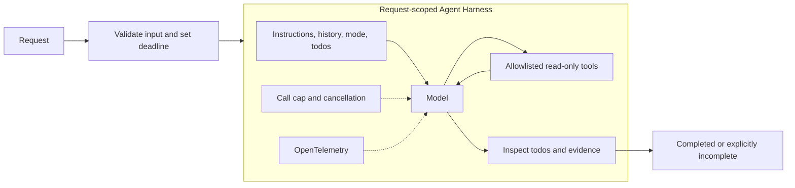

# Extension 01 - Agent Harness

An agent harness is the runtime around a model: it assembles context, exposes permitted
tools, maintains work state and bounds execution. This is an original enterprise extension,
not a book chapter or notebook port. The model proposes; code owns authority and completion.



## Where to look in code

| File / method | Responsibility |
|---|---|
| [HarnessRunner.CreateAgent](HarnessRunner.cs) | Actual MAF `AsHarnessAgent` options, todo provider and loop evaluator |
| [HarnessRunner.RunAsync](HarnessRunner.cs) | Fresh session, deadline, run and independent completion contract |
| [ModelCallBudgetClient](ModelCallBudgetClient.cs) | Hard per-request model-call cap below tool loops |
| [SupportTools](SupportTools.cs) | Read-only synthetic health/runbook tools and evidence receipts |
| [Hosted adapter](../Extension01.AgentHarness.Hosted/HarnessHostedAgent.cs) | Same runner, using the shared stateless adapter |

## Setup and run

Use .NET 10, a tool-capable Foundry chat deployment and [shared credentials](../../README.md).

```powershell
dotnet run --project dotnet\src\Extension01.AgentHarness
dotnet run --project dotnet\src\Extension01.AgentHarness -- --request "Investigate identity latency." --deployment quality
dotnet test dotnet\tests\AgentHarness.Tests
```

Default input investigates checkout latency. Output shows the envelope, tools, todos,
termination and final JSON. Exit codes: `0` completed, `2` incomplete, nonzero on errors.
The protected live workflow includes `AgentHarnessSmokeTests` after merge; local
deterministic tests use a scripted model, not credentials.

## Research to C# mapping

| Responsibility | MAF / application implementation |
|---|---|
| Runtime composition | `HarnessAgentOptions` and `AsHarnessAgent` |
| Planning state | Fresh session-backed `TodoProvider` |
| Tools | `AIFunctionFactory`: `GetServiceStatus` and `ReadRunbook` |
| Context control | 16,384-token envelope, 4,096-token output setting and MAF compaction |
| Termination | Two todo-loop passes, 12 model calls total, three-minute cooperative deadline |
| Completion | Code checks final answer, completed todos and matching evidence |

See the [research note and out-of-the-box examples](../../../ai-research/agent-harness-pattern.md).
The pinned package's loop/compaction options are experimental; suppression is scoped.
Disk memory, filesystem skills, search and mode-changing tools are explicitly disabled
to avoid adding storage/network capabilities unrelated to this read-only investigation.

## Request and completion contract

Provide a self-contained question of at most 4,000 characters naming `checkout` or
`identity` as whole words, case-insensitively. Each named supported service needs both
health and runbook receipts. No supported target, unfinished/missing todos or missing
evidence produces `incomplete`, not success. The last assistant answer is returned,
not concatenated progress. Empty output, provider errors, cancellation and call-budget
exhaustion propagate. Tools read synthetic data; no production action is performed.

The JSON result contains `status`, `answer`, `modelCalls`, `todos`, `evidence` and
`incompleteReason`. Todos show progress, not factual correctness; receipts show a tool
ran, not that prose interpreted it correctly. Provider retries may occur inside a
counted model call, so the call cap is not an exact token or billing budget.

## When to use / when not to use

Use for multistep work needing explicit state, bounded tools and observable completion.
Avoid a harness when one function/model call or a fixed deterministic workflow suffices.
Support investigation, sandboxed coding and source-grounded research are useful scenarios.
Plans can be wrong, compaction can lose evidence, and detailed traces can expose private
content. Durable work needs a separate tenant-scoped persistence and resume contract.

Combine [Planning](../Chapter06.Planning/README.md) with todos, [RAG](../Chapter14.RAG/README.md)
with evidence, [Evaluation](../Chapter19.Evaluation/README.md) with semantic acceptance,
and [Human-in-the-Loop](../Chapter13.HumanInTheLoop/README.md) before consequential tools.
Child agents must share an aggregate budget rather than silently resetting it.

## Foundry and hosting

The [hosted companion](../Extension01.AgentHarness.Hosted/README.md) preserves this
MAF runtime, fresh request state, read-only tools and buffered final result. See
[shared hosting](../../HOSTING.md) for deployment/RBAC/packaging. A Foundry-managed
GitHub Copilot harness is a separate runtime choice, not a drop-in adapter for this C#
completion contract. Sensitive telemetry is off locally by default; disable the manifest's
synthetic-demo capture before handling private input and restrict retention/access.
