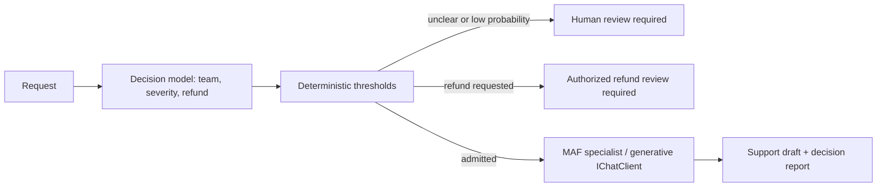

# Extension 02 - Decision Models

Decision models answer bounded questions with labels, distributions or scores instead
of prose. Application code decides what those judgments permit. This original extension
connects Routing, Prioritization, Guardrails and Evaluation; it is not another book chapter.



## Where to look in code

| File / method | Responsibility |
|---|---|
| [DecisionWorkflow.EvaluateAsync](DecisionWorkflow.cs) | Three typed decisions: team, severity and refund |
| [DecisionWorkflow.ApplyPolicy](DecisionWorkflow.cs) | Validate distributions and apply thresholds |
| [DecisionAgentWorkflow.RunAsync](DecisionAgentWorkflow.cs) | MAF conditional edges: review or selected specialist |
| [DecisionConfiguration.CreateClient](DecisionConfiguration.cs) | Configure the two distinct native decision APIs |
| [Hosted adapter](../Extension02.DecisionModels.Hosted/DecisionSupportAgent.cs) | Text-only request mapping, using the shared stateless adapter |

## Variants and pattern mapping

| Variant | Building blocks | What to observe |
|---|---|---|
| `microsoft` | `FoundryDecisionClient`, Microsoft-Decision-1 `SystemOne` | Choice, ordered score and Noul probability |
| `openai` | Same library, `OpenAIDecisions` | Distinct OpenAI Decisions endpoint/contract, not chat |
| `maf` | Typed decisions plus `WorkflowBuilder` and `ChatClientAgent` | Only admitted requests incur a generative call |
| `all` (default) | Both native providers, then MAF with Microsoft decisions | Three shared support examples, not a benchmark |

Chapter 02's coordinator/specialist notebooks map to typed conditional routing here.
Chapter 18's action boundary becomes a refund-review gate; Chapter 20's prioritization
becomes a severity proposal. Original chapter scenarios remain in their own demos.

## Setup and run

Configure [.NET 10 and shared user-secrets](../../README.md). Keep the generative
default separate from the decision deployments; missing aliases fail explicitly.

```powershell
dotnet user-secrets set "Foundry:ModelDeployments:decision" "<microsoft-decision-deployment>" --project dotnet\src\Shared
dotnet user-secrets set "Foundry:ModelDeployments:openaiDecision" "<gpt-6-luna-deployment>" --project dotnet\src\Shared
dotnet run --project dotnet\src\Extension02.DecisionModels -- microsoft
dotnet run --project dotnet\src\Extension02.DecisionModels -- openai
dotnet run --project dotnet\src\Extension02.DecisionModels -- maf --provider openai --input "My account is locked."
```

Omit arguments for `all`; `--input` replaces the batch. `--provider` selects only the
MAF backend. Each native variant needs its own alias; MAF also needs the generative
default. Ctrl+C cancels work. Environment equivalents are `Foundry__ModelDeployments__decision`
and `Foundry__ModelDeployments__openaiDecision`. Protected live CI does not invoke this
extension; run its selected provider explicitly with authorized credentials.

## Model judgment versus application policy

| Condition | Deterministic outcome |
|---|---|
| Team `unclear` or selected probability below `0.8` | `human-review`; no chat call |
| Otherwise refund probability at least `0.5` | `refund-review`; no chat call |
| Otherwise | `draft-response`; selected specialist only |
| Expected severity at least `1.5` | `urgent`; otherwise `normal` |

Equality meets thresholds. Review takes precedence over refunds. No refund, account
action, queue write or actual human notification occurs. Thresholds are teaching policy,
not calibrated production defaults. The selected probability is **not** provider confidence.
Scores are fractional expectations over zero-based levels: `[0, 0.5, 0.5, 0]` gives `1.5`.
Missing usage stays null; zero output tokens does not imply free inference. Refusals,
malformed distributions and transport errors fail rather than becoming approvals.

## When to use / when not to use

Use for fixed-category intake, queue prioritization or rubric grading before generative
work. Do not use for prose generation, deterministic authorization or sole approval of
financial/medical/legal actions. Real scenarios include support triage, specialist
selection and passage relevance scoring. Wording sensitivity, miscalibration, forced
choices and distribution shifts remain risks even when the schema is perfect; measure
abstention, error costs, latency and provider-specific usage with labeled data.

## Foundry and hosting

[The hosted companion](../Extension02.DecisionModels.Hosted/README.md) runs the same
workflow with independent requests and buffered final JSON. See [shared hosting](../../HOSTING.md)
for permissions, packaging and costs. Its deployed service name remains `decision-models`.
The pinned `ElBruno.AI.Decisions.Foundry` library supplies `IDecisionClient`; its
`DecisionRoutingChatClient.MinimumConfidence` uses provider confidence, so it is not
interchangeable with this probability-based policy. Specialists enable sensitive tracing:
use synthetic input or disable that capture before handling private requests.

Sources: [Microsoft decision deployment/API](https://learn.microsoft.com/azure/foundry/foundry-models/how-to/use-foundry-models-microsoft-decision),
[OpenAI Decisions prerequisites and contract](https://learn.microsoft.com/azure/foundry/openai/how-to/decisions),
[published library](https://github.com/elbruno/ElBruno.AI.Decisions/tree/v0.7.0).
